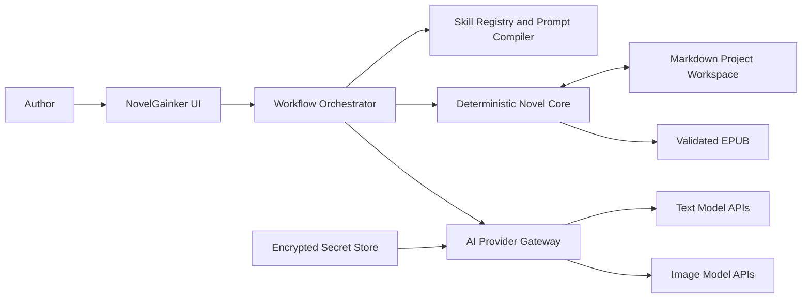
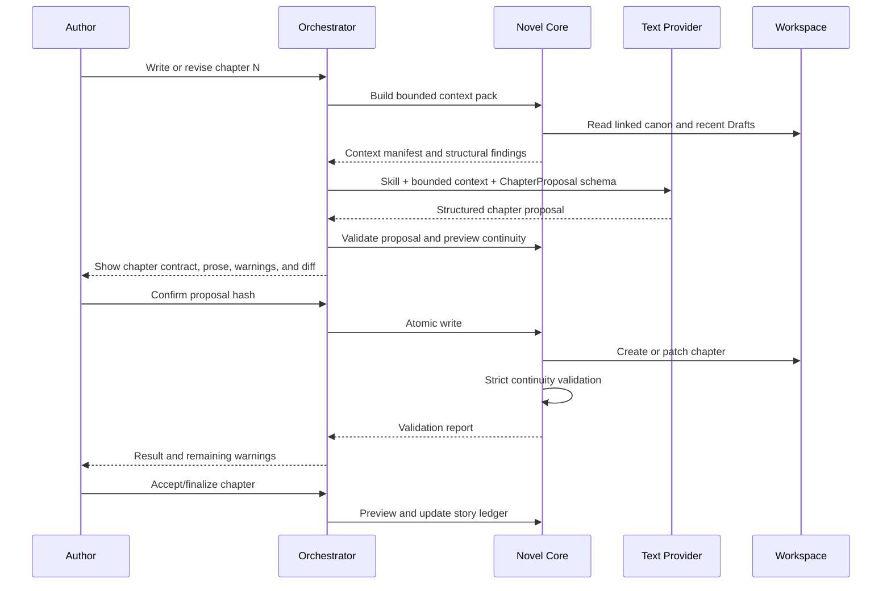

# NovelGainker Architecture

> **Superseded English draft.** This file no longer reflects the confirmed Q-001–Q-017 product decisions and must not be used for implementation.  
> The authoritative architecture is [architecture.zh-CN.md](./architecture.zh-CN.md).  
> Superseded: 2026-08-19

## 1. Executive summary

NovelGainker is a local-first novel-writing application that turns the Novelist
plugin's repeatable workflows into a standalone product. The application must
not depend on Codex, ChatGPT, Claude Code, or any single model vendor to provide
its core runtime.

The central architectural decision is to separate four concerns that are
combined inside the original agent host:

1. **Novel source and canon** — Markdown files, assets, and the story ledger.
2. **Workflow definitions** — versioned Novelist skills, references, templates,
   policies, and output contracts.
3. **Deterministic execution** — context building, file creation, validation,
   continuity checks, ledger updates, image registration, and EPUB packaging.
4. **Probabilistic generation** — text, review, classification, and image calls
   made through replaceable AI provider adapters.

The recommended desktop architecture is **Tauri 2 + React/TypeScript**, with a
Rust backend acting as the filesystem, secrets, network, permissions, and task
boundary. During the desktop phase, the existing Novelist Python scripts are
packaged as a restricted sidecar. The sidecar is never exposed as a general
shell. Before a standalone Android release, deterministic functionality is
migrated into a shared Rust core or a small native mobile layer.

Markdown remains the only canonical story source. SQLite and application state
may index, cache, and journal the project, but must be rebuildable from the
project files.

## 2. Architecture decisions

| ID | Decision | Status | Rationale |
| --- | --- | --- | --- |
| ADR-001 | Desktop-first, Windows-first MVP | Proposed default | Matches the current development environment and reduces initial packaging scope. |
| ADR-002 | Local-first; no required NovelGainker cloud | Accepted from product direction | Keeps manuscript ownership and offline editing independent of a service. |
| ADR-003 | Tauri 2 shell with React/TypeScript UI and Rust backend | Proposed | Provides a small desktop shell, scoped native capabilities, and a credible later Android path. |
| ADR-004 | Markdown and project assets are canonical | Accepted | Preserves Novelist compatibility and keeps projects portable. |
| ADR-005 | App-owned workflow orchestrator; vendor SDKs are adapters only | Accepted | Provider switching cannot depend on one vendor's skill or agent runtime. |
| ADR-006 | Bundle a pinned Novelist skill pack and add an App runtime overlay | Proposed | Preserves upstream skill text while adding executable schemas, permissions, and state transitions. |
| ADR-007 | Reuse Python scripts as a desktop sidecar, then port the deterministic core before standalone Android | Proposed | Delivers parity sooner without making Python a permanent mobile dependency. |
| ADR-008 | Human confirmation before canonical mutations | Proposed default | Matches the interactive skill contracts and protects the manuscript. |
| ADR-009 | One manager owns writes; specialist agents are read-only or proposal-only | Accepted | Avoids concurrent canon corruption. |
| ADR-010 | Text and image providers use separate profiles | Accepted | Image capabilities and pricing do not reliably match text-model providers. |

## 3. Goals and non-goals

### 3.1 Goals

- Create, open, edit, validate, and publish Novelist-compatible projects.
- Support all nine Novelist 0.2.0 skills through explicit App workflows.
- Allow users to configure and switch AI APIs without changing project files.
- Support OpenAI, Anthropic, Gemini, OpenAI-compatible endpoints, and local
  OpenAI-compatible servers through adapters rather than business-code forks.
- Keep API keys out of project files, logs, exports, and prompts.
- Show proposals and diffs before writing canon.
- Preserve strict chapter structure, continuity checks, story-ledger updates,
  and deterministic EPUB validation.
- Operate offline when a local model is configured or when the user is editing
  without AI.
- Make desktop projects portable to future Android or companion clients.

### 3.2 Non-goals for the first desktop release

- Real-time multi-user collaboration.
- A NovelGainker-hosted model proxy or subscription billing system.
- Automatic bookstore upload, email distribution, or public publication.
- Unrestricted shell access for models.
- Provider-native conversation state as the source of truth.
- Fully autonomous multi-agent writing with simultaneous file changes.
- Standalone Android execution of the Python toolchain.

## 4. Quality attributes

The following attributes drive design choices, in priority order:

1. **Manuscript safety** — no silent overwrite, path escape, or unreviewed
   canonical mutation.
2. **Provider portability** — core workflows work when tool calling,
   structured output, or provider-side conversation state is unavailable.
3. **Local ownership and privacy** — projects remain usable without a
   NovelGainker account or server.
4. **Determinism around generation** — schemas, validators, and local tools
   surround model output.
5. **Recoverability** — interrupted runs never leave half-written canon.
6. **Traceability** — users can see the active skill, provider, model, context
   sources, proposed writes, validation results, token usage, and cost estimate.
7. **Extensibility** — new skills and providers can be added without changing
   the editor or project model.

## 5. System context



NovelGainker owns the orchestration. AI providers receive bounded inputs and
return proposals; they do not own the project, filesystem, workflow state, or
approval policy.

## 6. Runtime boundaries

### 6.1 Frontend

The React/TypeScript frontend owns presentation and user interaction:

- project picker and recent projects;
- source tree and Markdown editor;
- skill launcher and chat panel;
- model/provider selector;
- context-source inspector;
- proposal, diff, validation, and confirmation views;
- task progress, cancellation, usage, and error display;
- EPUB and image preview entry points.

The frontend does not receive raw API keys and cannot invoke arbitrary shell
commands. It calls typed Tauri commands exposed by the Rust backend.

### 6.2 Rust application core

The Rust backend is the trusted application boundary. It owns:

- project-root selection and scoped filesystem access;
- path normalization and symlink-escape prevention;
- secret storage and provider configuration;
- outbound provider requests;
- normalized streaming events;
- workflow state and task cancellation;
- atomic write transactions and recovery journals;
- sidecar command allowlists and argument validation;
- App database access;
- update and migration coordination.

Provider HTTP requests should originate from Rust, not the WebView. This keeps
keys and custom headers out of browser storage, browser logs, and frontend
network inspection.

### 6.3 Novelist tool sidecar

For the desktop MVP, existing Python scripts are packaged into a versioned
executable and exposed through a narrow `NovelistToolBridge`. Tauri officially
supports bundling Python or other executables as sidecars, with per-command
permissions and argument validation.

Allowed operations are named application functions, not raw commands:

- `project.create`
- `project.scan`
- `source.create_character`
- `source.create_setting`
- `source.create_material`
- `source.create_plot`
- `story.build_context`
- `story.check_continuity`
- `story.write_chapter`
- `story.update_ledger`
- `review.inventory`
- `publish.build_epub`
- `publish.validate_epub`

The AI model never supplies an executable path or arbitrary CLI arguments.
`--force`-style overwrite behavior is not exposed to the model and requires a
separate user-confirmed App action.

### 6.4 Future shared core

The sidecar is a migration strategy, not the target mobile architecture.
Deterministic parsing, validation, context selection, ledger updates, and EPUB
packaging should gradually move into a reusable Rust crate:

```text
crates/
  novel-domain/       Markdown/frontmatter/domain types
  novel-workflows/    deterministic workflow transitions
  novel-validation/   structure and continuity validation
  novel-publish/      EPUB staging, packaging, and validation
  provider-core/      normalized provider contracts
```

The same crates can then run inside desktop Tauri and Android Tauri. Android-
specific document picking, background work, secure storage, and sharing may be
implemented through Kotlin plugins.

## 7. Repository and module layout

Recommended target layout:

```text
NovelGainker/
  apps/
    desktop/                    Tauri + React desktop application
    mobile/                     optional Android application shell
  crates/
    app-core/
    novel-domain/
    novel-workflows/
    provider-core/
  packages/
    ui/                         reusable React components
    workflow-schemas/           generated TypeScript schemas
  resources/
    novelist/
      upstream/0.2.0/           pinned, licensed Novelist payload
      runtime/                  NovelGainker execution overlays
  sidecars/
    novelist-tools/             packaging entry point for Python tools
  tests/
    fixtures/
    provider-contract/
    workflow-e2e/
  docs/
    architecture.md
    decisions/                  future ADRs
```

Do not load Novelist from a user's Codex plugin cache at runtime. The App must
bundle a tested, pinned copy so behavior does not change when an unrelated host
updates its plugins. Preserve the upstream license and notices, and verify all
third-party asset and provider terms before distribution.

## 8. Project data model

### 8.1 Canonical project files

The Novelist scaffold remains authoritative:

- `project.md`
- `AGENTS.md`
- `characters/`
- `materials/`
- `macguffins/`
- `plot/`
- `outlines/`
- `world/`
- `style/`
- `assets/`
- `chapters/`
- `published/`

`chapters/` is manuscript canon. Only `## Draft` is publishable prose.
`materials/000.story-ledger.md` is persistent summarized story state.
`published/` is generated output and is never edited as source.

### 8.2 Portable App metadata

A project may contain `.novelgainker/project.json` with non-secret metadata:

```json
{
  "schemaVersion": 1,
  "projectId": "uuid",
  "novelistPackVersion": "0.2.0",
  "defaultTextProfileId": "openai-main",
  "defaultImageProfileId": null,
  "strictChapterMarkup": true
}
```

This file must not contain API keys, access tokens, provider response IDs, or
absolute machine-specific paths. Projects without this file remain importable;
the App can derive defaults and create it after confirmation.

### 8.3 Operational state

An SQLite database under the OS application-data directory stores rebuildable
or machine-local state:

- recent projects and UI preferences;
- normalized conversation and run metadata;
- task checkpoints and recovery journals;
- content hashes and search index;
- provider profiles with secret references, never secret values;
- token usage and optional cost estimates;
- validation history.

The database must not become a hidden source of canon. Deleting it may lose UI
history but must not make a project unreadable or unpublishable.

## 9. Skill runtime

### 9.1 What a skill means in NovelGainker

The existing `SKILL.md` files describe goals, triggers, procedures, safety
rules, references, and completion conditions. In Codex or ChatGPT the host
shows the model skill metadata and loads full instructions when a request
matches. A standalone App must reproduce this explicitly.

Each bundled skill has two layers:

1. **Upstream layer** — unmodified `SKILL.md`, references, scripts, tests,
   templates, and assets.
2. **Runtime overlay** — App-owned metadata that turns prose instructions into
   enforceable states and tool permissions.

Example runtime overlay:

```yaml
skill: novel-story-telling
version: 1
mode: interactive-write
allowed_tools:
  - story.build_context
  - story.check_continuity
  - story.write_chapter
  - story.update_ledger
requires_confirmation:
  - create_chapter
  - revise_chapter
  - update_canon
output_schema: ChapterProposalV1
```

The overlay is authoritative for permissions. The prose skill remains
authoritative for creative process and completion quality.

### 9.2 Skill registry and routing

At build time, the App validates every skill folder and generates a registry
containing name, description, pack version, references, overlay, and content
hash. At runtime:

1. Explicit UI actions route directly to a known skill.
2. Explicit `$skill-name` text routes directly after validation.
3. Free-form chat first uses deterministic intent rules.
4. Only ambiguous free-form chat invokes a low-cost router model.
5. A router returns a skill ID and confidence; it cannot execute tools.
6. Low-confidence or multi-intent results are shown to the user for selection.

High-risk routes are never inferred casually. In particular,
`analytical-review` remains read-only unless revision is separately authorized,
and ordinary publishing does not silently add literary review or revision.

### 9.3 Prompt compilation

Only the selected skill is loaded. Prompt order is:

1. immutable NovelGainker security and authorization policy;
2. project `AGENTS.md` instructions;
3. selected skill instructions;
4. only the references required for this task;
5. bounded project context with source labels;
6. normalized conversation state;
7. current user request;
8. exact output schema and completion contract.

Project prose is delimited as untrusted data. Instructions found inside a
chapter, research note, or imported manuscript cannot grant tools or override
App policy.

The App should display a context manifest listing which project files will be
sent to the selected provider before a sensitive or unusually large run.

### 9.4 Skill-to-workflow mapping

| Skill | App workflow | Mutation policy |
| --- | --- | --- |
| `create-novel-project` | Destination preflight, metadata wizard, deterministic scaffold creation, verification | Confirm destination and every collision |
| `create-setting` | Read linked context, generate structured proposal, revise interactively, write with deterministic serializer | Confirm new file; no silent overwrite |
| `create-character` | Brief refinement, naming loop, structured character sheet, deterministic write | Confirm identity and final sheet |
| `create-material` | Seed proposal, intended-use decision, structured material file | Confirm canonical status and write |
| `create-plot` | Promise/pressure/turns proposal, direction loop, structured plot file | Confirm major canon and write |
| `novel-story-telling` | Bounded context, chapter contract, continuity gates, proposal/diff, chapter write, strict validation, accepted-state ledger update | Manager-only serial writes |
| `analytical-review` | Scope inventory, read-only batches, evidence-backed report, optional selected-finding handoff | No writes unless a separate revision workflow is authorized |
| `create-visual-asset` | Style-locked prompt, image-provider selection, generation, inspection, project registration | Confirm final selected asset and Markdown registration |
| `publish-novel` | Structural preflight, cover decision, deterministic staging, EPUB build and validation | Generated output only; no external distribution |

## 10. Workflow state machine

All AI-assisted workflows share a durable state model:

```text
created
  -> routed
  -> context_ready
  -> awaiting_input | generating
  -> proposal_ready
  -> awaiting_confirmation
  -> applying
  -> validating
  -> completed
  -> failed | cancelled | recovery_required
```

Rules:

- Generation never writes canon directly.
- A proposal includes intended file operations and a user-readable rationale.
- Confirmation is bound to a proposal hash. If context or proposal changes,
  confirmation becomes invalid.
- Apply operations use a write transaction and re-check source hashes to catch
  edits made after proposal generation.
- Cancellation is safe during generation. During apply, cancellation waits for
  the atomic transaction to finish or roll back.
- Validation failure leaves the previous source intact where possible and
  records a recovery event.

### 10.1 Chapter-writing sequence



Ledger updates happen after author acceptance or finalization, not merely after
a draft token stream completes.

## 11. Agent runtime

### 11.1 Meaning of the existing agent files

The Novelist `skills/*/agents/openai.yaml` files contain interface metadata
such as display name, short description, and default prompt. They do not define
independent executable agents. The effective behavior is in `SKILL.md`, project
`AGENTS.md`, references, and deterministic scripts.

NovelGainker therefore must not attempt to "run the YAML agent." It uses that
metadata for labels and starter actions, while its own orchestrator creates the
runtime role.

### 11.2 Manager and specialists

The default architecture uses one **Manager** that owns the user-visible run,
authorization state, and all canonical writes. Specialist roles are bounded
capabilities:

| Role | Responsibility | Write access |
| --- | --- | --- |
| Router | Classify ambiguous free-form requests | None |
| Story Writer | Plan, draft, or propose revisions under the storytelling skill | Proposal only |
| Continuity Auditor | Semantic checks over selected canon and Draft evidence | None |
| Analytical Reviewer | Outline, chapter, manuscript, or regression review | None |
| Context Summarizer | Produce bounded summaries with source references | None |
| Image Specialist | Produce prompts or call the selected image provider | Asset proposal only |
| Publisher | Execute deterministic EPUB tools | Generated output only |

Specialists may be implemented as separate provider calls, not necessarily as
vendor-native agents. The Manager assembles and validates their results.

### 11.3 Multi-agent policy

Multi-agent execution is optional and disabled for the MVP. It may later be
used for independent, read-only work such as:

- reviewing separate manuscript batches;
- continuity, style, and reader-model audits in parallel;
- comparing several bounded plot alternatives.

It must not allow multiple agents to edit the same file or shared canon. Each
specialist returns findings or patches. The Manager resolves conflicts and
applies one serial transaction.

Provider-native multi-agent features are accelerators only. The App-managed
fallback remains authoritative because provider support differs and some
multi-agent APIs are model-specific or beta.

## 12. AI provider architecture

### 12.1 Provider profiles

A provider profile is user-configurable and references a stored secret:

```json
{
  "id": "openai-main",
  "kind": "openai",
  "displayName": "OpenAI Main",
  "baseUrl": "https://api.openai.com/v1",
  "credentialRef": "vault://provider/openai-main",
  "defaultModel": "user-selected-model",
  "timeoutSeconds": 120,
  "enabled": true
}
```

Supported adapter families for the first complete desktop release:

- OpenAI Responses-style API;
- Anthropic Messages-style API;
- Google Gemini API;
- OpenAI-compatible Chat Completions API;
- local OpenAI-compatible endpoints, with an optional empty credential.

Exact model names are never hard-coded as permanent defaults. The user may
enter a model ID, refresh a provider model list when supported, and run a
connection/capability test.

### 12.2 Normalized contract

Conceptual provider interface:

```text
ProviderAdapter
  validate_config(profile) -> ValidationResult
  discover_models(profile) -> ModelDescriptor[]
  capabilities(profile, model) -> CapabilitySet
  generate(request) -> NormalizedResponse
  stream(request) -> Stream<NormalizedEvent>
  cancel(run_id)
  estimate_usage(request) -> optional UsageEstimate
```

Normalized requests contain messages, system instructions, output schema,
tool descriptions when applicable, media inputs, temperature-like settings,
maximum output, and a provider-neutral reasoning preference. Adapters map or
discard unsupported fields explicitly; they never silently invent equivalent
semantics.

Normalized responses contain:

- text and/or parsed structured data;
- tool-call proposals;
- usage values supplied by the provider;
- finish reason;
- provider/model identity;
- redacted error details;
- opaque provider response ID for diagnostics only.

### 12.3 Capability matrix and degradation

| Capability | Preferred path | Required fallback |
| --- | --- | --- |
| Streaming | Native provider stream | Non-streamed response with progress state |
| Structured output | Native schema enforcement | JSON instruction, strict local parser, one repair attempt, then fail visibly |
| Tool calling | Native function/tool calls | App-controlled workflow invokes deterministic tools directly |
| Token count | Native count endpoint/tokenizer | Conservative local estimate with reserved output budget |
| Vision input | Native image input | Disable image-aware workflow and explain why |
| Image generation | Separate image adapter | Save the style-locked prompt without claiming an image exists |
| Persisted conversation | Provider feature may optimize | App replays normalized context; provider state is never required |

Provider switching is allowed between runs. A run with an open write
transaction must finish, fail, or roll back before switching. On switch, the
App rebuilds a fresh bounded context from canonical files and normalized
conversation state; it does not attempt to transplant hidden provider state or
reasoning.

### 12.4 Model roles

The App offers a global default profile and optional per-role overrides:

- router;
- writer;
- reviewer;
- summarizer;
- image generator.

The MVP may use one text model for every text role, but the configuration model
must not prevent later cost/quality routing. Provider fallback is opt-in; the
App must never send a manuscript to a second provider without prior user
authorization.

## 13. Tool and filesystem security

### 13.1 Capability model

Tools are registered with:

- an input schema;
- an output schema;
- read/write classification;
- permitted workflow states;
- project-root requirements;
- confirmation requirements;
- timeout and cancellation behavior;
- audit-redaction rules.

The orchestrator, not the model, decides whether a tool call is legal.

### 13.2 Path safety

Every filesystem operation must:

1. resolve the project root selected by the user;
2. canonicalize the target parent where possible;
3. reject absolute model-supplied paths;
4. reject `..` escapes and symlink/reparse-point escapes;
5. restrict operations to expected source or generated directories;
6. reject overwrite unless the workflow and confirmation permit it;
7. use temporary sibling files and atomic rename for canonical writes.

Recursive delete is not part of model-accessible functionality.

### 13.3 Diff and confirmation

New files show a full preview. Revisions show a semantic or line diff. A
confirmation record contains:

- proposal hash;
- source hashes;
- provider/model;
- skill and workflow step;
- files to create or modify;
- validation warnings accepted by the user;
- timestamp.

If a file changes after preview, the apply step stops and regenerates the diff.

## 14. Secrets and privacy

API keys are stored in an encrypted application vault such as Tauri Stronghold
or the platform credential store. The project stores only profile IDs. Secret
values are never returned to the frontend after entry.

Privacy requirements:

- no manuscript or prompt bodies in telemetry by default;
- logs redact authorization headers, API keys, signed URLs, and response bodies;
- each run visibly names the provider and model receiving content;
- context inspection shows which files or excerpts will leave the device;
- local-provider mode performs no external model request;
- provider fallback requires explicit authorization;
- crash reports are opt-in and exclude project text;
- imported skill packs are trusted only after signature/hash and schema checks.

The threat model must include malicious text inside imported manuscripts,
prompt injection in research notes, path traversal in model JSON, compromised
provider responses, and sidecar argument injection.

## 15. Reliability, recovery, and concurrency

- One process-level lock protects each open project from two NovelGainker
  writers. A second window may open read-only or request lock transfer.
- External editor changes are detected by file watchers and content hashes.
- Canonical writes use a transaction journal stored outside the manuscript or
  in a temporary App state area.
- A failed transaction restores the previous file and reports recovery status.
- Generated `published/` output can be replaced after preflight, but source is
  never repaired by hand through generated output.
- Long provider calls support cancellation and visible timeouts.
- Retry only transient network and rate-limit failures. Do not automatically
  retry a write, paid image generation, or ambiguous model response.
- Application startup scans incomplete journals and offers recovery before new
  AI work begins.

## 16. Search, retrieval, and context budgeting

The existing Novelist context builder prioritizes explicit links, master
sources, the target outline, recent Drafts, the story ledger, and query matches.
NovelGainker preserves this deterministic priority.

Retrieval rules:

- explicit source IDs outrank lexical similarity;
- project `AGENTS.md`, style guide, master plot, and master outline are loaded
  according to the active skill contract;
- reader-visible knowledge is established only from prior `## Draft` text;
- hidden canon and outline facts are labeled as author-side context;
- full old chapters are loaded only when bounded summaries cannot resolve the
  task;
- model-specific context limits reserve output space and safety margin;
- context packs contain source paths and content hashes for traceability.

An optional local full-text index may improve discovery, but its result is a
candidate list. The deterministic context builder remains responsible for the
final pack.

## 17. Images and publishing

Text and image generation are separate provider domains. `create-visual-asset`
builds a style-locked prompt from project sources and then:

1. calls the selected image adapter when available;
2. saves candidate output to an App temporary area;
3. lets the user inspect and select a final asset;
4. copies the selected file under `assets/cover/` or
   `assets/illustrations/`;
5. registers the relative path only after confirmation.

When no image provider is configured, the workflow stores or displays the
complete prompt and clearly reports that no asset was generated.

EPUB publication remains deterministic. The publisher:

- runs strict chapter and continuity preflight;
- obtains confirmation for draft/non-final chapters;
- resolves title, author, language, and cover;
- renders only `## Draft` in numeric chapter order;
- retains `published/epub/` staging;
- packages and validates the final EPUB;
- never uploads or distributes it without a separate explicit feature and
  authorization.

## 18. Desktop and Android strategy

### 18.1 Desktop MVP

Default scope is Windows 11 x64. The architecture remains portable to macOS
and Linux, but each sidecar target requires its own signed and tested binary.

Desktop release contents:

- Tauri application;
- WebView UI assets;
- Rust backend;
- pinned Novelist skill/resources pack;
- target-specific `novelist-tools` sidecar;
- default local database migrations;
- license and attribution files.

### 18.2 Android companion

The lowest-risk Android phase is a companion that opens projects through an
explicit sync or remote-session design. Two variants remain possible:

- **Remote companion:** desktop owns files and tools; phone controls and reviews
  runs over an authenticated local/remote channel.
- **Synced editor:** project files sync through a user-selected storage
  provider; the phone edits Markdown and sends AI requests locally, but desktop
  remains responsible for Python-only validation/publishing until core porting
  is complete.

Neither variant is part of the desktop MVP. A remote companion requires a
separate threat model, device pairing, transport decision, and conflict policy.

### 18.3 Standalone Android

Standalone Android requires:

- the deterministic Python toolchain ported to Rust/Kotlin;
- Android Storage Access Framework-compatible project access;
- mobile secure storage and provider networking;
- background-task and lifecycle handling;
- mobile diff/editor UX;
- EPUB sharing and asset import flows;
- project locking and sync conflict decisions.

Tauri 2 supports Android, but not every desktop plugin or filesystem assumption
automatically transfers to mobile. Mobile release is therefore a planned
architecture extension, not an MVP packaging checkbox.

## 19. Observability and cost controls

Every run records metadata without manuscript bodies:

- run ID, skill, state transitions, and durations;
- provider, model, and capability path used;
- input/output token usage when supplied;
- estimated cost based on user-maintained or refreshed pricing metadata;
- tool names, status, and redacted errors;
- context source paths and hashes;
- confirmation and validation result IDs.

Pricing data changes over time and must be labeled with an update timestamp.
Cost estimates are advisory. The App provides per-run maximum output and an
optional monthly warning threshold, but it cannot guarantee provider billing.

## 20. Testing strategy

### 20.1 Upstream parity

Reuse the Novelist test suite and fixtures as a compatibility contract for:

- project initialization and collision behavior;
- chapter markup and strict validation;
- story-ledger rendering and updates;
- analytical-review inventory;
- image-provider adapter invocation;
- EPUB rendering, packaging, and validation.

Ported Rust behavior must pass equivalent golden tests before replacing a
Python operation.

### 20.2 Provider contract tests

Each adapter must pass a common test suite using mocks and opt-in live tests:

- authentication failure redaction;
- streaming event normalization;
- cancellation;
- structured-output success and malformed output;
- rate limit and timeout handling;
- unsupported-capability degradation;
- usage normalization;
- provider switch between runs.

Live provider tests are never required for ordinary offline unit tests and use
developer-owned test credentials outside the repository.

### 20.3 Security and workflow tests

- traversal, absolute path, symlink, and reparse-point attempts;
- malicious filenames and frontmatter;
- model attempts to request unregistered tools;
- stale proposal hashes and concurrent file edits;
- cancellation during every workflow state;
- crash recovery around atomic writes;
- imported manuscript prompt injection;
- missing image and cover paths;
- no-key local endpoint behavior;
- secrets absent from logs, database exports, and project files.

### 20.4 End-to-end acceptance path

The minimum release path is:

1. create a project;
2. configure and test two different text provider profiles;
3. create a character;
4. create or refine a plot;
5. write a chapter with provider A;
6. switch to provider B and revise through a fresh context pack;
7. run strict continuity validation;
8. accept the chapter and update the ledger;
9. build and validate an EPUB;
10. close and reopen the App with the project intact and secrets protected.

## 21. Delivery sequence

This is an architectural sequence, not yet a sprint plan.

### Stage A — Foundation

- establish Tauri/React/Rust workspace;
- import and pin the Novelist pack;
- define domain schemas and tool contracts;
- open/create projects and edit Markdown;
- implement scoped filesystem and encrypted provider profiles.

### Stage B — Provider and proposal loop

- implement one OpenAI-style and one non-OpenAI adapter;
- add normalized streaming and capability checks;
- implement workflow state, proposal hashes, diff, and confirmation;
- support create-project and one entity-creation skill end to end.

### Stage C — Storytelling core

- integrate context builder, continuity checker, chapter writer, and ledger;
- implement chapter contract and strict post-write validation;
- add recovery journals and external-change detection.

### Stage D — Complete desktop skill coverage

- add all entity skills;
- add analytical review, visual assets, and EPUB publishing;
- complete provider conformance and upstream parity tests;
- package and sign the Windows release.

### Stage E — Cross-platform and mobile decision gate

- port deterministic tools incrementally to Rust;
- validate macOS/Linux packaging if required;
- choose Android companion versus standalone priority;
- design pairing/sync only after that choice is approved.

## 22. Risks and mitigations

| Risk | Impact | Mitigation |
| --- | --- | --- |
| Skill prose is treated as executable policy | Provider behavior varies and safety rules drift | Runtime overlays and deterministic state machines enforce permissions and gates |
| Different provider capabilities | A switch silently breaks workflow quality | Capability test, explicit degradation paths, provider contract suite |
| Long manuscripts exceed context | Continuity or voice degrades | Bounded deterministic context, ledger, source-linked retrieval, conservative budgets |
| Concurrent or stale edits | Canon is overwritten | Project lock, file hashes, diff confirmation, atomic writes |
| Python sidecar blocks Android | Mobile cannot reach feature parity | Treat sidecar as desktop bridge and port tested operations to shared Rust core |
| Manuscript privacy leakage | Sensitive work reaches unintended provider/log | Context manifest, explicit provider display, encrypted secrets, redacted local logs |
| Upstream Novelist updates change schemas | Existing projects become incompatible | Pin pack version, validate upgrades, provide project migrations and rollback |
| Autonomous agents create conflicting canon | Story state becomes inconsistent | Single write-owning Manager; specialists return proposals only |
| EPUB build is mistaken for external publication | Unexpected external action | Keep export local; distribution is a separate explicitly authorized feature |

## 23. Open decisions requiring product-owner confirmation

These decisions do not block this draft. The proposed defaults are used above
and must be confirmed or changed during architecture review.

| ID | Question | Proposed default | Consequence of changing it |
| --- | --- | --- | --- |
| Q-001 | Is the first supported desktop target Windows 11 x64 only? | Yes; add macOS/Linux after feature completeness | Supporting all desktop OSes immediately multiplies sidecar packaging, signing, and QA |
| Q-002 | Should Android first be a remote companion or a fully standalone editor? | Remote companion first; standalone after Rust port | Standalone requires early toolchain rewrite and mobile storage/sync decisions |
| Q-003 | Which providers must be launch-ready? | OpenAI, Anthropic, Gemini, OpenAI-compatible/local | More providers increase adapter and conformance work; fewer may not prove portability |
| Q-004 | Is the product BYOK-only? | Yes; no NovelGainker proxy or bundled usage credits | A hosted proxy introduces accounts, billing, abuse controls, backend operations, and privacy obligations |
| Q-005 | Is cloud sync excluded from the MVP? | Yes | Including sync requires identity, encryption, conflict resolution, and a server/storage choice |
| Q-006 | Must every canonical write show confirmation, or may users enable auto-apply? | Always confirm in MVP | Auto-apply needs granular trust settings, backup guarantees, and clearer recovery UX |
| Q-007 | Should publishable chapters enforce Novelist's strict Markdown contract? | Yes | A flexible mode requires conversion rules and weakens deterministic EPUB guarantees |
| Q-008 | Is Git integration a product feature? | Optional manual Git compatibility; no automatic commits | Auto-versioning adds Git ownership, identity, conflict, and recovery UX |
| Q-009 | What is the initial UI language? | Simplified Chinese UI; project language remains configurable | Multi-language UI adds localization workflow but does not change manuscript language handling |
| Q-010 | May a provider fallback send content to another configured vendor automatically? | No; require explicit authorization | Automatic fallback improves availability but changes the data recipient without a fresh decision |
| Q-011 | Is multi-agent execution a launch requirement? | No; single Manager first | Launch multi-agent adds cost, trace, merge, cancellation, and provider-compatibility complexity |
| Q-012 | How will the Novelist upstream source be incorporated and updated? | Vendor pinned 0.2.0 with license notices; manual reviewed upgrades | Git submodule/package dependency changes build reproducibility and update control |

## 24. Architecture review gate

This document is ready to advance to execution planning only when:

- Q-001 through Q-006 and Q-012 have explicit decisions;
- the canonical data boundary is approved;
- the provider adapter and no-silent-fallback policy are approved;
- the sidecar-to-shared-core migration is accepted;
- the single-writer Agent policy is accepted;
- secret storage and context-disclosure requirements are accepted;
- the Android phase is explicitly classified as companion or standalone;
- the MVP scope is narrow enough to become a sprint/story packet.

After approval, the next BMAD move is a review gate followed by execution-ready
task planning. Implementation stories should not be created from an unreviewed
architecture draft.

## 25. References

- [OpenAI plugin architecture](https://developers.openai.com/plugins/concepts/plugins)
- [OpenAI plugin skills and activation](https://developers.openai.com/plugins/concepts/skills)
- [OpenAI hosted/local skill bundles](https://developers.openai.com/api/docs/guides/tools-skills)
- [OpenAI agent orchestration and handoffs](https://developers.openai.com/api/docs/guides/agents/orchestration)
- [OpenAI Agents SDK models and providers](https://developers.openai.com/api/docs/guides/agents/models)
- [OpenAI Responses multi-agent](https://developers.openai.com/api/docs/guides/responses-multi-agent)
- [Tauri 2 mobile architecture](https://v2.tauri.app/blog/tauri-20/)
- [Tauri sidecar packaging](https://v2.tauri.app/zh-cn/develop/sidecar/)
- [Tauri Stronghold](https://v2.tauri.app/plugin/stronghold/)

