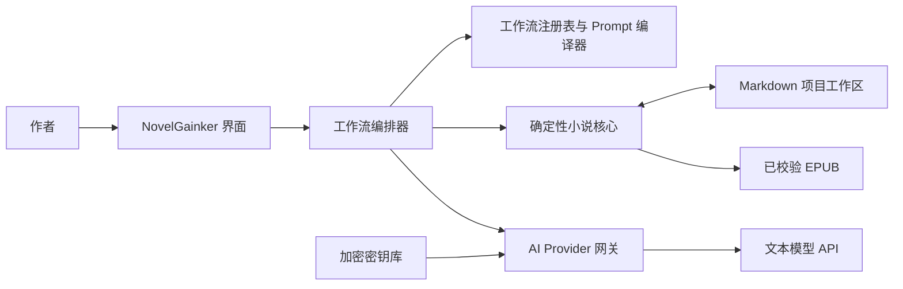
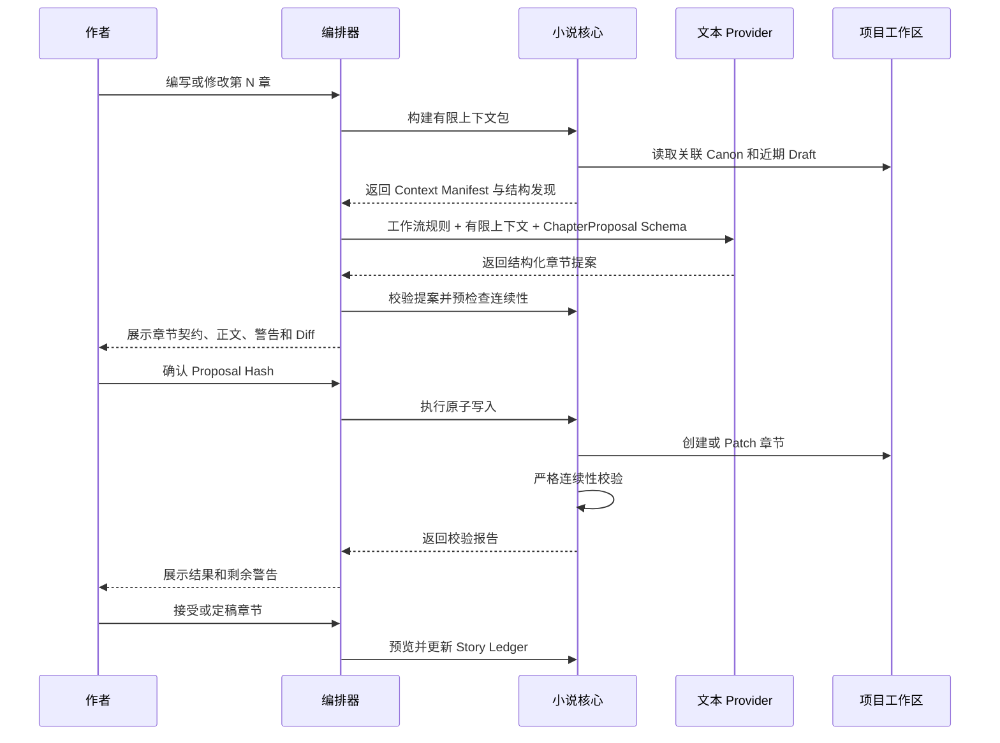

# NovelGainker 架构设计

> 状态：架构评审通过——Q-001 至 Q-017 已确认  
> 日期：2026-08-19  
> BMAD 数据包：`architecture-packet`（已批准）  
> 项目级别：3  
> 主要目标：桌面优先、本地优先、可切换 AI Provider  
> 可选目标：未来评估独立 Android 版；不建设远程伴侣端

## 1. 执行摘要

NovelGainker 是一款桌面优先、本地优先的中文小说写作应用。第一版面向 Windows 11 x64，只连接 DeepSeek 与 OpenAI 两种文本 AI API；未联网或未配置 API Key 时，用户仍可完整浏览和手动编辑本地项目。

Novelist 插件仅作为早期产品分析和行为参考，不是应用的运行时、打包依赖或兼容目标。NovelGainker 从第一天起拥有自己的工作流定义、Markdown 契约与 Rust 确定性核心；后续缺陷、格式演进和发布节奏均由本项目自行负责，不受 Novelist 更新影响。

核心架构决策，是把当前 Agent 宿主中混合在一起的四类职责拆开：

1. **小说源文件与正史（Canon）**——Markdown 文件、图片资源和故事账本。
2. **工作流定义**——带版本的 NovelGainker 原生工作流、参考资料、模板、规则和输出契约。
3. **确定性执行**——上下文构建、文件创建、格式验证、连续性检查、账本更新、图片登记和 EPUB 打包。
4. **概率性生成**——通过 DeepSeek 或 OpenAI Provider Adapter 完成文本生成、评审和意图分类。

推荐的桌面架构是 **Tauri 2 + React/TypeScript**，Rust 后端负责文件系统、密钥、网络、权限、工作流执行、格式校验和任务边界。应用不打包 Python、Novelist 插件或通用 Shell。若未来批准独立 Android 版，可复用同一 Rust Core，并仅为移动端系统能力增加少量 Kotlin 层。

Markdown 始终是小说内容的唯一权威来源。SQLite 和应用状态可以用于索引、缓存和运行日志，但必须能够从项目文件重建。

## 2. 架构决策

| ID | 决策 | 状态 | 理由 |
| --- | --- | --- | --- |
| ADR-001 | 桌面优先，第一版只支持 Windows 11 x64 | 已确认 | 符合当前开发环境，可控制第一阶段打包范围。 |
| ADR-002 | Local-first，不依赖 NovelGainker 云服务 | 已确认 | 保证手稿所有权、离线编辑和长期可用性。 |
| ADR-003 | 使用 Tauri 2 外壳、React/TypeScript UI 和 Rust 后端 | 已确认 | 体积较小、原生权限可控，并为后续 Android 提供可行路径。 |
| ADR-004 | Markdown 和项目资源是唯一权威数据 | 已确认 | 形成 NovelGainker 自有、可移植且不依赖数据库的项目格式。 |
| ADR-005 | 由 App 自己编排工作流，厂商 SDK 只作为 Adapter | 已确认 | API 切换不能依赖某家厂商的 Skill 或 Agent 运行时。 |
| ADR-006 | 内置固定版本的 NovelGainker 原生 Workflow Pack | 已确认 | 产品从第一天起独立维护，不加载或运行 Novelist 插件。 |
| ADR-007 | 确定性能力从第一版起全部实现于 Rust Core | 已确认 | 不引入 Python Sidecar，也不遗留后续移植负担。 |
| ADR-008 | 所有 Canon 写入先预览、再经人工确认 | 已确认 | 保护手稿，并让 AI 修改始终可审查。 |
| ADR-009 | 第一版只使用单一 Manager；不建设 Multi-agent | 已确认 | 降低运行、合并、成本与 Provider 兼容复杂度。 |
| ADR-010 | BYOK；密钥仅保存在本机加密存储 | 已确认 | 不引入账号、代理、额度或云端秘密管理。 |
| ADR-011 | 第一版只支持 DeepSeek 与 OpenAI 文本 API，且禁止自动跨 Provider Fallback | 已确认 | 控制首发测试范围，并确保手稿不会被静默发送给另一方。 |
| ADR-012 | 不支持离线 AI，但完整支持离线浏览和手动编辑 | 已确认 | 不承担本地模型部署成本，同时保证基本写作不依赖网络。 |
| ADR-013 | 采用类似 Codex 的可折叠三栏界面 | 已确认 | 左栏配置 API，中栏对话，右栏查看项目文件，符合首版交互目标。 |
| ADR-014 | 用户只输入 API Key，其余 Provider 配置由 App 固定 | 已确认 | 降低配置门槛，并缩小错误与安全输入面。 |
| ADR-015 | UI 与默认写作语言为简体中文，不引入韩语专用逻辑 | 已确认 | 聚焦首批中文用户，避免继承无关的插件内容。 |

## 3. 目标与非目标

### 3.1 目标

- 创建、打开、手动编辑、校验和导出 NovelGainker 原生 Markdown 项目。
- 用 NovelGainker 原生工作流覆盖项目、设定、人物、素材、剧情、叙事、评审、视觉素材和 EPUB 等核心小说流程；这些是产品能力分类，不是对 Novelist Skill 的运行时兼容承诺。
- 允许用户在 DeepSeek 与 OpenAI 之间显式切换，切换过程不修改小说项目文件。
- 通过两个独立 Adapter 隔离厂商协议差异，业务代码不按厂商分叉。
- API Key 不得进入项目文件、日志、导出物或 Prompt。
- 修改 Canon 前展示提案和 Diff。
- 保留严格章节结构、连续性检查、故事账本更新以及确定性 EPUB 校验。
- 无网络或无 API Key 时，文件树、预览、搜索、手动编辑、保存和本地确定性校验仍可使用。
- 保证核心领域和工作流代码可被未来单独立项的 Android App 复用。

### 3.2 首个桌面版本的非目标

- 多人实时协作。
- NovelGainker 自建模型代理、账户体系或订阅计费。
- 离线 AI、本地模型和自定义 OpenAI-compatible Endpoint。
- Anthropic、Gemini 或第一版范围之外的其他 AI Provider。
- 自动上传书店、发送邮件或公开发布。
- 向模型提供不受限 Shell。
- 把 Provider 的会话状态当作权威状态。
- Multi-agent 编排或多个 Agent 同时自主修改文件。
- Android 远程伴侣、同步伴侣或第一版 Android 客户端。
- 产品内置 Git 初始化、提交、分支或仓库管理；用户自行创建和管理仓库。

## 4. 质量属性

以下属性按优先级驱动架构选择：

1. **手稿安全**——不能静默覆盖、越出项目路径或未经审核修改 Canon。
2. **Provider 可移植性**——即使模型不支持 Tool Calling、Structured Output 或 Provider 会话状态，核心工作流仍可运行。
3. **本地所有权与隐私**——不需要 NovelGainker 账户或服务器，也能持续使用项目。
4. **生成过程外围确定性**——用 Schema、Validator 和本地工具包围模型输出。
5. **可恢复性**——中断的运行不能留下半写入 Canon。
6. **可追踪性**——用户能看到当前工作流、Provider、模型、上下文来源、拟修改内容、校验结果、Token 用量和成本估算。
7. **可扩展性**——新增工作流或 Provider 时不应修改编辑器和项目领域模型。

## 5. 系统上下文



NovelGainker 掌握编排权。AI Provider 只接收受限输入并返回提案；它们不拥有项目、文件系统、工作流状态或授权规则。

## 6. 运行时边界

### 6.1 前端

React/TypeScript 前端采用类似 Codex 的三栏工作台：

- **左侧栏（可整体收起）**：只显示 DeepSeek/OpenAI Provider 选择、连接状态与 API Key 录入；API 设置卡本身也可折叠。第一版不显示 Base URL、协议、Model ID 或生成参数。
- **中间主栏**：承载对话流、流式输出、当前工作流状态、停止生成、上下文说明、提案及确认入口，是最小宽度优先的主区域。
- **右侧栏（可整体收起）**：承载项目文件树和当前文件的 Markdown 源文本。选中文件后直接手动编辑，不设置“预览 / 编辑”双标签；保存仍经过原子写入与外部修改检查。
- 三栏宽度、折叠状态和右栏当前文件保存在本机 UI 偏好中，不写入项目。
- 窄窗口优先保留中间栏，左右栏以抽屉方式打开，避免压缩对话区。
- Diff、校验警告和 Canon 写入确认使用模态或覆盖面板，不与 Markdown 编辑区、API Key 表单混在一起。
- 离线时对话输入仍可用于本地命令，但“发送给 AI”明确禁用并显示网络/密钥原因；预览、编辑、搜索、保存和确定性校验继续可用。

前端不能执行任意 Shell。API Key 录入控件只把密钥提交给 Rust 后端存入加密 Vault；保存后前端只取得“是否已配置”和连接状态，不能取得掩码、尾号、指纹、凭据引用或任何 Key 字符。

NG-201 只开放 provider_status_load、provider_key_save 和 provider_key_delete 三条窄 Command。没有 Key 读取、Reveal 或 Export 接口；该 Story 不执行 Provider 网络请求，连接测试仍属于后续 Story。

NG-202 在此基础上只增加 provider_select 本地状态命令，并把禁用占位替换为真实 Key-only 设置。Key 使用密码控件和组件局部短生命周期 Buffer，提交时先清空界面状态，再由 Rust 单向写入 Vault；保存、替换、确认删除和显式选择均不触网。界面的“连接测试”仅展示将使用的 Provider、固定模型和极少 API 用量说明，实际请求必须等 NG-203 的 Provider Core 获得授权后接入。

### 6.2 Rust 应用核心

Rust 后端是可信应用边界，负责：

- 选择项目根目录并限制文件访问范围；
- 路径标准化以及阻止符号链接越界；
- 密钥保存和只读 Provider Preset 管理；
- 向 Provider 发起网络请求；
- 输出标准化流式事件；
- 保存工作流状态并取消任务；
- 原子写入事务和恢复日志；
- 运行 NovelGainker 原生确定性工具及参数 Schema 校验；
- 访问应用数据库；
- 协调更新和数据迁移。

Provider HTTP 请求应从 Rust 发出，而不是从 WebView 发出。这样 API Key 和自定义 Header 不会进入浏览器存储、前端日志或 WebView 网络检查工具。

### 6.3 原生确定性工具

第一版直接通过 Rust Crate 和带类型的 Tauri Command 暴露确定性操作。模型只能提出结构化参数；是否允许执行由编排器、工作流状态和用户确认共同决定。

注册的应用能力包括：

- `project.create`
- `project.scan`
- `source.create_character`
- `source.create_setting`
- `source.create_material`
- `source.create_plot`
- `story.build_context`
- `story.check_continuity`
- `story.apply_chapter_patch`
- `story.update_ledger`
- `review.inventory`
- `publish.build_epub`
- `publish.validate_epub`

这些名称是 App 内部命令契约，不是 CLI。模型不能提供可执行文件路径、Shell 命令或任意参数。覆盖操作只能通过独立 UI 操作和新的确认记录触发。

### 6.4 共享 Rust Core

确定性能力从第一版起位于可复用 Rust Crate：

```text
crates/
  novelgainker-domain/       Markdown、Frontmatter 和领域类型
  novelgainker-workflows/    确定性工作流状态转换
  novelgainker-validation/   结构与连续性校验
  novelgainker-publish/      EPUB 暂存、打包和验证
  provider-core/             标准化 Provider 契约
```

桌面 Tauri 直接调用这些 Crate。未来若独立 Android 版获得批准，应复用同一 Core；Android 文档选择、后台任务、安全存储和系统分享再通过少量 Kotlin/Tauri Plugin 实现。

## 7. 仓库与模块布局

建议的目标目录：

```text
NovelGainker/
  apps/
    desktop/                    Tauri + React 桌面应用
  crates/
    app-core/                   编排、授权、事务与应用服务
    novelgainker-domain/        项目格式与领域类型
    novelgainker-workflows/     原生工作流状态机
    novelgainker-validation/    格式与连续性校验
    novelgainker-publish/       EPUB 构建与验证
    provider-core/              Provider 标准化契约
    provider-deepseek/          DeepSeek Adapter
    provider-openai/            OpenAI Adapter
  packages/
    ui/                         React 组件与三栏布局
    workflow-schemas/           生成的 TypeScript Schema
  resources/
    workflows/v1/              NovelGainker 原生工作流、模板与参考资料
  tests/
    fixtures/
    provider-contract/
    workflow-e2e/
  docs/
    architecture.md             已被本中文评审稿取代的英文旧稿
    architecture.zh-CN.md       当前架构事实来源
    decisions/                  后续 ADR
```

运行时不读取 Codex Plugin Cache，也不打包 Novelist 目录、`SKILL.md`、`openai.yaml` 或 Python 脚本。工作流的产品意图可以参考早期分析，但实现、措辞、Schema、Fixture 和 Golden Test 均由 NovelGainker 自己维护。若未来确需复制第三方代码、文字或资源，必须单独完成许可审查并保留相应声明；默认路径是原生实现。

## 8. 项目数据模型

### 8.1 权威项目文件

NovelGainker 原生 Scaffold 采用以下权威结构：

- `project.md`
- `AGENTS.md`
- `characters/`
- `materials/`
- `macguffins/`
- `plot/`
- `outlines/`
- `world/`
- `style/`
- `assets/`
- `chapters/`
- `published/`

`chapters/` 是手稿 Canon，只有 `## Draft` 中的内容可以进入出版物。`materials/000.story-ledger.md` 保存持久化的故事状态摘要。`published/` 只保存生成物，不能被当作编辑源。

### 8.2 可移植的 App 元数据

项目可包含 `.novelgainker/project.json`，只保存非敏感元数据：

```json
{
  "schemaVersion": 1,
  "projectId": "uuid",
  "workflowPackVersion": "1.0.0",
  "defaultProviderId": "openai",
  "writingLanguage": "zh-CN",
  "strictChapterMarkup": true
}
```

该文件不得包含 API Key、Access Token、Provider Response ID 或与单台电脑绑定的绝对路径。没有此文件的项目仍然可以导入；App 可以推导默认值，并经用户确认后创建它。

### 8.3 运行状态

操作系统应用数据目录中的 SQLite 数据库保存可重建或仅与本机有关的状态：

- 最近项目与界面偏好；
- 标准化对话和运行元数据；
- 任务检查点和恢复日志；
- 内容哈希和搜索索引；
- Provider Preset 版本、当前选择和密钥引用，不包含密钥本身；
- Token 用量和可选成本估算；
- 校验历史。

数据库不能成为隐藏的 Canon 来源。删除数据库可能丢失界面历史，但不能让小说项目无法读取或无法出版。

NG-201 已把 App State 从 Schema v1 事务迁移到 v2。为支持现有 `app-state-v1.sqlite3` 原位升级，数据库文件名保持不变；Sprint 1 的 `ui_preferences`、`recent_projects` 和 `project_files` 三张表及其职责也保持不变。

Schema v2 只新增 `provider_settings`：保存固定 `provider_id`、`preset_version`、不透明 `credential_ref`、选择状态、连接状态和检查时间。Provider 只能是 `deepseek` 或 `openai`，默认选择 OpenAI，且最多一个 Provider 被选中。真实 Key、Key 特征、Prompt、Response、Usage 和 Canon 均不得进入 SQLite。

NG-302 已把同一数据库事务迁移到 Schema v3。v3 只新增 `workflow_runs`：保存 Run/Project/Workflow/Pack/Provider/Preset/Model 快照、状态、sequence、相对目标路径、时间与内容 Hash，并用唯一索引保证全 App 最多一个非终态 Run。表中不得出现简报、Prompt、消息、Context 正文、Provider Response、Proposal Markdown、Diff、API Key 或 Canon；终态历史最多保留 20 条。

启动读取到非终态 Run 时，Manager 必须把它归类为 `recovery_required` 并清除已丢失语义的进程内正文，绝不自动重发请求、重建提案、Apply 或写入 Markdown。v1/v2 → v3 Migration 失败必须事务回滚并安全降级；Vault、Workflow 检查点与 SQLite 不一致时只报告脱敏恢复状态，不自动联网，也不阻塞项目打开、手动编辑或原子保存。


## 9. 原生工作流运行时

### 9.1 工作流定义

NovelGainker 把“Skill”概念产品化为自己的版本化工作流定义。每个工作流由可审查的说明、状态机、输入/输出 Schema、允许工具和确认点组成；安全边界由代码与 Schema 执行，不能只依赖 Prompt。

```yaml
id: novelgainker.storytelling
version: 1
mode: interactive-write
allowed_tools:
  - story.build_context
  - story.check_continuity
  - story.apply_chapter_patch
  - story.update_ledger
requires_confirmation:
  - create_chapter
  - revise_chapter
  - update_canon
output_schema: ChapterProposalV1
```

每个发行版内置并固定一个 Workflow Pack 版本。升级由 NovelGainker 自己提供 Schema Migration、变更记录和回归测试，不存在 Novelist 上游同步或兼容门。

### 9.2 工作流注册与路由

构建阶段验证 `resources/workflows/v1/`，并生成包含 ID、描述、版本、参考资料、权限、Schema 和内容哈希的注册表。运行时按以下顺序路由：

1. 用户点击明确功能时，直接进入对应工作流。
2. 用户输入明确的工作流命令时，验证后直接进入对应工作流。
3. 自由对话先用确定性意图规则判断。
4. 只有含糊的自由对话才调用当前选定 Provider 做意图分类。
5. Router 只能返回工作流 ID 和置信度，不能执行工具。
6. 低置信度或多意图结果必须让用户选择。

高风险路由不能被随意推断。“分析评审”默认只读；普通出版不能偷偷增加文学评审或自动修订。

### 9.3 Prompt 编译

每次只加载当前工作流所需内容。Prompt 顺序如下：

1. 不可变的 NovelGainker 安全与授权规则；
2. 项目 `AGENTS.md`（若存在，仅作为项目写作约束，不授予系统权限）；
3. 当前工作流说明；
4. 当前任务需要的参考资料；
5. 带来源标签的有限项目上下文；
6. 标准化的对话状态；
7. 当前用户请求；
8. 精确输出 Schema 和完成契约。

项目正文必须标记为不可信数据。章节、研究笔记或导入手稿中的文字不能授予工具权限，也不能覆盖 App Policy。发送敏感或大量上下文前，App 展示 Context Manifest，列出将发送的 Provider、模型、项目文件和片段。

### 9.4 工作流映射

| 工作流 ID | 产品流程 | 修改规则 |
| --- | --- | --- |
| `novelgainker.project-create` | 目标目录预检、元数据向导、确定性 Scaffold 创建和验证 | 确认目标目录及所有冲突 |
| `novelgainker.setting-create` | 读取关联上下文、生成结构化提案、交互修订、确定性写入 | 确认新文件，不静默覆盖 |
| `novelgainker.character-create` | 人物简报细化、命名循环、结构化人物表、确定性写入 | 确认身份和最终人物表 |
| `novelgainker.material-create` | 素材种子、用途决策、结构化素材文件 | 确认是否成为 Canon 以及是否写入 |
| `novelgainker.plot-create` | Promise/Pressure/Turns 提案、方向调整、结构化 Plot 文件 | 确认重要 Canon 后写入 |
| `novelgainker.storytelling` | 有限上下文、章节契约、连续性门禁、提案与 Diff、写章、严格校验、接受后更新账本 | Manager 串行写入 |
| `novelgainker.analytical-review` | 范围清单、只读分批、证据化报告、可选的选定问题移交 | 除非另行授权修订，否则禁止写入 |
| `novelgainker.visual-asset` | 锁定风格的 Prompt、导入或未来图片 Provider 结果、登记到项目 | 第一版不内置图片生成 API；确认资源与引用 |
| `novelgainker.publish` | 结构预检、封面决策、确定性暂存、EPUB 构建和验证 | 只写生成目录，不执行外部分发 |

工作流默认使用简体中文交互和中文写作。人物命名、文化语境和语言风格从项目设定推导；不保留原插件中的韩语命名或韩国语境专用分支。

## 10. 工作流状态机

所有 AI 辅助工作流共用持久化状态模型：

```text
created
  -> routed
  -> awaiting_input
  -> context_ready
  -> generating
  -> proposal_ready
  -> awaiting_confirmation
  -> applying
  -> validating
  -> completed
generating -> cancelled
允许放弃的非终态 -> cancelled
任何非终态 -> failed | recovery_required
```

规则：

- 生成阶段绝不能直接修改 Canon。
- 提案必须包含计划执行的文件操作和用户可读的理由。
- 用户确认与 Proposal Hash 绑定；上下文或提案变化后，旧确认自动失效。
- Apply 前再次检查源文件 Hash，发现预览后被外部修改时立即停止。
- 生成阶段可安全取消；Apply 阶段则等待原子事务完成或回滚。
- 校验失败时尽量保留原文件，并记录恢复事件。
- 每个 Run 的 Project/Workflow/Pack/Provider/Preset/Model 快照创建后不可更换；事件必须携带下一 sequence，旧事件与终态后的事件一律拒绝。
- 全 App 最多一个非终态 Workflow Run；只有 `generating` 占用与普通聊天共享的 Provider 请求通道。
- NG-303 在既有 `status/cancel/abandon` 上增加 `workflow_run_prepare` 与 `workflow_run_generate`：Prepare 只接受不透明项目会话、固定人物工作流和 `CharacterBriefV1`；Generate 只接受 Run ID、Manifest Hash 和显式确认。前端仍不能提交目标状态、完整 Prompt、Provider Response、Proposal、Diff、文件路径或 Apply 内容。
- 放弃需要显式确认，只清除内存运行内容并把 Run 终止为 `cancelled`，不修改 Canon。

### 10.1 章节写作顺序



故事账本必须在作者接受或定稿章节后更新，不能在模型刚完成 Token 输出时就更新。

## 11. Agent 运行时

### 11.1 单 Manager 模型

第一版只有一个由 App 编排器实现的 **Manager**。它持有一个用户可见 Run 的状态、上下文、确认记录和全部 Canon 写入权。Manager 不是独立常驻 AI Agent；它是确定性状态机，按需要调用当前选中的文本 Provider。

NG-302 的 as-built Manager 位于 App 自有 Rust Crate，不依赖 Novelist、Codex Skill/Agent 或厂商 Agent Runtime。Manager 生产代码不访问文件系统或网络；App State 只持久化脱敏检查点，简报、上下文正文、Provider Response 和 Proposal 只允许存在于可清除的进程内内存。Tauri 层采用“克隆 Manager → 验证转换 → 持久化检查点 → 提交内存状态”的顺序，持久化失败不会把未记录的目标状态留在 Manager 中。

NG-303 的 as-built Context Builder 位于同一 App 自有 Rust Crate，生产代码不访问文件系统或网络；Tauri 只能通过 App Core 的受控项目句柄读取 `project.md` 与根目录 `AGENTS.md`。人物简报固定为 Schema v1，最多 4000 字符/16 KiB；每个来源最多纳入 1600 字符/4 KiB，并在 Manifest 中展示准确的相对路径、来源 Hash、原始/纳入计数、包含理由、信任标签、有界明文预览和截断状态。未保存编辑器文本、搜索结果、其他 Canon、隐藏目录、普通聊天历史和项目外文件不在输入面内。

Manifest 的 canonical JSON Hash 绑定 Run、Project、Workflow/Pack、Provider/Preset/Model、Brief Hash 与全部来源 Hash。固定 Prompt 依次包含 App 安全策略、标为不可信的项目 `AGENTS.md`、工作流说明、固定参考/模板、标为不可信的 `project.md`、空对话历史、标为不可信的人物简报和输出 Schema；每个不可信边界同时包含对应内容 SHA-256，使项目文本不能伪造结束标签或扩大权限。Prompt 顺序、注入 Fixture 与 Golden Hash 由纯 Rust 测试锁定。

`workflow_run_prepare` 完全离线且不写项目，只在内存保存 Prepared Context，并在 App State 写入脱敏运行元数据与 Manifest Hash。用户审查 Manifest 后，`workflow_run_generate` 必须同时满足显式 `confirmed=true`、完全相同的 Manifest Hash、来源文件 Hash 未变化、捕获的 Provider 仍是当前已配置且连接成功的 Provider，才会通过固定 Provider Core 发起人物结构化生成；本地严格解析失败时最多向同一捕获 Provider 发起一次有界修复请求。生成期间普通聊天、Provider/Key 切换和项目切换被锁定，但右栏 Markdown 手动编辑仍保持独立；若用户编辑了被纳入来源，Hash 重检会阻止发送并要求重新准备。

完整简报、Prompt 和 Context 只存在可清除的 Rust 内存；Provider 原始响应只存在于解析/单次修复的短生命周期局部变量，随后立即清除，均不进入 WebView 事件、App State、日志或证据。NG-304 建立的通用 Proposal 安全层保持不变：严格 `CanonProposalV1` 只允许一个 create/replace Operation；版本化 Canonical JSON 与 Proposal Hash 绑定 Workflow/Pack/Run、Provider/Preset/Model、Manifest、目标源状态、拟写入字节 Hash/长度、严格校验结果和警告。Rust 只在内存保留精确拟写入字节，Debug、检查点、日志和错误不含正文或 Diff。

Workflow 状态快照升级为 Schema v3；WebView 可以显示目标、操作、来源状态、安全校验、完整新内容和 replace 逐行 Diff，但 `workflow_proposal_apply` 只接受 `runId`、`proposalHash` 与 `confirmed`。Apply 从 Rust 持有的 Proposal 取回全部材料，重新检查 Context 和目标状态，拒绝当前编辑目标、只读会话、第二 Writer、恢复阻断、create collision 和过期 replace；写入使用同目录临时文件、恢复日志、不覆盖 create 或 Windows 原子 replace，并在写后 Hash 与严格 Validation 都通过后才进入 `completed`。失败只会保持旧 Canon、回滚或进入 `recovery_required`。

NG-305 已把 `character-create` 接入生产路径。Provider 只能返回拒绝未知字段、带严格语义上限的 `CharacterProposalV1`，不能指定路径、Frontmatter、工具或文件操作；DeepSeek 固定使用 JSON Output，OpenAI 固定使用 strict JSON Schema Structured Outputs，普通对话请求不携带结构化输出设置。两家 Adapter 最终进入同一个本地 Validator；OpenAI 请求 Schema 只移除其支持子集未接受的 `uniqueItems`，本地唯一性约束仍保留。

有效人物数据由纯 Rust Serializer 确定性生成为 UTF-8/LF Markdown，并只在安全中文显示名通过 Windows 保留名、分隔符、隐藏名、尾点/空格与长度检查后映射到 `characters/<人物名>.md`。目标必须处于 `missing`，否则返回冲突且零写入；成功生成只形成 create Proposal，继续经过完整预览、Proposal Hash、独立确认与可恢复原子 Apply。创建成功后前端刷新文件树并请求右栏打开新文件，现有未保存编辑仍受丢弃确认保护。

NG-306 已把取消、冲突、故障恢复和双 Provider 路径汇总为 G3 技术证据。DeepSeek/OpenAI Loopback 均经过生产 Validator、确定性 Serializer、Proposal Hash、显式确认与可恢复 Apply；未确认、取消、过期和冲突路径保持零 Canon 写入。Applying 子进程故障注入覆盖提交前回滚与写后完成，重启对账只允许完成、回滚或进入 `recovery_required`。隔离临时项目中的高熵 Canary 会扫描 SQLite、日志、错误、DOM、截图元数据和 G3 产物，默认质量门仍不读取真实 Key、不联网，也不触发跨 Provider Fallback。

原 Novelist 包中的 `agents/openai.yaml` 仅曾被用于分析显示名称和起始提示，不会打包、解析或运行。NovelGainker 不承诺兼容任何 Codex、ChatGPT 或厂商 Agent 格式。

### 11.2 逻辑角色而非 Multi-agent

Router、Writer、Reviewer、Summarizer、Continuity Auditor 和 Publisher 是同一 Manager 内部的工作流步骤或 Prompt Profile，不是可并行自治的 Agent：

| 逻辑角色 | 职责 | 执行边界 |
| --- | --- | --- |
| Router | 对含糊自由请求分类 | 只返回工作流 ID 和置信度 |
| Writer | 规划、起草或提出修订 | 只提交结构化提案 |
| Reviewer | 执行大纲、章节或全稿评审 | 默认只读 |
| Summarizer | 生成带来源的有限摘要 | 不写 Canon |
| Continuity Auditor | 检查人物、时间线、世界规则和线索 | 不写 Canon |
| Publisher | 调用确定性 EPUB 工具 | 只能写 `published/` |

第一版不实现 Agent 创建、Agent 间通信、Handoff、并行任务或自动合并。若未来产品目标发生变化，必须另开 ADR 与安全评审，不能把 Provider 原生 Multi-agent 能力直接接入 Canon 写入路径。

## 12. AI Provider 架构

### 12.1 Key-only 设置体验

左栏仅展示两个内置 Provider：

1. **DeepSeek**——用户输入 DeepSeek API Key；
2. **OpenAI**——用户输入 OpenAI Platform API Key。

“ChatGPT API”在本架构中按 **OpenAI Platform API** 理解，不使用 ChatGPT Plus/Pro 登录或订阅凭据。两个 Key 分别存储，可只配置其中一个；切换 Provider 是显式用户操作。

用户不可编辑 Base URL、协议、Model ID、Header、Timeout 或生成参数。它们来自随 App 发布、只读且带版本的 `ProviderPreset`：

```json
{
  "presetVersion": 1,
  "providers": [
    {
      "id": "deepseek",
      "baseUrl": "https://api.deepseek.com",
      "protocol": "deepseek-chat",
      "model": "deepseek-v4-pro",
      "timeoutSeconds": 120
    },
    {
      "id": "openai",
      "baseUrl": "https://api.openai.com/v1",
      "protocol": "openai-responses",
      "model": "gpt-5.6-terra",
      "timeoutSeconds": 120
    }
  ]
}
```

以上模型是 2026-08-19 已确认的首版内置值。厂商弃用模型时，通过新的 App 版本和 Preset Migration 更新，不在第一版提供任意 Model ID 输入或模型发现。连接测试仅验证 Key、端点可达性和预设模型可用性。

项目文件只保存非敏感的默认 Provider ID。本机 SQLite 保存当前选择、Preset 版本与密钥引用；真实 Key 只进入加密 Vault。

### 12.2 标准化契约

两个 Adapter 共同实现最小接口：

```text
ProviderAdapter
  validate_key(credential_ref, preset) -> ValidationResult
  capabilities(preset) -> CapabilitySet
  generate(request) -> NormalizedResponse
  stream(request) -> Stream<NormalizedEvent>
  cancel(run_id)
  estimate_usage(request) -> optional UsageEstimate
```

标准化请求包含 Messages、System Instructions、Output Schema、必要的 Tool Description、最大输出和厂商无关的 Reasoning Preference。Adapter 必须明确转换或丢弃不支持字段，不能假装两家厂商语义完全等价。

标准化响应包含文本和/或已解析结构化数据、Tool Call 提案、用量、Finish Reason、Provider/Model 身份、脱敏错误和仅用于诊断的不透明 Response ID。

### 12.3 能力与降级

| 能力 | 首选路径 | 本地降级路径 |
| --- | --- | --- |
| Streaming | Provider 原生流 | 非流式响应，并显示任务进行中状态 |
| Structured Output | 原生 Schema 约束 | JSON 指令、严格本地解析、一次同 Provider 修复尝试，失败后停止 |
| Tool Calling | 原生 Function/Tool Call | 模型只输出结构化提案，由 App 工作流调用确定性工具 |
| Token Count | Provider 返回计数 | 保守本地估算并预留输出预算 |
| Persisted Conversation | 不作为依赖 | App 从标准化对话与 Canon 重建上下文 |

第一版不支持 Vision 或图片生成 API；视觉素材工作流只生成文字 Prompt、导入本地图片并登记资源。第一版也不实现离线 AI、本地端点或自定义兼容端点。

只允许在两个 Run 之间切换 Provider。存在未完成写事务时，必须先完成、失败或回滚。切换后从 Canon 文件和标准化对话重新构建上下文，不能迁移 Provider 隐藏状态或隐藏推理。

### 12.4 模型角色与 Fallback

当前选中的 Provider 负责 Router、Writer、Reviewer 和 Summarizer 等全部 AI 步骤。所有步骤使用该 Provider 的固定预设模型，第一版没有按角色选择模型的 UI。

禁止自动跨 Provider Fallback。当前 Provider 失败时，Run 进入失败或可重试状态；只有用户明确切换并重新发送后，内容才能交给另一 Provider。同一 Provider 内也只允许对瞬时网络错误或 Rate Limit 做有界重试，不能借重试更换厂商。

## 13. 工具与文件系统安全

### 13.1 Capability 模型

每个工具注册时必须声明：

- Input Schema；
- Output Schema；
- 只读或写入分类；
- 允许调用的工作流状态；
- 对 Project Root 的要求；
- 是否需要确认；
- Timeout 和取消行为；
- 审计日志脱敏规则。

是否合法调用工具，由编排器决定，而不是模型决定。

### 13.2 路径安全

所有文件操作必须：

1. 从用户选定的 Project Root 开始解析；
2. 在可能的情况下规范化目标父目录；
3. 拒绝模型提供的绝对路径；
4. 拒绝 `..`、符号链接和 Reparse Point 越界；
5. 只允许访问预期的源目录或生成目录；
6. 除非工作流和用户确认允许，否则拒绝覆盖；
7. Canon 写入使用同目录临时文件和原子 Rename。

模型可访问功能中不包含递归删除。

### 13.3 Diff 与确认

新文件展示完整预览，修改展示语义或逐行 Diff。确认记录包含：

- Proposal Hash；
- 源文件 Hash；
- Provider 与 Model；
- 工作流 ID 和当前步骤；
- 要创建或修改的文件；
- 用户接受的校验警告；
- 时间戳。

如果预览后文件发生变化，Apply 必须停止并重新生成 Diff。

## 14. 密钥与隐私

API Key 保存在加密应用 Vault，例如 Tauri Stronghold 或操作系统凭据库。项目只保存默认 Provider ID。密钥录入后，原始值不得再返回前端。

隐私要求：

- Telemetry 默认不包含手稿和 Prompt 正文；
- 日志脱敏 Authorization Header、API Key、Signed URL 和 Response Body；
- 每个 Run 明确显示会收到内容的 Provider 和 Model；
- Context Inspector 展示将离开设备的文件或片段；
- 跨 Provider Fallback 不存在；用户必须显式切换并重新发送；
- Crash Report 必须选择加入，且不能包含项目正文；
- 内置 Workflow Pack 在构建时经过 Hash 与 Schema 校验；项目文本始终按不可信输入处理。

Threat Model 必须覆盖：导入手稿中的恶意文字、研究笔记 Prompt Injection、模型 JSON 中的路径穿越、被入侵的 Provider Response、密钥泄漏和外部文件并发修改。

## 15. 可靠性、恢复与并发

- 每个打开项目由一个进程级 Lock 保护，确保同一时间只有一个 NovelGainker Writer。第二个窗口只能只读，或请求转移 Lock。
- 通过 File Watcher 和内容 Hash 检测外部编辑器修改。
- Canon 写入使用事务日志；日志保存在 App 状态目录，而不是手稿正文中。
- 事务失败时恢复旧文件并报告恢复状态。
- `published/` 可在预检后重建，但不能通过修改生成物来反向修复源文件。
- 长时间 Provider Call 支持取消和明确 Timeout。
- 只自动重试瞬时网络错误和 Rate Limit；不能自动重试写入或含糊模型响应。
- App 启动时扫描未完成事务，并在开始新的 AI 工作前提供恢复。

## 16. 搜索、检索与上下文预算

NovelGainker 原生 Context Builder 按产品规则优先考虑显式链接、Master Source、目标大纲、近期 Draft、Story Ledger 和 Query Match。

检索规则：

- 显式 Source ID 的优先级高于词法相似度；
- 按当前工作流契约加载项目 `AGENTS.md`、Style Guide、Master Plot 和 Master Outline；
- 读者已知信息只能从之前章节的 `## Draft` 判断；
- 隐藏 Canon 和 Outline 信息必须标为作者侧上下文；
- 只有有限摘要无法解决任务时，才读取完整旧章节；
- 根据模型 Context Limit 预留输出空间和安全余量；
- Context Pack 带有源路径和内容 Hash，以便追踪。

本地全文索引可用于加速候选发现，但索引结果只是候选列表，最终 Context Pack 仍由确定性 Context Builder 负责。

## 17. 视觉素材与出版

第一版不调用图片生成 API。视觉素材工作流根据项目源文件生成并保存锁定风格的文字 Prompt，用户可在外部工具生成图片后导入：

1. App 生成并展示可复制的完整 Prompt；
2. 用户从本地选择候选图片；
3. App 在临时视图中预览并检查格式；
4. 用户确认后复制到 `assets/cover/` 或 `assets/illustrations/`；
5. 再次确认 Markdown 相对路径和登记信息。

EPUB 出版保持确定性。Publisher 必须：

- 执行严格章节和连续性预检；
- 遇到 Draft 或非 Final 章节时取得确认；
- 确认书名、作者、语言和封面；
- 按章节编号只渲染 `## Draft`；
- 保留 `published/epub/` 暂存目录；
- 打包并验证最终 EPUB；
- 未经单独授权，不上传或分发文件。

## 18. 桌面与 Android 策略

### 18.1 桌面第一版

第一阶段只支持 Windows 11 x64，并交付内部测试包。暂不处理安装器、代码签名、自动更新或公开分发；这些能力在正式发布里程碑前另行评审。架构不主动阻断未来 macOS/Linux，但当前不承诺其打包或 QA。

Windows 内部测试包包含：

- Tauri 应用与 WebView UI；
- Rust 后端及原生确定性 Core；
- 固定版本的 NovelGainker Workflow Pack；
- SQLite Migration；
- Windows Credential Manager 集成；
- 必要的许可和 Attribution 文件。

发行包不包含 Python、Novelist 插件缓存、本地模型或远程控制服务。

### 18.2 Android 范围

第一版不包含 Android，也不建设远程伴侣或同步伴侣。桌面端不会为了手机控制而开放监听端口、设备配对、远程文件协议或云同步。

如果未来需要 Android，只考虑**独立 Android App**，并通过新的产品决策和架构评审启动。届时可以复用 Rust 领域、工作流、校验、出版和 Provider Core，但必须单独解决：

- Android Storage Access Framework；
- 移动端安全存储和 Provider 网络调用；
- 后台任务与应用生命周期；
- 移动端三栏交互的重新布局；
- EPUB 分享和资源导入；
- 项目 Lock，以及用户自行选择同步工具时的外部冲突。

这是一项未来扩展，不属于桌面第一版的验收或技术前置条件。

## 19. 可观测性与成本控制

每个 Run 记录不含手稿正文的元数据：

- Run ID、工作流 ID、状态转换和耗时；
- Provider、Model 和采用的 Capability 路径；
- Provider 返回的 Input/Output Token；
- 根据带更新时间的价格元数据计算的估算成本；
- 工具名称、状态和脱敏错误；
- 上下文源路径与 Hash；
- 确认记录和校验结果 ID。

价格会随时间变化，必须显示更新时间。成本只是估算值，App 可提供每次 Run 的最大输出限制和每月警告阈值，但不能保证 Provider 最终账单。

## 20. 测试策略

### 20.1 NovelGainker 原生契约测试

由本项目维护 Fixture 与 Golden Test，覆盖：

- 项目初始化、已有目录与冲突处理；
- Markdown/Frontmatter Schema 与严格章节标记；
- Story Ledger 渲染与更新；
- Context Pack 的选择顺序和来源 Hash；
- Analytical Review Inventory；
- 图片导入与资源路径登记；
- EPUB 渲染、打包和验证。

这些测试表达 NovelGainker 自己的产品契约，不以 Novelist 版本或测试结果作为发布门。

### 20.2 Provider Contract Test

DeepSeek 与 OpenAI Adapter 都必须通过 Mock 契约测试，以及由开发者凭据启用的可选 Live Test：

- Key 认证失败且错误信息脱敏；
- 固定 Base URL、协议与 Model ID；
- Streaming Event 标准化与取消；
- Structured Output 成功、畸形输出和同 Provider 修复；
- Rate Limit、Timeout 与有界重试；
- Usage 标准化；
- 用户显式切换 Provider；
- 失败时绝不自动请求另一 Provider；
- 日志、数据库、项目文件和错误 UI 中不出现完整 Key。

普通单元测试与离线编辑测试不能依赖 Live Provider。

### 20.3 安全、离线与工作流测试

- 路径穿越、绝对路径、符号链接和 Reparse Point；
- 恶意文件名、Frontmatter 与 Prompt Injection；
- 模型请求未注册工具；
- 过期 Proposal Hash 和并发外部修改；
- 每个工作流状态中的取消；
- 原子写入阶段的 Crash Recovery；
- 离线或无 Key 时仍能打开、预览、编辑、保存、搜索和本地校验；
- 离线时 AI 发送明确禁用，且不会排队后静默发送；
- 所有 Canon 写入都显示预览或 Diff，并绑定确认 Hash；
- UI 不暴露 Base URL、Model ID 或自定义 Endpoint；
- 中文 UI 与新项目默认写作语言为简体中文；
- 工作流资源中不存在韩语专用分支；
- 应用不加载 Novelist 插件缓存，也不启动 Python/通用 Shell。

### 20.4 端到端验收路径

最低发布验收路径：

1. 在 Windows 11 x64 创建 NovelGainker 项目；
2. 不配置 Key，离线打开、编辑并保存 Markdown；
3. 分别录入 DeepSeek 与 OpenAI Platform API Key，并完成连接测试；
4. 折叠 API 卡、左侧栏和右侧栏，重启后确认布局偏好恢复；
5. 创建人物并完善剧情；
6. 使用 DeepSeek 生成一章提案，预览并确认写入；
7. 显式切换到 OpenAI，通过新 Context Pack 提出修订；
8. 运行严格连续性校验，接受章节并更新 Story Ledger；
9. 构建并验证 EPUB；
10. 关闭并重新打开 App，确认项目完整、密钥受到保护且没有自动 Fallback。

## 21. 交付顺序

以下是架构层面的先后关系，还不是 Sprint Plan。

### 阶段 A——桌面与本地基础

- 建立 Tauri/React/Rust Workspace；
- 实现可折叠三栏 Shell 与本地 UI 偏好；
- 定义 NovelGainker 项目 Schema、Workflow Pack v1 和工具契约；
- 支持创建、打开、预览、手动编辑、原子保存和外部修改检测；
- 实现项目路径沙箱、SQLite 状态库与加密 Vault。

### 阶段 B——两家 Provider

- 内置 DeepSeek 与 OpenAI Provider Preset；
- 实现 Key-only 设置、连接测试和显式切换；
- 实现标准化 Streaming、取消、错误与 Usage；
- 完成 Provider Contract Test 和禁止 Fallback 测试。

### 阶段 C——提案与 Storytelling Core

- 实现工作流状态、Context Manifest、Proposal Hash、Diff 与确认；
- 实现 Context Builder、Continuity Checker、Chapter Patch 和 Story Ledger；
- 增加严格校验、Recovery Journal 与离线回归测试。

### 阶段 D——原生工作流覆盖

- 完成项目、设定、人物、素材、剧情、叙事与分析评审工作流；
- 完成视觉 Prompt/本地图片导入和 EPUB Publishing；
- 完成中文默认值、韩语专用内容排除和安全测试。

### 阶段 E——Windows 内部测试包门

- 执行完整端到端验收、性能与大项目测试；
- 生成明确标注“内部测试”的 Windows 测试包，并验证测试版本数据与 Preset Migration；
- 完成许可、隐私说明、密钥恢复说明与发布检查。

macOS、Linux、新 Provider、图片生成 API、Multi-agent 和独立 Android 均需新的产品决策，不进入第一版 Task Planning。

## 22. 风险与缓解措施

| 风险 | 影响 | 缓解措施 |
| --- | --- | --- |
| 把自然语言工作流误当成安全策略 | 不同模型行为不一致，权限漂移 | 用 Rust 状态机、Schema 和工具注册表执行权限与门禁 |
| DeepSeek 与 OpenAI 能力不同 | 切换后结果格式或质量变化 | 最小公共契约、Adapter 测试、显式能力降级和清晰错误 |
| 固定模型被厂商弃用 | 新安装或连接测试失败 | Provider Preset 版本化、应用升级迁移、发布前 Live Smoke Test |
| 原生重写范围被低估 | 首版延误或缺少关键行为 | 先固化产品行为清单和 Golden Test，再按垂直切片实现 |
| 长篇小说超过 Context | 连续性或文风质量下降 | 有限确定性上下文、Story Ledger、带来源检索、保守预算 |
| 并发或过期编辑 | Canon 被覆盖 | Project Lock、File Hash、Diff 确认和原子写入 |
| 手稿隐私泄漏 | 内容发给非预期 Provider 或日志 | Context Manifest、显式 Provider、加密密钥、日志脱敏、禁止 Fallback |
| 离线状态表达不清 | 用户误以为修改未保存或 AI 可用 | 独立显示本地保存状态和 AI 连接状态；离线编辑进入 E2E 验收 |
| 用户把 EPUB 构建误认为外部出版 | 发生非预期外部动作 | Export 只在本地，分发不属于第一版 |

## 23. 已确认产品决策

### 23.1 已确认（Q-001 至 Q-017）

| ID | 已确认决策 | 架构结果 |
| --- | --- | --- |
| Q-001 | 第一版只支持 Windows 11 x64 | 其他桌面平台不进入首版打包与 QA |
| Q-002 | 不做远程伴侣 | 第一版无 Android；未来若立项，只评估独立 Android App |
| Q-003 | 第一版只支持 DeepSeek 和 OpenAI | 只实现两个文本 Adapter |
| Q-004 | 采用 BYOK | 不建设账户、代理、额度或计费后端 |
| Q-005 | MVP 不包含云同步 | 项目只在用户选择的本地目录；外部同步由用户自行负责 |
| Q-006 | 采用建议：所有 Canon 写入先预览/确认 | 不提供 Auto-apply |
| Q-007 | 强制严格 Markdown 契约 | 确定性校验是写入和出版门禁 |
| Q-008 | Git 不属于产品功能 | 用户自行创建、提交和管理仓库 |
| Q-009 | UI 与默认写作语言为简体中文 | 不加入原插件中的韩语专用内容 |
| Q-010 | 不允许自动 Provider Fallback | 失败后只能由用户显式切换并重新发送 |
| Q-011 | 不需要 Multi-agent | 第一版只有一个确定性 Manager |
| Q-012 | 工作流内置固定，后续由项目自己维护，从一开始与 Novelist 无关 | 原生 Workflow Pack + Rust Core；无插件、Sidecar 或上游兼容依赖 |
| Q-013 | “ChatGPT API”只指 OpenAI Platform API Key | 不接入 ChatGPT Plus/Pro 登录或消费者订阅 |
| Q-014 | 接受首版内置模型：DeepSeek `deepseek-v4-pro`、OpenAI `gpt-5.6-terra` | 模型随 App 的 Provider Preset 版本更新，用户不填写 Model ID |
| Q-015 | 右栏不使用“预览 / 编辑”两个标签，直接手动编辑 Markdown | 右栏以可编辑 Markdown 源文本作为当前文件视图；离线时同样可保存 |
| Q-016 | 接受 Tauri 2 + React/TypeScript + Rust 作为第一版技术栈 | 技术栈冻结；后续实现按 Tauri 权限、Rust Core 和 React 三栏 UI 拆分 |
| Q-017 | 当前只交付 Windows 内部测试包，暂不处理安装器、签名、自动更新和公开分发 | 测试包必须明确标识；正式发布能力以后另开评审 |

## 24. 架构评审门

**Review Gate 结论：通过。**

Q-001 至 Q-017 已全部闭环。产品负责人已批准权威数据边界、Windows 内部测试包、Tauri 2 + React/TypeScript + Rust、DeepSeek/OpenAI 固定 Provider、BYOK、禁止自动 Fallback、单 Manager、直接 Markdown 编辑、NovelGainker 原生 Workflow Pack 与 Rust Core、无云同步和无远程伴侣。

架构已进入执行阶段。执行规划已批准：[sprint-plan.zh-CN.md](./sprint-plan.zh-CN.md)；Sprint 0 已通过 G0，Sprint 1 的 NG-101～NG-107 和 G1 技术验收也已全部完成。

G1 已由产品负责人批准，[Sprint 2 Story Packet](./stories/sprint-2-story-packet.zh-CN.md) Review Gate 也已通过，S2-Q001～Q004 全部按建议接受。NG-201～NG-207 已按依赖顺序完成技术实现、通过统一质量门并获得产品验收；产品负责人已按 S2-Q004 明确记录 G2 Live Waiver，未执行真实 Provider 请求。产品负责人已批准 G2 并关闭 Sprint 2；[Sprint 3 Story Packet](./stories/sprint-3-story-packet.zh-CN.md) 已完成 NG-301～NG-306、通过 G3 并关闭 Sprint 3；[Sprint 4 Story Packet](./stories/sprint-4-story-packet.zh-CN.md) 已完成 NG-401～NG-407、通过 G4 并关闭；[Sprint 5 Story Packet](./stories/sprint-5-story-packet.zh-CN.md) 已完成 NG-501～NG-507、通过 G5 并关闭。当前 [Sprint 6 Story Packet](./stories/sprint-6-story-packet.zh-CN.md) 已创建，等待 S6-Q001～Q007 与 Story Packet Review Gate；NG-601 尚未授权。

NG-403 将实体工作流扩展到 `novelgainker.material-create` v1：Provider 只返回严格 `MaterialProposalV1` 领域数据，Rust 独占 ID、路径、Frontmatter、Markdown 与写入决定；Context 只接受用户显式选择的 `world/`、`characters/`、`plot/` Canon 来源。未接受素材仅存在于进程内，App State v5 继续只保存有界元数据；`materials/000.story-ledger.md` 和全部 `000.*` 目标在 Core、Tauri、前端三层不可写。create/replace 共用 G3 Hash、确认和可恢复 Apply，且禁止跨 Provider Fallback。

NG-404 新增 `novelgainker.plot-create` v1：Context 仅接受显式选择的至多 8 个人物、设定和普通素材来源；Provider 只返回严格 `PlotProposalV1`，Rust 独占 `plot_` ID、固定目标 `plot/main.md`、Frontmatter、Markdown 与写入决定。首次创建与显式同路径同 ID replace 均绑定 Manifest、Proposal 和目标源 Hash；Reveal、Payoff、未决问题及全部正文不进入 App State v6、日志或证据。App State v6 保留 v3/v4/v5 历史，双 Provider 禁止自动 Fallback，离线手动编辑不受影响。

NG-405 将 `novelgainker.character-create` 升级为 v2：create/enhance 共用严格 `CharacterBriefV2` 与 `CharacterProposalV2`，Context 只读取用户显式选择的至多 6 个受支持 Canon 来源。Rust 独占人物 ID、固定原路径、Frontmatter、Markdown 与可验证关系链接；v2 enhance 保持同 ID/路径，v1 仅在用户确认单文件升级 Proposal 后获得新 v2 ID，不后台迁移或创建反向关系。App State v7 保留历史终态 v1/v2 元数据但拒绝新的 v1 写入；双 Provider 共用 Validator、单次有界修复并禁止自动 Fallback，离线手动编辑保持可用。

NG-406 新增独立于普通对话的确定性 Router：六个精确中文命令完全本地解析，含糊文本只有在用户看到并同意当前 Provider、固定模型、发送范围和用量提示后才进行一次无工具分类。Router IPC 不接收项目会话或文件句柄，请求只含当前文本与固定五工作流目录；`RouterDecisionV1` 通过统一严格 Validator，最多一次同 Provider 结构修复，禁止瞬时错误重试和跨 Provider Fallback。高置信度只打开表单，中低置信度、未知、畸形、取消与无 Key 均停在固定选择器。App State v8 只保存至多 20 条终态脱敏元数据，不保存原文、Prompt、Response 或项目内容；普通对话和离线编辑契约保持不变。

NG-407 在不引入新运行时能力的前提下增加 G4 聚合证据层：固定重算 5 个 Workflow、24 个编译期资源与 Pack Hash，汇总 project-create 事务矩阵、四实体双 Loopback Schema/Serializer Golden、Router 零请求和 Proposal/Apply/Recovery 负面矩阵。隔离临时项目中的高熵 Canary 会扫描 SQLite、日志、错误、DOM、PNG 元数据和脱敏报告；Story Ledger 与 Sprint 5 目录保持原字节。默认质量门仍不读取真实项目、真实 Key 或调用真实 Provider。

NG-501 新增只读、不可路由、不可执行的 `novelgainker.storytelling` Workflow 和原生 Context Builder v2。Rust 从当前已打开项目的受控会话读取固定必需来源、可取消默认候选与用户显式加入的额外 Canon，按稳定顺序实施 48 KiB 上下文预算、8 KiB 单源 UTF-8 截断、来源 Hash、aggregateHash 和明确排除原因；WebView 只接收严格 Manifest DTO 并提供可展开审查。该 Story 不调用 Provider、不写项目文件、不持久化正文，也不开放章节生成。

NG-502 在同一只读边界内加入固定 24/48/24 KiB 请求预算、六字段 Reader Mental Model、`readerModelHash` 与 `requestHash`。来源变化保留用户编辑但使审查状态变为 `needsReview`；只有当前 Manifest 与用户复核后的请求快照可供后续生成使用，仍不调用 Provider 或写入项目。

NG-503 增加专用、不可写的 Chapter Proposal 运行面：Context Manifest 与 Reader Mental Model 编译为固定中文协议，经当前选中的 DeepSeek `deepseek-v4-pro` 或 OpenAI `gpt-5.6-terra` 流式发送；两者共用严格 `ChapterProposalPayloadV1` Validator，解析失败最多向同一 Provider 修复一次，禁止自动跨 Provider Fallback。Run 与无效响应预览只保存在进程内，完成后重新构建 Manifest 标记 `current` / `stale`；所有 Proposal 固定 `continuityCheckVersion=null`、`writeEnabled=false`，没有章节或 Ledger Apply 能力。当前 Pack 为 6 个 Workflow、31 个构建期资源，Pack Hash 为 `bb6b615e05bff316ba440481fd669224da492226d24362ff89d1f2d67352c4eb`。

NG-504 在 Chapter Proposal 之后增加纯本地、确定性的连续性检查 v1。17 条稳定排序规则输出 blocking、warning、unknown、passed 四类结果；每条结果包含固定 ruleId、解释、证据、Source ID 与建议动作。来源或目标文件 Hash 变化、响应不完整和结构契约失败均为 blocking；启发式语义无法可靠判断时明确标记 unknown，不伪装为通过。NG-507 完整路径回归补齐作者决策语义：warning 与 unknown 都只在当前进程会话内按精确规则 ID 显式确认，unknown 的分类与数量保持不变；blocking 仍不可确认绕过。检查不调用 Provider、不写项目文件，且 `writeEnabled` 继续固定为 false。当前 Pack 仍为 6 个 Workflow、31 个构建期资源，新增只读 `story.check_continuity` 与本地 review 操作，规范化 Pack Hash 为 `deecbcdb9505c63934626e9a9e236457a614eee2abd763975bf26bd3e2de1b14`。

NG-505 在连续性报告通过后增加确定性章节目标构建、逐行 Diff 与单文件事务性 Apply。create 只写用户指定的 `chapters/NNN.md` 并拒绝碰撞；revise 保持路径、ID、章节号、未知 Frontmatter 和非 Draft 区块，accepted/final 必须显式解锁且写回 draft。确认前项目零写入；确认时重新构建 Manifest、请求、Proposal、连续性结果和目标 Hash，并校验最终编码字节 Hash。App Core 使用同目录临时文件、flush/sync、严格校验、备份、原子替换、回读校验和恢复 Journal，故障或崩溃优先恢复原文件。Apply 不调用 Provider，不更新 Story Ledger，不实现章节状态迁移。当前 Pack 仍为 6 个 Workflow、31 个构建期资源，Workflow 注册表规范化 Hash 为 `e47d451c39880c284c307ce30edb3a33d7bd939bc2e8aa112e23a9c17dc9fe8f`；46 条精确 Command 已登记，但 Storytelling 继续保持 `executionAvailable=false`、`routable=false`，等待 NG-505 产品验收。

NG-506 将章节 Patch、状态迁移和 Ledger 更新冻结为三个互不合并的确认/事务面。状态机只允许 `draft → accepted → final`，AI、章节 Apply 或 Ledger Apply 都不能自动改变状态；accepted/final 修订仍沿用 NG-505 的显式解锁并回到 draft。首次接受会把严格、可见且可恢复的 `Ledger Pending` 记录写入当前章节 Markdown，该记录绑定章节 ID、编号、标题、路径和 Proposal/Manifest/Request Hash；Ledger 只从当前章节与固定 `materials/000.story-ledger.md` 重建差异，并由第二次确认单独写入。Ledger 失败不回滚章节，“稍后处理”不创建后台任务或自动重试。Storytelling 已按 NG-505 产品验收开放为 `executionAvailable=true`、`routable=false`，Router 范围不变；当前 Pack Hash 为 `1658685537a9fe57b441928816e0fd2af770109e9b9a12a985204774496246a5`，登记 51 条精确 Command。产品负责人已单独授权同步 G4 当前回归基线，完整 `pnpm quality` 已通过；NG-506 已获产品验收。

NG-507 不增加运行时能力，只建立跨 Provider Storytelling 完整证据层并修复演示链上的 Continuity 决策死锁。DeepSeek/OpenAI Loopback 共享 Context、Proposal、Continuity、章节 create/revise、accepted 与 Ledger Apply 状态机；取消、截断、解析失败、Provider 错误和 source-stale 都证明零项目写入，手动 Markdown 编辑使旧 Proposal 的源 Hash 失效并拒绝覆盖。G5 证据使用高熵 Canary、固定文件名与 SHA-256 Manifest，包含双 Provider、章节/Ledger 事务、取消/恢复、Review Report 和真实桌面 PNG；Live Smoke 未获本次授权，记录为非阻断且请求数为 0。NG-507 已获产品验收，G5 已获产品批准，Sprint 5 已关闭。

Sprint 6 当前只有已创建、待 Review Gate 的执行 Packet。它建议依次交付只读 analytical-review、文字视觉 Prompt 与受控本地图片导入、确定性 EPUB 预检/构建/验证，并继续限定 DeepSeek/OpenAI 文本 Provider、显式工作流入口、项目相对路径和用户确认写入。该建议在 S6-Q001～Q007 获确认前不是运行时授权，NG-601 尚未启动。

执行规划必须保持本架构范围，不得顺带加入 Android、macOS/Linux、第三家 Provider、任意 Model ID、图片生成 API、Multi-agent、云同步或产品内 Git 管理。

## 25. 参考资料

- [DeepSeek API 快速开始与定价](https://api-docs.deepseek.com/quick_start/pricing-details-cny/)
- [DeepSeek API 更新记录](https://api-docs.deepseek.com/updates/)
- [OpenAI API 模型目录](https://developers.openai.com/api/docs/models)
- [OpenAI API 模型比较](https://developers.openai.com/api/docs/models/compare)
- [OpenAI API 认证](https://platform.openai.com/docs/api-reference/authentication)
- [Tauri 2 移动端与跨平台架构](https://v2.tauri.app/blog/tauri-20/)
- [Tauri Stronghold](https://v2.tauri.app/plugin/stronghold/)
