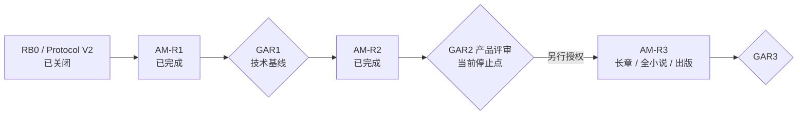

# NovelGainker 当前实施 Plan

> 状态：AM-R2 已完成并提交 GAR2 技术评审；gar2Approved=false
>
> 日期：2026-08-31
>
> 当前停止点：GAR2 独立产品评审
>
> 未授权：AM-R3、Sprint 6、真实 Provider Live Smoke

## 1. 产品目标

NovelGainker 通过与 AI 自然对话完成小说创作，并把角色、世界、素材、剧情和章节长期保存在工程中。小说 Markdown 与资源是唯一 Canon；完整可见对话、来源、Host Memory 与未来 Context Mark 保存在 `.novelgainker/agent/**`，但不属于 Canon。

已冻结的用户结果：

1. 启动时必须新建或打开工程；
2. 主界面保持三栏，中栏只显示 Conversation 与输入；
3. 新工程不强制创建角色、世界或剧情锚点；
4. 用户可先聊天、先设定或直接开始写；
5. 后续 Canon 化会把对话中形成的角色/世界/设定写入对应 Markdown；
6. 每轮 Agent 按需读取并检查已有 Canon；
7. 九项 Novelist-compatible Skill 作为统一 Agent 的完整能力包；
8. Context Mark 可由 AI 建议，但创建/修改由 Host 治理；
9. 与既有设定冲突时由用户选择解决方式；
10. 目标规模支持几十万字长篇小说。

## 2. 当前统一架构

产品只保留一条 Agent Protocol V2 运行路径：

- Conversation、Control、Content、Canon、Persistence 五层分离；
- Host 独占路径、权限、预算、History 校验、冲突门、事务和写入；
- DeepSeek/OpenAI 归一化到同一状态机，不自动跨 Provider Fallback；
- bundled Skill Pack 完整加载九项 Skill，不按关键词过滤 eligible 集合；
- Context Index 从当前 Canon 重建，返回 Hash 绑定 SourceRef；
- History/Memory 随工程保存，首次创建前展示隐私提示；
- 同步分支必须由用户显式选择，不自动合并或删除；
- Conversation Anchor、Proposal/Conflict、WritePlan/Commit/Undo 与 Context Mark 已挂载到唯一 V2 产品路径。

旧 Timeline、Provider Chat、Router、Workflow/Story 表单和 Agent V1 写入入口不再是产品路径。旧安全实现已直接合并为当前 Kernel 与回归，不作为独立 AM1/AM2 产品阶段保留。

## 3. Roadmap 与 Gate

| 阶段              | 当前状态     | 交付边界                                                                                          | 进入条件                         |
| ----------------- | ------------ | ------------------------------------------------------------------------------------------------- | -------------------------------- |
| RB0 / Protocol V2 | 已关闭       | 产品入口、五层协议、History/Memory、Context Mark 与迁移规则                                       | 已完成评审                       |
| AM-R1             | 技术完成     | 项目入口、纯 Conversation、完整 Skill Loader、Context Index、工程 History/Memory、只读 Agent Loop | 已按 Draft 2 授权完成            |
| GAR1              | 技术基线     | 28 Command、7 Agent IPC、零 Agent Canon 写入、50 万字规模与双 Provider Loopback                   | 已作为 AM-R2 上游基线             |
| AM-R2             | 技术完成     | Conversation Canon 化、Context Mark、冲突决议、WritePlan/Commit/Undo V2                           | Draft 1 已批准并完成              |
| GAR2              | 等待产品评审 | 35 Command、14 Agent IPC、120 章/54 万字、72 写入场景、单 V2 生产路径                             | 当前停止点                        |
| AM-R3             | 未授权       | 长章/全小说编排、分析修订、图片与 EPUB 闭环                                                       | GAR2 产品批准后另建并批准 Packet |
| Sprint 6          | 未授权       | 必须按统一 Agent 架构重新定义                                                                     | 后续明确授权                     |

## 4. AM-R1 完成记录

| Story   | 结果 | 核心证据                                                                       |
| ------- | ---- | ------------------------------------------------------------------------------ |
| NG-R101 | 完成 | 启动项目选择、最小 Scaffold、History 隐私同意、零 Provider/零 Canon 改动       |
| NG-R102 | 完成 | 三栏职责、纯 Conversation、工程 History/Memory、Hash Chain、损坏隔离、分支选择 |
| NG-R103 | 完成 | 九项完整 bundled Skill、36 个锁定资源、语义 Selection、无外部 Runtime 依赖     |
| NG-R104 | 完成 | Canon Context Index、SourceRef、Host-only 查询、120 章/50 万字规模门           |
| NG-R105 | 完成 | Control/Conversation 分离、累计预算、增量 Memory、阈值 Compaction、稳定终态    |
| NG-R106 | 完成 | 双 Provider Loopback、28/7 单路径切换、旧 IPC 撤权、质量入口和退役清单         |

权威 Packet：[AM-R1 Story Packet](./stories/agent-conversation-authoring-am-r1-story-packet.zh-CN.md)。

## 5. GAR1 技术结论

唯一完整 `pnpm quality` 已通过：

- Prettier、ESLint、TypeScript 与 158 个前端测试；
- 28 Command / 7 Agent IPC 静态边界；
- Skill Pack 与 Agent V2 Contract 锁；
- 全 workspace/target/feature 严格 Clippy，无 lint 例外；
- Rust workspace、Sprint 1/2、未挂载写入与 Canon Kernel 回归；
- Debug/Release 构建与主窗口 Smoke；
- NG-R101～NG-R106 证据与 GAR1 Manifest。

规模结果：120 章、540,960 中文字符、48/48 真值命中、无 Agent 元数据/未授权/项目外来源命中，热查询 p95 30.275 ms，峰值 RSS 9,498,624 bytes，Canon Hash 不变。

GAR1 最终状态：生产 Command 28、生产 Agent IPC 7、Agent Canon 写入 0、真实 Provider Live Smoke 未执行、技术提交就绪、GAR1 未批准、AM-R2/AM-R3 未授权。

## 6. AM-R2 完成记录

| Story   | 结果 | 核心证据                                                                 |
| ------- | ---- | ------------------------------------------------------------------------ |
| NG-R201 | 完成 | 普通 Conversation、Host Anchor、唯一候选确认、歧义澄清与 Hash/Branch 绑定 |
| NG-R202 | 完成 | 可见 Draft Artifact、Canon Proposal、稳定实体/路径归一与六份契约资源      |
| NG-R203 | 完成 | Context Mark 生命周期、Branch 隔离、损坏隔离与 History+Canon 重建         |
| NG-R204 | 完成 | 九类 Conflict、五种作者决议、证据展示和零写入阻断                         |
| NG-R205 | 完成 | Host WritePlanV2、三种 Policy、八文件事务、Recovery、Receipt 与 Undo      |
| NG-R206 | 完成 | 人物/世界/素材/剧情 Conversation-to-Canon 双 Provider Loopback            |
| NG-R207 | 完成 | 可见消息/选区到 Chapter Draft；Composition/Segment 调用保持 0              |
| NG-R208 | 完成 | 35/14 单路径切换、120 章/540,960 字/72 场景规模门与 GAR2 技术提交          |

权威 Packet：[AM-R2 Story Packet](./stories/agent-conversation-authoring-am-r2-story-packet.zh-CN.md)。

## 7. GAR2 技术结论

一次无中断 `pnpm quality` 已通过，包括 164 个前端测试、Rust workspace 严格 Clippy/测试、Debug/Release Build 与桌面 Smoke、全部保留回归、NG-R201～NG-R208 和 GAR2 证据生成。

GAR2 Manifest 冻结生产 Command 35、Agent IPC 14、Contract Resource 6；规模门覆盖 120 章、540,960 中文字符、48 个真值查询和 72 个写入闭环场景。双 Provider 只使用确定性 Loopback；Composition、Segment、外网、真实凭据和真实 Provider Live Smoke 均为 0。

GAR2 最终技术状态：`technicalSubmissionReady=true`、`gar2Approved=false`、`amR3Authorized=false`、`sprint6Authorized=false`。

## 8. 后续候选范围（未授权）

AM-R3 候选：Reader Mental Model、章节/场景长内容生成、跨章连续性、几十万字分层摘要与线程跟踪、分析修订、视觉资产和 EPUB 发布。

这些条目不是当前授权，也不能从本 Plan 直接开始实现。

## 9. 不可跨越的边界

- GAR2 技术通过不等于 GAR2 产品批准；
- 未经新授权不实现 AM-R3 长章/全小说 Composition、Sprint 6 或出版闭环；
- 未经独立授权不读取真实 Key、不执行真实 Provider Live Smoke；
- 不向用户提供 V1/V2 双路径或自动 Provider Fallback；
- 不弱化路径、Hash、预算、取消、事务、Undo、Canary 或双 Provider 回归；
- 不执行 Git 历史重写；不保留历史只指当前工作树、运行时和权威文档不保留旧产品层。

## 10. 下一步：GAR2 产品 Review Gate

当前只有一个动作：产品负责人独立评审 `target/qa/gar2/gar2-manifest.json` 与 `gar2-review-report.md`，确认下列产品结果：

1. 自然聊天、明确决定与写入指令可进入人物/世界/素材/剧情 Canon，探索性内容保持零写入；
2. 可见消息或选区可锚定为 Chapter Draft，中栏纯 Conversation，右栏承载 Proposal/Conflict/Diff/Undo；
3. Context Mark、九类 Conflict、三种 Write Policy、原子 Commit/Recovery/Undo 符合作者控制边界；
4. Commit 后 Context/Memory/Mark 更新，重启、同步 Branch、损坏恢复和人工修改保护通过；
5. 35/14 单路径、120 章/54 万字/72 场景、双 Provider Loopback 和完整安全回归足以接受 GAR2 技术基线。

GAR2 的合法评审结论为批准、要求修订，或单独授权真实 Provider Live Smoke。任何结论都不自动授权 AM-R3；AM-R3 必须另行形成、评审并批准 Story Packet。
