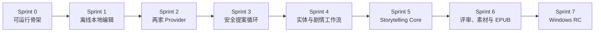

# NovelGainker 第一版 Sprint Plan

> 状态：Sprint 5 Story Packet Review Gate 已通过；NG-501 Context Builder v2 已完成技术实现并通过全量质量门，等待产品验收；NG-502 尚未授权
> 日期：2026-08-24  
> BMAD 数据包：`execution-packet`  
> 上游架构：[architecture.zh-CN.md](./architecture.zh-CN.md)（已批准）

## 1. 计划目的

本文把已批准的 NovelGainker 架构拆成第一版可执行的 Sprint 顺序。它回答四个问题：

1. 先做什么，才能最早暴露桌面打包、本地文件安全和 Provider 协议风险；
2. 每个 Sprint 结束时，用户能实际完成什么；
3. 每个 Story 的边界、依赖和验收条件是什么；
4. 什么条件满足后，第一阶段才可以交付 Windows 内部测试包。

本文定义顺序和验收门，不承诺日历日期。团队人数、每个 Sprint 的长度和可用工时尚未提供，因此工作量使用 S/M/L 相对规模，不能直接换算为天数。

## 2. 规划基线

### 2.1 已冻结范围

- 第一版只支持 Windows 11 x64。
- 技术栈为 Tauri 2、React/TypeScript 和 Rust。
- 桌面三栏界面：左栏 API、中栏对话、右栏直接编辑 Markdown。
- 左栏、右栏和 API 设置卡都可以收起。
- Local-first；无网络、无 Key 时仍可创建、打开、搜索、编辑、保存和校验项目。
- 不支持离线 AI。
- 文本 Provider 只有 DeepSeek 与 OpenAI。
- 用户只输入 API Key；Base URL、协议、模型和参数由 App 固定。
- DeepSeek 首版模型为 `deepseek-v4-pro`；OpenAI 首版模型为 `gpt-5.6-terra`。
- 禁止自动跨 Provider Fallback。
- 只有单一 Manager，不实现 Multi-agent。
- NovelGainker 使用原生 Workflow Pack 与 Rust Core，不运行 Novelist 插件或 Python Sidecar。
- AI 对 Canon 的写入必须先展示提案或 Diff，并由用户确认。
- UI 与默认写作语言为简体中文，不包含韩语专用流程。
- 不建设云同步、Android、图片生成 API 或产品内 Git 管理。

### 2.2 第一版发布成果

第一版完成后，用户应能：

1. 获取并启动 Windows 内部测试包；
2. 创建或打开一个 NovelGainker Markdown 小说项目；
3. 不连接网络，直接在右栏编辑和保存 Markdown；
4. 分别录入 DeepSeek/OpenAI API Key，并明确选择当前 Provider；
5. 在中栏通过原生小说工作流创建人物、设定、素材、剧情和章节；
6. 查看 AI 将读取的上下文、写入提案和 Diff；
7. 确认后安全写入 Canon，并完成连续性检查与 Story Ledger 更新；
8. 执行只读分析评审；
9. 生成视觉素材 Prompt、导入本地图片；
10. 构建并验证 EPUB；
11. 关闭并重新打开 App 后恢复项目、布局和非敏感运行状态。

### 2.3 明确排除

- macOS、Linux 和 Android 客户端；
- ChatGPT Plus/Pro 登录；
- Anthropic、Gemini、自定义 Endpoint 和任意 Model ID；
- 本地模型、离线推理和云端代理；
- 图片生成、自动外部分发和云同步；
- Multi-agent、Agent Handoff 和并行 Canon 写入；
- Git 初始化、Commit、Branch 或冲突管理。

## 3. 交付原则

### 3.1 垂直切片

每个 Sprint 必须留下一个可运行、可演示、可回归测试的用户路径。不得以“后端完成但 UI 不可用”或“UI 完成但数据不落盘”作为 Sprint 完成。

### 3.2 风险优先

最先验证以下高风险假设：

- Tauri Windows 打包和 Rust/React Command 边界可行；
- 用户项目目录可以被严格限制，且原子保存不会损坏手稿；
- API Key 不会进入前端状态、日志、SQLite 或项目；
- 两家 Provider 能被同一最小契约稳定驱动；
- AI 生成与 Canon 写入可以被提案、Hash、Diff 和确认彻底隔开；
- EPUB 可以只从权威 Markdown 重建。

### 3.3 用户写入和 AI 写入

- 用户在右栏直接编辑 Markdown 并按下保存，保存动作本身视为用户确认。
- AI 不能直接保存；必须先生成结构化提案，并经过单独的预览或 Diff 确认。
- 已确认：手动编辑遇到格式错误时仍允许原子保存，但显示诊断并阻止 AI Apply、Final 标记和 EPUB 发布。

## 4. Sprint 依赖图

不得跳过 Sprint Exit Gate。若前一 Sprint 的安全或恢复测试失败，后一 Sprint 不得用临时绕过方式继续写 Canon。

## 5. Sprint 总览

| Sprint | Sprint Goal | 用户可演示结果 | Exit Gate |
| --- | --- | --- | --- |
| 0 | 建立可运行、可测试的桌面骨架 | Windows 上启动中文三栏 App，并完成一次受限 Rust Command 往返 | G0 Walking Skeleton |
| 1 | 交付真正可用的离线 Markdown 编辑器 | 创建/打开项目，直接编辑、保存、重开且内容不丢失 | G1 Offline Editor |
| 2 | 安全接入 DeepSeek 与 OpenAI | 只填 Key，测试连接，显式切换并完成流式对话 | G2 Provider Ready |
| 3 | 建立 AI 到 Canon 的安全提案循环 | AI 创建人物提案，用户查看 Diff 后确认写入 | G3 Safe Apply |
| 4 | 覆盖项目实体与剧情工作流 | 创建设定、人物、素材、剧情并保持严格格式 | G4 Workflow Foundation |
| 5 | 交付核心章节写作闭环 | 写章、修订、连续性检查、确认和账本更新 | G5 Storytelling Complete |
| 6 | 补齐评审、视觉素材和 EPUB | 只读评审、导入图片、构建并验证 EPUB | G6 Feature Complete |
| 7 | 完成安全、性能与测试包验收 | 运行 Windows 内部测试包并通过完整第一版 E2E | G7 Internal Test Candidate |

## 6. Sprint 0——可运行桌面骨架

### Sprint Goal

在 Windows 11 x64 上建立最小但真实的 Tauri/React/Rust 纵向链路，为后续功能提供统一构建、测试和权限边界。

### Stories

| ID | Size | Story | 验收条件 |
| --- | --- | --- | --- |
| NG-001 | M | 建立 Tauri、React/TypeScript 与 Rust Workspace | Debug 构建可在 Windows 启动；目录符合批准架构；不包含 Python、Novelist 插件或通用 Shell |
| NG-002 | M | 实现中文三栏 Walking Skeleton | 左栏、中栏、右栏可见；左右栏和 API 卡可折叠；右栏展示可编辑 Markdown 占位视图；窗口缩窄时主对话区不被挤掉 |
| NG-003 | M | 建立带类型的 Tauri Command 边界 | React 能调用一个只读 Rust 健康检查 Command；未注册 Command 被拒绝；前端不能执行任意文件或 Shell 操作 |
| NG-004 | M | 建立质量基线 | Rust 与 TypeScript 格式化、静态检查、单元测试和桌面 Smoke Test 可由统一命令运行；失败返回非零状态 |
| NG-005 | S | 建立简体中文资源与错误模型 | 首屏、折叠控件、空状态和错误边界为简体中文；错误区分用户错误、系统错误和 Provider 错误 |

### Exit Gate G0

- Windows 开发构建可重复启动。
- 三栏状态可在一次进程内正常交互。
- Rust Command 白名单测试通过。
- 没有 API、数据库或真实项目依赖。
- 所有自动化测试从干净检出环境可运行。

## 7. Sprint 1——离线本地编辑

### Sprint Goal

在完全无网络、无 API Key 的情况下，让用户安全创建、打开、编辑和恢复一个 NovelGainker Markdown 项目。

### Stories

| ID | Size | 依赖 | Story | 验收条件 |
| --- | --- | --- | --- | --- |
| NG-101 | L | NG-003 | 实现项目创建与打开 | 用户选择目录；新项目生成原生 Scaffold 和 project.json；已有项目可扫描；冲突必须展示且不得静默覆盖 |
| NG-102 | L | NG-101 | 实现项目文件树和直接 Markdown 编辑 | 右栏列出允许目录中的文件；选择文件后直接编辑源文本；保存和未保存状态明确；默认写作语言为 zh-CN |
| NG-103 | L | NG-102 | 实现路径沙箱与原子保存 | 拒绝绝对路径、上级路径、符号链接和 Reparse Point 越界；使用同目录临时文件和原子替换；失败不破坏原文件 |
| NG-104 | L | NG-103 | 实现 Project Lock、外部修改检测与恢复日志 | 第二个窗口只读或请求转移 Lock；外部修改触发冲突提示；启动时能识别并恢复未完成事务 |
| NG-105 | M | NG-102 | 实现 Markdown/Frontmatter 校验和本地搜索 | 保存后显示结构诊断；全文搜索不联网；搜索结果只作为候选，不改变 Canon |
| NG-106 | M | NG-002 | 持久化本机 UI 偏好 | 最近项目、栏宽、折叠状态和当前文件重启后恢复；项目目录不保存设备专属绝对路径 |
| NG-107 | M | NG-101～106 | 建立离线 E2E | 禁止网络条件下完成创建、编辑、保存、关闭、重开、搜索和校验；不存在延迟排队后自动发出 AI 请求 |

### Exit Gate G1

- 离线 E2E 全部通过。
- 手稿保存失败不会导致原文件丢失或截断。
- 路径越界与并发修改负面测试通过。
- 删除 App SQLite 后，项目仍可打开和读取。
- SP-Q001 的手动格式错误保存策略已确认并固化测试。

## 8. Sprint 2——DeepSeek 与 OpenAI Provider

### Sprint Goal

以 Key-only 方式安全接入两家固定 Provider，并在中栏交付不修改 Canon 的流式对话。

### Stories

| ID | Size | 依赖 | Story | 验收条件 |
| --- | --- | --- | --- | --- |
| NG-201 | L | G1 | 扩展本机状态库并实现加密 Vault | App State 显式迁移到 v2；SQLite 只保存非敏感 Provider 状态和不透明凭据引用；真实 Key 进入 Rust CredentialVault 后面的 Windows Credential Manager；前端只取得配置/连接状态，不取得掩码、尾号或任何 Key 字符 |
| NG-202 | M | NG-201 | 实现左栏 Key-only 设置 | 只显示 DeepSeek/OpenAI Key 输入、连接测试和当前选择；不显示 Base URL、Model ID、协议或生成参数 |
| NG-203 | L | NG-201 | 实现 Provider Core 与固定 Preset v1 | 两个 Adapter 实现统一最小接口；Preset 固定已批准 URL、协议、模型和 Timeout；用户输入不能覆盖 |
| NG-204 | L | NG-203 | 实现 Mock Provider Contract Test | 覆盖认证失败脱敏、Streaming、取消、畸形结构、Rate Limit、Timeout、Usage 和有限重试 |
| NG-205 | L | NG-202～204 | 实现中栏流式对话 | 使用任一已配置 Provider 发送对话；可停止生成；显示当前 Provider、固定模型、状态和用量；不写项目文件 |
| NG-206 | M | NG-205 | 实现显式切换和禁止 Fallback | 只能在 Run 之间切换；失败不会调用另一 Provider；用户必须切换并重新发送；接收方变化清晰可见 |
| NG-207 | M | NG-201～206 | 建立密钥泄漏回归测试 | 日志、错误 UI、SQLite 导出、项目、Prompt 和测试快照中均不出现完整 Key |

### Exit Gate G2

- DeepSeek 与 OpenAI Mock Contract Test 通过。
- 使用开发者凭据分别完成一次可选 Live Smoke Test，或按 S2-Q004 明确记录一次 G2 Live Waiver。
- Key 从前端保存后不可读回。
- Provider 失败不会触发跨 Provider 请求。
- 没有 Key 或无网络时，AI 发送按钮给出明确中文状态，离线编辑不受影响。

## 9. Sprint 3——安全提案循环

### Sprint Goal

建立单 Manager、Workflow Pack、Context Manifest、Proposal Hash、Diff 和确认写入的完整安全链路，并用人物创建作为第一个端到端工作流。

### Stories

| ID | Size | 依赖 | Story | 验收条件 |
| --- | --- | --- | --- | --- |
| NG-301 | L | G1、G2 | 实现 Workflow Pack v1 注册表 | 构建时校验工作流 ID、版本、Schema、工具权限和内容 Hash；运行时不读取 Plugin Cache |
| NG-302 | L | NG-301 | 实现单 Manager 状态机和检查点 | 状态覆盖 created 到 completed/failed/cancelled/recovery_required；中断后可恢复或明确终止 |
| NG-303 | L | NG-301 | 实现 Prompt Compiler 与 Context Manifest | Prompt 顺序符合架构；项目文本标为不可信；发送前显示 Provider、模型、文件和片段来源 |
| NG-304 | XL | NG-302～303 | 实现 Proposal、Hash、Diff、确认和原子 Apply | 生成阶段不能写文件；确认绑定 Proposal/源文件 Hash；预览后文件变化会阻止 Apply；确认记录可审计且脱敏 |
| NG-305 | L | NG-304 | 交付 character-create 纵向工作流 | 用户从对话生成结构化人物提案；中文命名不使用韩语专用逻辑；查看完整新文件并确认后写入 characters/ |
| NG-306 | M | NG-302～305 | 建立取消与恢复 E2E | generating 可取消；applying 只能完成或回滚；任何失败都不会留下半写 Canon |

### Exit Gate G3

- AI 不能绕过 Manager 或直接调用写工具。
- 新文件和修改文件均有独立确认。
- 过期 Proposal Hash、过期源文件 Hash 和未注册工具测试通过。
- character-create 可分别用两家 Provider 完成，且结果进入同一原生 Schema。
- 所有确认和错误日志均不含密钥或完整手稿正文。

## 10. Sprint 4——实体与剧情工作流

### Sprint Goal

补齐章节写作前需要的项目、设定、人物、素材和剧情基础，使用户能建立结构完整的中文小说 Canon。

### Stories

| ID | Size | 依赖 | Story | 验收条件 |
| --- | --- | --- | --- | --- |
| NG-401 | M | G3 | 完善 project-create 工作流 | 项目元数据向导、目录冲突和 Scaffold 预览明确；重复执行不静默覆盖 |
| NG-402 | L | G3 | 实现 setting-create | 按 Schema 生成世界/地点/规则提案；读取范围可见；确认后写入 world/ |
| NG-403 | M | G3 | 实现 material-create | 支持主题、线索、物件和场景种子；用户决定是否成为 Canon；写入 materials/ |
| NG-404 | L | G3 | 实现 plot-create | 生成 Promise、Pressure、Turns、Reveal 和 Payoff；重要剧情写入前独立确认 |
| NG-405 | M | NG-305 | 完善 character-create | 支持关系、动机、秘密和剧情功能；重复名称或 ID 冲突必须解决 |
| NG-406 | L | NG-401～405 | 实现确定性路由和中文默认契约 | 明确按钮直接路由；含糊对话才调用 Router；低置信度让用户选择；资源中不存在韩语专用分支 |
| NG-407 | M | NG-401～406 | 建立实体工作流 Golden Test | 所有实体文件满足 Frontmatter、目录、ID、链接和不覆盖契约；两家 Provider 使用相同本地 Validator |

### Exit Gate G4

- 用户可从空项目建立人物、设定、素材和主剧情。
- 每个 AI 写入都经过 G3 的同一安全提案循环。
- Workflow Pack、Schema 与 Golden Test 一一对应。
- Provider 切换不改变项目格式。
- 简体中文默认值和无韩语专用逻辑测试通过。

## 11. Sprint 5——Storytelling Core

### Sprint Goal

交付 NovelGainker 的核心价值：从有限、可追踪的 Canon 上下文生成章节提案，安全写入、校验并更新故事状态。

### Stories

| ID | Size | 依赖 | Story | 验收条件 |
| --- | --- | --- | --- | --- |
| NG-501 | XL | G4 | 实现确定性 Context Builder | 优先级为显式 Source、Master Source、目标大纲、近期 Draft、Story Ledger、Query Match；每个片段带路径与 Hash |
| NG-502 | L | NG-501 | 实现 Context Budget 与读者认知边界 | 为输出预留预算；旧章节优先摘要；读者已知内容只来自更早章节 Draft；隐藏 Canon 明确标注 |
| NG-503 | XL | NG-501～502 | 实现 Chapter Proposal 与章节契约 | 输出章节目标、冲突、Reveal、正文和文件操作；本地严格解析失败时只允许同 Provider 修复一次 |
| NG-504 | XL | NG-503 | 实现 Continuity Checker | 检查人物、时间线、世界规则、线索、MacGuffin 和 Plot Thread；警告带证据来源 |
| NG-505 | XL | NG-304、NG-504 | 实现章节 Diff 与事务写入 | 写入 chapters/ 前确认；过期文件阻止 Apply；写后严格校验；Crash Recovery 可恢复旧文件 |
| NG-506 | L | NG-505 | 实现 Story Ledger 更新 | 只有用户接受/定稿章节后才提议更新；更新内容可预览并单独确认 |
| NG-507 | XL | NG-501～506 | 建立跨 Provider Storytelling E2E | DeepSeek 生成章节，用户确认；显式切换 OpenAI 后从 Canon 重建上下文并提出修订；无隐藏状态迁移 |

### Exit Gate G5

- 完整章节路径 NG-507 通过。
- Context Manifest 能解释所有发送内容。
- 连续性错误不会被静默忽略。
- Ledger 不会在 Token 输出结束时自动更新。
- Cancel、Hash 冲突、校验失败和 Crash Recovery 回归测试通过。

## 12. Sprint 6——评审、视觉素材与 EPUB

### Sprint Goal

补齐第一版剩余原生工作流，并从权威 Markdown 生成可验证的本地 EPUB。

### Stories

| ID | Size | 依赖 | Story | 验收条件 |
| --- | --- | --- | --- | --- |
| NG-601 | L | G5 | 实现 analytical-review | 支持范围清单、分批只读评审和证据化报告；默认不能写 Canon；修订必须另起写入工作流 |
| NG-602 | M | G4 | 实现 visual-asset Prompt 与本地导入 | 生成可复制的视觉 Prompt；不调用图片 API；用户选择本地图片、预览并确认后复制到 assets/ |
| NG-603 | M | NG-602 | 实现图片登记和资源校验 | 只保存项目相对路径；缺失图片、非法格式和越界路径有明确错误 |
| NG-604 | XL | G5 | 实现 publish 预检与暂存 | 检查章节状态、严格标记、书名、作者、语言和封面；只从 Draft 源内容构建 published/epub/ 暂存 |
| NG-605 | XL | NG-604 | 实现 EPUB 构建和验证 | 生成有效 EPUB；校验失败保留诊断；不得上传或外部分发；published/ 可从源文件重建 |
| NG-606 | L | NG-601～605 | 建立评审与出版 E2E | 只读评审不改变项目；导入封面；构建并验证 EPUB；删除生成目录后可重复构建 |

### Exit Gate G6

- 九类原生工作流均有注册表、Schema、权限和测试。
- analytical-review 默认只读。
- 没有图片生成网络请求。
- EPUB 仅由权威 Markdown 和已确认资源生成。
- 项目数据库删除后仍可重新构建 EPUB。

## 13. Sprint 7——Windows 内部测试包

### Sprint Goal

把功能完整版本加固成可运行、可诊断、不会泄密的 Windows 11 x64 内部测试包。安装器、代码签名和公开分发不属于当前里程碑。

### Stories

| ID | Size | 依赖 | Story | 验收条件 |
| --- | --- | --- | --- | --- |
| NG-701 | XL | G6 | 执行安全与隐私加固 | 完成路径穿越、Prompt Injection、未注册工具、Key 泄漏、恶意 Provider Response 和外部修改测试 |
| NG-702 | L | G6 | 执行长篇项目性能测试 | 用大项目 Fixture 测量启动、扫描、搜索、上下文构建和 Diff；形成基线与阻塞阈值 |
| NG-703 | L | G2、G6 | 完成 Provider Live Conformance 与 Preset Migration | 两个固定模型完成发布前 Smoke Test；Preset 版本迁移可回滚；模型不可用时显示升级指引且不自动换 Provider |
| NG-704 | M | G6 | 生成 Windows 内部测试包 | 在干净 Windows 11 x64 环境解压或启动测试包；不要求安装器、签名或公开分发；必须明确标注“内部测试” |
| NG-705 | L | NG-704 | 完成测试版本数据迁移验证 | 旧版 SQLite、UI 偏好和 Provider Preset 可迁移；Key 不被导出或重新显示；失败提供恢复路径 |
| NG-706 | M | G6 | 完成用户与隐私文档 | 提供首次启动、Key 来源、离线能力、数据位置、备份、恢复、导出、许可和隐私说明 |
| NG-707 | XL | NG-701～706 | 执行完整 Windows 测试包验收 | 在内部测试包上完成架构定义的十步 E2E；零 P0/P1 缺陷；所有测试证据可追踪 |

### Exit Gate G7

- 内部测试包在干净 Windows 11 x64 机器通过验收。
- 完整 E2E、离线、Provider、安全、恢复和 EPUB 测试通过。
- 没有 P0/P1 缺陷；P2 缺陷有明确接受人和后续计划。
- Provider Preset、Workflow Pack、数据库 Schema 和项目 Schema 均有版本。
- 隐私、许可、备份和密钥恢复说明完成。
- 产品负责人明确批准内部测试候选版。

## 14. 跨 Sprint 技术任务

以下任务不单独形成“基础设施 Sprint”，但必须随相关 Story 一起完成：

| 领域 | 持续要求 |
| --- | --- |
| Schema | Rust 类型与 TypeScript 类型由同一契约生成或做一致性测试 |
| 日志 | 默认不记录 Prompt、手稿正文、Response Body 或完整 Key |
| 错误 | 用户错误、网络错误、Provider 错误、校验错误和恢复错误可区分 |
| 可取消性 | 所有长任务定义可取消点；Apply 期间只能完成或回滚 |
| 可恢复性 | 每个 Canon 写入 Story 都必须包含 Crash Recovery 测试 |
| 中文体验 | 新 UI 文案默认简体中文；不得留下韩语专用分支 |
| 可访问性 | 折叠按钮、对话输入、文件树、编辑器和确认对话框支持键盘操作与可见焦点 |
| 依赖安全 | 第三方依赖进入发布前需许可和已知风险检查 |
| 范围保护 | 新 Provider、Android、云同步、图片生成和 Multi-agent 必须先有新 ADR |

## 15. Definition of Ready

Story 进入实现前必须满足：

- 用户价值和范围边界明确；
- 关联架构章节或 ADR 已标注；
- 上游依赖已完成，或有明确 Mock；
- 验收条件可自动化或有书面人工步骤；
- 涉及文件写入时，已定义路径、Hash、确认和恢复行为；
- 涉及 Provider 时，已定义错误脱敏、取消和禁止 Fallback 行为；
- 没有未决产品问题会改变 Story 的核心实现。

## 16. Definition of Done

Story 完成必须满足：

- 用户可以通过真实 UI 走通目标路径；
- Rust、TypeScript 和相关 Fixture 测试通过；
- 负面路径、取消、错误和恢复行为已验证；
- 新 Command、Schema、Workflow 或 Migration 有版本和文档；
- 不包含完整 Key、手稿日志、调试后门或通用 Shell；
- 简体中文 UI 和键盘交互可用；
- 相关架构、Sprint Plan 或用户文档已同步；
- Story 的验收证据可以在 Sprint Review 中复现。

## 17. 测试与发布门矩阵

| 测试层 | 首次建立 | 最晚完整 | 发布要求 |
| --- | --- | --- | --- |
| Rust Unit/Property Test | Sprint 0 | 持续 | 全部通过 |
| React Component Test | Sprint 0 | 持续 | 核心三栏与确认 UI 通过 |
| 文件系统安全测试 | Sprint 1 | Sprint 7 | Windows 路径负面矩阵通过 |
| 离线 E2E | Sprint 1 | Sprint 7 | 无网络完整编辑路径通过 |
| Provider Mock Contract | Sprint 2 | Sprint 7 | 两个 Adapter 全部通过 |
| Provider Live Smoke | Sprint 2 | Sprint 7 | 两个固定模型发布前通过 |
| Workflow Golden Test | Sprint 3 | Sprint 6 | 九类工作流均覆盖 |
| Canon 写入/恢复 E2E | Sprint 3 | Sprint 7 | 无半写入、过期写入或静默覆盖 |
| Storytelling E2E | Sprint 5 | Sprint 7 | 跨 Provider 路径通过 |
| EPUB Validation | Sprint 6 | Sprint 7 | 重复构建和验证通过 |
| 安全与隐私测试 | Sprint 1 起 | Sprint 7 | 零 Key 泄漏，威胁矩阵通过 |
| Windows 测试包验收 | Sprint 7 | Sprint 7 | 干净系统通过 |

## 18. 架构追踪矩阵

| 架构能力 | 主要 Sprint | 主要 Gate |
| --- | --- | --- |
| Tauri/React/Rust 与三栏 UI | 0 | G0 |
| Local-first 项目和离线 Markdown 编辑 | 1 | G1 |
| 最小、可删除、无秘密的 SQLite App State | 1 | G1 |
| Provider 状态扩展、Vault、DeepSeek/OpenAI | 2 | G2 |
| 单 Manager、Workflow Pack、提案与确认 | 3 | G3 |
| 项目实体与剧情工作流 | 4 | G4 |
| Context、章节、连续性与 Ledger | 5 | G5 |
| Analytical Review、视觉导入与 EPUB | 6 | G6 |
| 安全、性能、安装与发布 | 7 | G7 |

## 19. 主要风险与触发条件

| 风险 | 触发条件 | 处理 |
| --- | --- | --- |
| Windows Credential Manager 在测试包中不可用 | NG-201 或 NG-704 的隔离验证失败 | 阻断 AI 配置发布并诊断系统凭据后端；离线项目打开、编辑和保存仍必须可用 |
| 固定模型被厂商弃用 | Live Smoke 返回模型不存在/弃用 | 停止发布，升级 Provider Preset；不得允许任意 Model ID 或自动换厂商 |
| 原子保存破坏用户内容 | Crash/磁盘满测试不保留旧文件 | G1 阻塞，后续 Sprint 不得写 Canon |
| Context 在长篇项目中超预算 | Fixture 超过预设安全余量 | 优先摘要和缩小上下文；不得无提示截断来源 |
| EPUB 工具链不稳定 | 同一输入生成不一致或验证失败 | G6 阻塞，保留暂存目录与可复现 Fixture |
| 内部测试包被误认为正式发布 | 测试包没有明确标识或被公开分发 | 包内和界面标明“内部测试”；不提供安装器、签名或正式发布声明 |
| 原生工作流范围膨胀 | Story 引入插件兼容或上游同步 | 拒绝 Scope Change，按 NovelGainker 自有契约实现 |

## 20. Sprint Plan 决策记录

| ID | 决策 | 状态 | 规划影响 |
| --- | --- | --- | --- |
| SP-Q001 | 手动编辑产生不符合严格契约的 Markdown 时仍允许原子保存并显示错误；阻止 AI Apply、Final 和 EPUB | 已确认 | Sprint 1 按此行为实现和测试 |
| SP-Q002 | 团队人数为 1 人；Sprint 周期尚未指定 | 部分确认 | 按单一开发流顺序执行；周期只影响日历，不改变依赖顺序 |
| SP-Q003 | 当前只交付 Windows 内部测试包，暂不处理安装器、代码签名和公开分发 | 已确认 | Sprint 7 改为 Internal Test Candidate |
| SP-Q004 | 内部测试阶段不包含自动更新；正式发布时另行决策 | 已确认（测试阶段） | 测试包通过手动替换版本，仍需验证数据迁移 |

## 21. Sprint Plan Review Gate

**Review Gate 结论：通过。**

产品负责人已确认：

- SP-Q001 采用建议行为；
- 8 个 Sprint 的顺序和第一阶段 Feature Complete 边界；
- 只为 Sprint 0 编写首批 Story Packet；
- 当前目标是 Windows 内部测试包，不处理安装器、签名、公开分发或自动更新。

首批 [Sprint 0 Story Packet](./stories/sprint-0-story-packet.zh-CN.md) 只覆盖 NG-001～NG-005；Sprint 0 已通过 G0，Sprint 1 已通过 G1 并关闭；[Sprint 2 Story Packet](./stories/sprint-2-story-packet.zh-CN.md) 已完成 NG-201～NG-207 并通过 G2，G2 Live Waiver 已按 S2-Q004 记录；[Sprint 3 Story Packet](./stories/sprint-3-story-packet.zh-CN.md) 已完成 NG-301～NG-306 并通过 G3；[Sprint 4 Story Packet](./stories/sprint-4-story-packet.zh-CN.md) 已完成 NG-401～NG-407、通过 G4 并关闭。当前 [Sprint 5 Story Packet](./stories/sprint-5-story-packet.zh-CN.md) Review Gate 已通过；NG-501 Context Builder v2 已完成技术实现并通过全量质量门，等待产品验收；NG-502 尚未授权。SP-Q002 不阻塞开发，只有在需要承诺日期、分配多人任务或确定单次 Sprint 容量时才必须确认。
