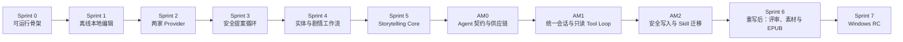

# NovelGainker 第一版 Sprint Plan

> 状态：GA0 与 GA1 已获产品批准；AM2 的 NG-A201～NG-A206 与 GA2 技术提交已通过，等待 GA2 独立产品验收；Sprint 6 未授权
> 日期：2026-08-29
> BMAD 数据包：`execution-packet`  
> 上游架构：[architecture.zh-CN.md](./architecture.zh-CN.md)（已批准）

## 1. 计划目的

本文把已批准的 NovelGainker 架构拆成第一版可执行的 Sprint 顺序。它回答四个问题：

1. 先做什么，才能最早暴露桌面打包、本地文件安全和 Provider 协议风险；
2. 每个 Sprint 结束时，用户能实际完成什么；
3. 每个 Story 的边界、依赖和验收条件是什么；
4. 什么条件满足后，第一阶段才可以交付 Windows 内部测试包。

本文定义顺序和验收门，不承诺日历日期。团队人数、每个 Sprint 的长度和可用工时尚未提供，因此工作量使用 S/M/L 相对规模，不能直接换算为天数。

## 2. 规划基线

### 2.1 已冻结范围

- 第一版只支持 Windows 11 x64。
- 技术栈为 Tauri 2、React/TypeScript 和 Rust。
- 桌面三栏界面：左栏 API、中栏统一项目 Agent Timeline、右栏直接编辑 Markdown。
- 左栏、右栏和 API 设置卡都可以收起。
- Local-first；无网络、无 Key 时仍可创建、打开、搜索、编辑、保存和校验项目。
- 不支持离线 AI。
- 文本 Provider 只有 DeepSeek 与 OpenAI。
- 用户只输入 API Key；Base URL、协议、模型和参数由 App 固定。
- DeepSeek 首版模型为 `deepseek-v4-pro`；OpenAI 首版模型为 `gpt-5.6-terra`。
- 禁止自动跨 Provider Fallback。
- 只有单一 `ProjectAgentSession`、多个 Skill 和唯一 Canon Writer，不实现 Multi-agent。
- NovelGainker 自持 Agent Host，并内置版本锁定、经许可审查的 Novelist-compatible Skill Pack；运行时不读取外部 Novelist/Codex 插件缓存、用户 `SKILL.md` 或 Python Sidecar。
- 默认授权策略为 `auto-apply-safe`；常规安全 Markdown 写入可在会话授权内执行，但每个 Turn 必须产生 Diff、事务记录和可恢复撤销。
- `review-every-write` 与 `plan-only` 可选；保护文件覆盖、整章替换、章节状态、Story Ledger、项目外导入和发布替换始终单独确认。
- UI 与默认写作语言为简体中文，不包含韩语专用流程。
- 不建设云同步、Android、图片生成 API 或产品内 Git 管理。

### 2.2 第一版发布成果

第一版完成后，用户应能：

1. 获取并启动 Windows 内部测试包；
2. 创建或打开一个 NovelGainker Markdown 小说项目；
3. 不连接网络，直接在右栏编辑和保存 Markdown；
4. 分别录入 DeepSeek/OpenAI API Key，并明确选择当前 Provider；
5. 在同一项目 Agent 会话中持续创建和维护人物、设定、素材、剧情、章节及其关联 Markdown；
6. 查看 Agent 选用的 Skill、上下文来源、工具动作和逐轮 Diff；
7. 在授权策略与高风险确认门下安全更新 Canon，并可撤销一个完整多文件 Turn；
8. 执行只读分析评审；
9. 生成视觉素材 Prompt、导入本地图片；
10. 构建并验证 EPUB；
11. 关闭并重新打开 App 后恢复项目、布局、有界会话摘要和非敏感 Turn/Skill/Tool 元数据。

### 2.3 明确排除

- macOS、Linux 和 Android 客户端；
- ChatGPT Plus/Pro 登录；
- Anthropic、Gemini、自定义 Endpoint 和任意 Model ID；
- 本地模型、离线推理和云端代理；
- 图片生成、自动外部分发和云同步；
- Multi-agent、Agent Handoff 和并行 Canon 写入；
- Git 初始化、Commit、Branch 或冲突管理。

## 3. 交付原则

### 3.1 垂直切片

每个 Sprint 必须留下一个可运行、可演示、可回归测试的用户路径。不得以“后端完成但 UI 不可用”或“UI 完成但数据不落盘”作为 Sprint 完成。

### 3.2 风险优先

最先验证以下高风险假设：

- Tauri Windows 打包和 Rust/React Command 边界可行；
- 用户项目目录可以被严格限制，且原子保存不会损坏手稿；
- API Key 不会进入前端状态、日志、SQLite 或项目；
- 两家 Provider 能被同一最小契约稳定驱动；
- 两家 Provider 能生成同一 Agent Action/Tool Loop，并由 App Policy 执行统一权限；
- 会话授权下的安全自动写入仍受路径、Schema、Hash、风险矩阵、事务、Diff 与撤销约束；
- EPUB 可以只从权威 Markdown 重建。

### 3.3 用户写入和 AI 写入

- 用户在右栏直接编辑 Markdown 并按下保存，保存动作本身视为用户确认。
- Agent 只能通过注册的受限工具写入；`auto-apply-safe` 可自动提交常规安全变更，`review-every-write` 必须先审 Diff，`plan-only` 不得提交。
- 高风险动作在任何策略下都必须绑定 Turn、Action Plan 和全部源文件 Hash 单独确认。
- 多文件 Turn 由唯一 Writer 串行事务提交；任一前置校验失败时零写入，完成后提供逐轮 Diff 与有界撤销。
- 已确认：手动编辑遇到格式错误时仍允许原子保存，但显示诊断并阻止 AI Apply、Final 标记和 EPUB 发布。

## 4. Sprint 依赖图

不得跳过 Sprint Exit Gate。若前一 Sprint 的安全或恢复测试失败，后一 Sprint 不得用临时绕过方式继续写 Canon。

## 5. Sprint 总览

| Sprint | Sprint Goal                                        | 用户可演示结果                                               | Exit Gate                  |
| ------ | -------------------------------------------------- | ------------------------------------------------------------ | -------------------------- |
| 0      | 建立可运行、可测试的桌面骨架                       | Windows 上启动中文三栏 App，并完成一次受限 Rust Command 往返 | G0 Walking Skeleton        |
| 1      | 交付真正可用的离线 Markdown 编辑器                 | 创建/打开项目，直接编辑、保存、重开且内容不丢失              | G1 Offline Editor          |
| 2      | 安全接入 DeepSeek 与 OpenAI                        | 只填 Key，测试连接，显式切换并完成流式对话                   | G2 Provider Ready          |
| 3      | 建立 AI 到 Canon 的安全提案循环                    | AI 创建人物提案，用户查看 Diff 后确认写入                    | G3 Safe Apply              |
| 4      | 覆盖项目实体与剧情工作流                           | 创建设定、人物、素材、剧情并保持严格格式                     | G4 Workflow Foundation     |
| 5      | 交付核心章节写作闭环                               | 写章、修订、连续性检查、确认和账本更新                       | G5 Storytelling Complete   |
| AM0    | 冻结 Agent 契约与 Skill Pack 供应链                | 形成可测试的 Session/Action/Tool/Turn/授权/持久化/撤销契约   | GA0 Agent Contracts        |
| AM1    | 建立统一项目会话与只读 Tool Loop                   | Agent 在同一 Timeline 内选择 Skill、读取/搜索项目并解释动作  | GA1 Read-only Agent        |
| AM2    | 交付安全写入与核心 Skill 迁移                      | 会话持续更新多份 Markdown，支持 Diff、事务、高风险确认和撤销 | GA2 Continuous Agent       |
| 6      | 暂停；GA2 后按统一 Agent 重写评审、视觉素材和 EPUB | 只读评审、导入图片、构建并验证 EPUB                          | G6 Feature Complete        |
| 7      | 完成安全、性能与测试包验收                         | 运行 Windows 内部测试包并通过完整第一版 E2E                  | G7 Internal Test Candidate |

## 6. Sprint 0——可运行桌面骨架

### Sprint Goal

在 Windows 11 x64 上建立最小但真实的 Tauri/React/Rust 纵向链路，为后续功能提供统一构建、测试和权限边界。

### Stories

| ID     | Size | Story                                          | 验收条件                                                                                                  |
| ------ | ---- | ---------------------------------------------- | --------------------------------------------------------------------------------------------------------- |
| NG-001 | M    | 建立 Tauri、React/TypeScript 与 Rust Workspace | Debug 构建可在 Windows 启动；目录符合批准架构；不包含 Python、Novelist 插件或通用 Shell                   |
| NG-002 | M    | 实现中文三栏 Walking Skeleton                  | 左栏、中栏、右栏可见；左右栏和 API 卡可折叠；右栏展示可编辑 Markdown 占位视图；窗口缩窄时主对话区不被挤掉 |
| NG-003 | M    | 建立带类型的 Tauri Command 边界                | React 能调用一个只读 Rust 健康检查 Command；未注册 Command 被拒绝；前端不能执行任意文件或 Shell 操作      |
| NG-004 | M    | 建立质量基线                                   | Rust 与 TypeScript 格式化、静态检查、单元测试和桌面 Smoke Test 可由统一命令运行；失败返回非零状态         |
| NG-005 | S    | 建立简体中文资源与错误模型                     | 首屏、折叠控件、空状态和错误边界为简体中文；错误区分用户错误、系统错误和 Provider 错误                    |

### Exit Gate G0

- Windows 开发构建可重复启动。
- 三栏状态可在一次进程内正常交互。
- Rust Command 白名单测试通过。
- 没有 API、数据库或真实项目依赖。
- 所有自动化测试从干净检出环境可运行。

## 7. Sprint 1——离线本地编辑

### Sprint Goal

在完全无网络、无 API Key 的情况下，让用户安全创建、打开、编辑和恢复一个 NovelGainker Markdown 项目。

### Stories

| ID     | Size | 依赖        | Story                                     | 验收条件                                                                                              |
| ------ | ---- | ----------- | ----------------------------------------- | ----------------------------------------------------------------------------------------------------- |
| NG-101 | L    | NG-003      | 实现项目创建与打开                        | 用户选择目录；新项目生成原生 Scaffold 和 project.json；已有项目可扫描；冲突必须展示且不得静默覆盖     |
| NG-102 | L    | NG-101      | 实现项目文件树和直接 Markdown 编辑        | 右栏列出允许目录中的文件；选择文件后直接编辑源文本；保存和未保存状态明确；默认写作语言为 zh-CN        |
| NG-103 | L    | NG-102      | 实现路径沙箱与原子保存                    | 拒绝绝对路径、上级路径、符号链接和 Reparse Point 越界；使用同目录临时文件和原子替换；失败不破坏原文件 |
| NG-104 | L    | NG-103      | 实现 Project Lock、外部修改检测与恢复日志 | 第二个窗口只读或请求转移 Lock；外部修改触发冲突提示；启动时能识别并恢复未完成事务                     |
| NG-105 | M    | NG-102      | 实现 Markdown/Frontmatter 校验和本地搜索  | 保存后显示结构诊断；全文搜索不联网；搜索结果只作为候选，不改变 Canon                                  |
| NG-106 | M    | NG-002      | 持久化本机 UI 偏好                        | 最近项目、栏宽、折叠状态和当前文件重启后恢复；项目目录不保存设备专属绝对路径                          |
| NG-107 | M    | NG-101～106 | 建立离线 E2E                              | 禁止网络条件下完成创建、编辑、保存、关闭、重开、搜索和校验；不存在延迟排队后自动发出 AI 请求          |

### Exit Gate G1

- 离线 E2E 全部通过。
- 手稿保存失败不会导致原文件丢失或截断。
- 路径越界与并发修改负面测试通过。
- 删除 App SQLite 后，项目仍可打开和读取。
- SP-Q001 的手动格式错误保存策略已确认并固化测试。

## 8. Sprint 2——DeepSeek 与 OpenAI Provider

### Sprint Goal

以 Key-only 方式安全接入两家固定 Provider，并在中栏交付不修改 Canon 的流式对话。

### Stories

| ID     | Size | 依赖        | Story                               | 验收条件                                                                                                                                                                                                   |
| ------ | ---- | ----------- | ----------------------------------- | ---------------------------------------------------------------------------------------------------------------------------------------------------------------------------------------------------------- |
| NG-201 | L    | G1          | 扩展本机状态库并实现加密 Vault      | App State 显式迁移到 v2；SQLite 只保存非敏感 Provider 状态和不透明凭据引用；真实 Key 进入 Rust CredentialVault 后面的 Windows Credential Manager；前端只取得配置/连接状态，不取得掩码、尾号或任何 Key 字符 |
| NG-202 | M    | NG-201      | 实现左栏 Key-only 设置              | 只显示 DeepSeek/OpenAI Key 输入、连接测试和当前选择；不显示 Base URL、Model ID、协议或生成参数                                                                                                             |
| NG-203 | L    | NG-201      | 实现 Provider Core 与固定 Preset v1 | 两个 Adapter 实现统一最小接口；Preset 固定已批准 URL、协议、模型和 Timeout；用户输入不能覆盖                                                                                                               |
| NG-204 | L    | NG-203      | 实现 Mock Provider Contract Test    | 覆盖认证失败脱敏、Streaming、取消、畸形结构、Rate Limit、Timeout、Usage 和有限重试                                                                                                                         |
| NG-205 | L    | NG-202～204 | 实现中栏流式对话                    | 使用任一已配置 Provider 发送对话；可停止生成；显示当前 Provider、固定模型、状态和用量；不写项目文件                                                                                                        |
| NG-206 | M    | NG-205      | 实现显式切换和禁止 Fallback         | 只能在 Run 之间切换；失败不会调用另一 Provider；用户必须切换并重新发送；接收方变化清晰可见                                                                                                                 |
| NG-207 | M    | NG-201～206 | 建立密钥泄漏回归测试                | 日志、错误 UI、SQLite 导出、项目、Prompt 和测试快照中均不出现完整 Key                                                                                                                                      |

### Exit Gate G2

- DeepSeek 与 OpenAI Mock Contract Test 通过。
- 使用开发者凭据分别完成一次可选 Live Smoke Test，或按 S2-Q004 明确记录一次 G2 Live Waiver。
- Key 从前端保存后不可读回。
- Provider 失败不会触发跨 Provider 请求。
- 没有 Key 或无网络时，AI 发送按钮给出明确中文状态，离线编辑不受影响。

## 9. Sprint 3——安全提案循环

### Sprint Goal

建立单 Manager、Workflow Pack、Context Manifest、Proposal Hash、Diff 和确认写入的完整安全链路，并用人物创建作为第一个端到端工作流。

### Stories

| ID     | Size | 依赖        | Story                                       | 验收条件                                                                                            |
| ------ | ---- | ----------- | ------------------------------------------- | --------------------------------------------------------------------------------------------------- |
| NG-301 | L    | G1、G2      | 实现 Workflow Pack v1 注册表                | 构建时校验工作流 ID、版本、Schema、工具权限和内容 Hash；运行时不读取 Plugin Cache                   |
| NG-302 | L    | NG-301      | 实现单 Manager 状态机和检查点               | 状态覆盖 created 到 completed/failed/cancelled/recovery_required；中断后可恢复或明确终止            |
| NG-303 | L    | NG-301      | 实现 Prompt Compiler 与 Context Manifest    | Prompt 顺序符合架构；项目文本标为不可信；发送前显示 Provider、模型、文件和片段来源                  |
| NG-304 | XL   | NG-302～303 | 实现 Proposal、Hash、Diff、确认和原子 Apply | 生成阶段不能写文件；确认绑定 Proposal/源文件 Hash；预览后文件变化会阻止 Apply；确认记录可审计且脱敏 |
| NG-305 | L    | NG-304      | 交付 character-create 纵向工作流            | 用户从对话生成结构化人物提案；中文命名不使用韩语专用逻辑；查看完整新文件并确认后写入 characters/    |
| NG-306 | M    | NG-302～305 | 建立取消与恢复 E2E                          | generating 可取消；applying 只能完成或回滚；任何失败都不会留下半写 Canon                            |

### Exit Gate G3

- AI 不能绕过 Manager 或直接调用写工具。
- 新文件和修改文件均有独立确认。
- 过期 Proposal Hash、过期源文件 Hash 和未注册工具测试通过。
- character-create 可分别用两家 Provider 完成，且结果进入同一原生 Schema。
- 所有确认和错误日志均不含密钥或完整手稿正文。

## 10. Sprint 4——实体与剧情工作流

### Sprint Goal

补齐章节写作前需要的项目、设定、人物、素材和剧情基础，使用户能建立结构完整的中文小说 Canon。

### Stories

| ID     | Size | 依赖        | Story                        | 验收条件                                                                                       |
| ------ | ---- | ----------- | ---------------------------- | ---------------------------------------------------------------------------------------------- |
| NG-401 | M    | G3          | 完善 project-create 工作流   | 项目元数据向导、目录冲突和 Scaffold 预览明确；重复执行不静默覆盖                               |
| NG-402 | L    | G3          | 实现 setting-create          | 按 Schema 生成世界/地点/规则提案；读取范围可见；确认后写入 world/                              |
| NG-403 | M    | G3          | 实现 material-create         | 支持主题、线索、物件和场景种子；用户决定是否成为 Canon；写入 materials/                        |
| NG-404 | L    | G3          | 实现 plot-create             | 生成 Promise、Pressure、Turns、Reveal 和 Payoff；重要剧情写入前独立确认                        |
| NG-405 | M    | NG-305      | 完善 character-create        | 支持关系、动机、秘密和剧情功能；重复名称或 ID 冲突必须解决                                     |
| NG-406 | L    | NG-401～405 | 实现确定性路由和中文默认契约 | 明确按钮直接路由；含糊对话才调用 Router；低置信度让用户选择；资源中不存在韩语专用分支          |
| NG-407 | M    | NG-401～406 | 建立实体工作流 Golden Test   | 所有实体文件满足 Frontmatter、目录、ID、链接和不覆盖契约；两家 Provider 使用相同本地 Validator |

### Exit Gate G4

- 用户可从空项目建立人物、设定、素材和主剧情。
- 每个 AI 写入都经过 G3 的同一安全提案循环。
- Workflow Pack、Schema 与 Golden Test 一一对应。
- Provider 切换不改变项目格式。
- 简体中文默认值和无韩语专用逻辑测试通过。

## 11. Sprint 5——Storytelling Core

### Sprint Goal

交付 NovelGainker 的核心价值：从有限、可追踪的 Canon 上下文生成章节提案，安全写入、校验并更新故事状态。

### Stories

| ID     | Size | 依赖           | Story                              | 验收条件                                                                                                   |
| ------ | ---- | -------------- | ---------------------------------- | ---------------------------------------------------------------------------------------------------------- |
| NG-501 | XL   | G4             | 实现确定性 Context Builder         | 优先级为显式 Source、Master Source、目标大纲、近期 Draft、Story Ledger、Query Match；每个片段带路径与 Hash |
| NG-502 | L    | NG-501         | 实现 Context Budget 与读者认知边界 | 为输出预留预算；旧章节优先摘要；读者已知内容只来自更早章节 Draft；隐藏 Canon 明确标注                      |
| NG-503 | XL   | NG-501～502    | 实现 Chapter Proposal 与章节契约   | 输出章节目标、冲突、Reveal、正文和文件操作；本地严格解析失败时只允许同 Provider 修复一次                   |
| NG-504 | XL   | NG-503         | 实现 Continuity Checker            | 检查人物、时间线、世界规则、线索、MacGuffin 和 Plot Thread；警告带证据来源                                 |
| NG-505 | XL   | NG-304、NG-504 | 实现章节 Diff 与事务写入           | 写入 chapters/ 前确认；过期文件阻止 Apply；写后严格校验；Crash Recovery 可恢复旧文件                       |
| NG-506 | L    | NG-505         | 实现 Story Ledger 更新             | 只有用户接受/定稿章节后才提议更新；更新内容可预览并单独确认                                                |
| NG-507 | XL   | NG-501～506    | 建立跨 Provider Storytelling E2E   | DeepSeek 生成章节，用户确认；显式切换 OpenAI 后从 Canon 重建上下文并提出修订；无隐藏状态迁移               |

### Exit Gate G5

- 完整章节路径 NG-507 通过。
- Context Manifest 能解释所有发送内容。
- 连续性错误不会被静默忽略。
- Ledger 不会在 Token 输出结束时自动更新。
- Cancel、Hash 冲突、校验失败和 Crash Recovery 回归测试通过。

## 12. Agent Migration Program——统一 Novelist Agent 会话

> 状态：AM0/GA0 与 AM1/GA1 已关闭；AM2 的 NG-A201～NG-A206、完整质量门与 GA2 技术提交已通过，等待 GA2 独立产品验收。

该 Program 在 G5 已实现基线与 Sprint 6 之间建立迁移门。迁移过程中保留现有 Manager、Workflow、Provider、Validator、事务和恢复能力作为 as-built 输入；只有对应 Story Packet 明确列入的模块才可修改或移除。

### 12.1 AM0——Agent 契约与 Skill Pack 供应链

#### Sprint Goal

在不改变 release 运行时行为的前提下，冻结统一 Agent Host 的边界、数据契约、供应链、授权矩阵和测试门，为后续实现提供可审查输入。

#### 候选 Stories

| ID      | Size | 依赖             | Story                                        | 验收条件                                                                                                              |
| ------- | ---- | ---------------- | -------------------------------------------- | --------------------------------------------------------------------------------------------------------------------- |
| NG-A001 | L    | G5               | 冻结 Novelist-compatible Skill Pack 供应链   | 明确九项 Skill、固定版本、来源、许可、内容 Hash、Manifest、模板/参考资料边界和升级 Gate；禁止运行时读取外部插件缓存   |
| NG-A002 | L    | NG-A001          | 定义 `ProjectAgentSession` 与 Turn 契约      | 定义状态机、唯一 Writer、Turn 上限、取消、失败、恢复、Provider/Pack 冻结和项目隔离                                    |
| NG-A003 | XL   | NG-A002          | 定义 Agent Action、Tool 与 Provider 适配契约 | 原生 Tool Calling 和严格 JSON 降级映射到同一 Action Schema；工具权限、结果回传、修复与停止条件可测试                  |
| NG-A004 | L    | NG-A002～NG-A003 | 冻结授权、持久化、事务与撤销契约             | `plan-only`、`review-every-write`、`auto-apply-safe`、高风险矩阵、多文件 Hash、零写入前置校验、有界摘要和撤销规则闭环 |

NG-A001 技术记录：已固定公开上游 commit `64e4a2e1473ff0bad5893eff394ccbf1fa1cd580`，形成九项未激活 Skill、37 个 Pack 资源和 Pack Hash `0ad3906792d9f2afcfab5f9e4206cd1285aeed07a640599dea4c1928fc57ba72`。构建期来源、许可、清单、资源 Hash、未知文件、符号链接和可执行文件门禁以及完整 `pnpm quality` 均已通过；产品验收于 2026-08-28 通过，当前只授权实施 NG-A002。

NG-A002 技术记录：已冻结 `ProjectAgentSessionV1`、`AgentTurnV1`、`ProjectAgentBasePolicyV1`、预算、取消、恢复、唯一活动 Turn 与唯一 Writer 契约；对应 JSON Schema、TypeScript 镜像和三份 Fixture 共 5 个受锁资源，Contract Set Hash 为 `3cbbc2bb99ccab33299880249b0f72a24acc84e2eb051ad99416864374f03ef8`。11 个状态的 121 个转换对中固定 23 个合法、98 个拒绝；完整 `pnpm quality` 已通过。产品验收于 2026-08-28 通过，当前只授权实施 NG-A003。

NG-A003 技术记录：已冻结严格的 Agent Action/Tool Schema、应用注入的权限绑定、稳定错误码、Action Hash Chain、Tool Result 不可信边界和 Turn Budget；OpenAI 原生 Tool Calling、DeepSeek 原生 Tool Calling 与严格 JSON 降级的规范化 Action Hash 一致。独立 Contract Set 含 10 个受锁资源，Hash 为 `d4015ded6735e1a1612d02b411e7d4e51c4ffd08347a3cfe9a0013e7a9b6856c`；8 类负向案例全部拒绝，`novelgainker-agent` 共 20 项测试通过。完整 `pnpm quality` 以退出码 0 通过，真实 Provider 请求和项目读写均为 0，NG-A001 与 NG-A002 Hash 不变。产品验收于 2026-08-28 通过，当前只授权实施 NG-A004。

NG-A004 技术记录：已冻结三档授权策略、四级风险矩阵、21 类 Action、保护对象、混合风险零部分写规则、哈希绑定一次性确认、多文件事务前置校验、有界 Session 持久化和受 Windows 用户上下文保护的 Undo 契约。初版独立 Contract Set Hash 为 `51e5d2d0ee5efcfa30ade05240c8b334574ea652d8d5fe8c3aa9cda44e7b3015b`，产品验收于 2026-08-28 通过；GA0 首轮审查随后发现 `GA0-R001`～`GA0-R003`。产品负责人明确授权仅修复这三项并重新提交 Gate。修订后，写工具风险改为由 Tool Request、Project/Session/Turn、目标路径和已验证变更形态生成并绑定事务的分类结果，且普通实体创建与 Draft 章节创建必须由不同的已验证形态证明；8 个敏感 Canary 由真实 Rust 拒绝器逐项执行；零 Undo 预算被拒绝，`auto-apply-safe` 必须绑定非空、Ready、同事务且目标 Hash 完整匹配的 Undo Record。最终 10 个受锁资源 Hash 为 `a60b41ee0d16be3e035509076c7bdf110a506fb5d8c8203f1b0f948b72450f38`，`novelgainker-agent` 共 31 项测试通过，完整 `pnpm quality` 以退出码 0 通过。App State 仍为 v8，Tauri Command 仍为 51，新增 IPC、Migration、Capability、UI 入口、真实 Provider 请求和项目读写均为 0。三项阻断均已关闭，GA0 技术复审通过；产品负责人于 2026-08-28 明确批准 GA0，并统一授权完整 AM1。

#### Exit Gate GA0

- Skill Pack 来源、许可、版本、Hash、Manifest 和升级 Gate 已审查；
- Session、Action、Tool、Turn、授权、持久化、事务与撤销契约无阻断问题；
- DeepSeek/OpenAI 的公共 Agent 协议和降级边界已冻结；
- GA0 原始边界只允许进入 AM1 Story Packet 评审；产品负责人随后以新的明确授权覆盖该等待点，批准完整 AM1 连续实施。

当前 Gate 状态：**通过**（2026-08-28）。

### 12.2 AM1——统一会话与只读 Tool Loop

#### Sprint Goal

把普通聊天和独立 Router 迁移为一个持续的项目 Agent Timeline，先证明 Agent 能在不写 Canon 的前提下选择 Skill、读取/搜索项目、循环使用工具并恢复有界会话。

执行授权：产品负责人已批准 [AM1 Story Packet](./stories/agent-migration-am1-story-packet.zh-CN.md) 的推荐决策、Review Gate、NG-A101～NG-A104 顺序实施与 GA1 技术提交。各 Story 仍须满足依赖与质量门，但无需逐 Story 再等待授权。

技术结果：NG-A101～NG-A104 已按顺序完成。当前构建使用一个统一 Agent Timeline、9 项内置 Skill、4 个受限只读项目工具、0 个 Agent 写工具、App State v9 与 56 条 Tauri Command；DeepSeek/OpenAI 共用严格 Action Schema，项目写入数固定为 0。完整 `pnpm quality`、Debug/Release 构建、桌面 Smoke 与 G1～G5 回归均通过，GA1 Manifest 保持 `ga1Approved=false`。

#### 候选 Stories

| ID      | Size | 依赖          | Story                                     | 验收条件                                                                                                       |
| ------- | ---- | ------------- | ----------------------------------------- | -------------------------------------------------------------------------------------------------------------- |
| NG-A101 | XL   | GA0           | 建立统一 Agent Timeline 与 Session 控制面 | 中栏不再区分普通聊天/工作流入口；显示 Provider、Skill、Turn、工具、来源、取消和错误；离线输入不排队            |
| NG-A102 | XL   | NG-A101       | 实现受限只读项目工具                      | list/read/search/validate 只接受 Project ID 与项目相对路径；路径、大小、数量、超时和脱敏规则可测试             |
| NG-A103 | XL   | NG-A102       | 实现会话内 Skill Router 与 Tool Loop      | 单 Turn 可选择一个或多个 Skill 并串行调用工具；未注册动作、Prompt Injection、循环上限和 Provider 异常安全停止  |
| NG-A104 | L    | NG-A101～A103 | 实现有界会话恢复与双 Provider 契约        | 只保存摘要、消息索引和 Turn/Skill/Tool 元数据；DeepSeek/OpenAI 都从 Canon 和可见状态重建上下文，无隐藏状态迁移 |

#### Exit Gate GA1

- 同一 Timeline 可完成至少人物、设定、剧情和叙事意图的 Skill 选择与只读项目检查；
- 所有 Agent 工具调用可见、可取消、可追踪，项目写入数固定为 0；
- 重启和显式切换 Provider 后可从 Canon 与有界会话状态继续；
- GA1 通过后才可送审 AM2 Story Packet。

当前 Gate 状态：**通过并关闭**（2026-08-28）。产品负责人已明确批准 GA1，并统一授权完整 AM2。

### 12.3 AM2——安全写入与核心 Skill 迁移

#### Sprint Goal

在 App Policy 与 Rust 确定性工具边界内，让同一 Agent 会话持续更新多份项目 Markdown，并提供逐轮 Diff、多文件事务、高风险确认与安全撤销。

执行授权：产品负责人已批准 [AM2 Story Packet](./stories/agent-migration-am2-story-packet.zh-CN.md) 的推荐决策、Review Gate、NG-A201～NG-A206 顺序实施、完整质量门与 GA2 技术提交。授权止于 GA2 技术提交，不自动批准 GA2 或 Sprint 6。

技术结果：NG-A201～NG-A206 已按顺序完成。当前构建使用一个统一 Agent Timeline、9 项内置 Skill、4 个读取工具、2 个受治理写工具、三种授权策略、最多八文件原子事务、Hash 绑定确认和 Windows 当前用户 DPAPI Undo；App State 为 v10，Tauri Command 为 60 条，其中 Agent IPC 为 9 条。完整聊天与 Pending 写入正文均不持久化，旧 Conversation/Router/表单入口不可达。GA2-R001 已修复孤儿 `Generating` 通道占用与失败输入丢失；GA2-R002 消除原项目恢复死锁；GA2-R003 按产品授权把遗留 `RecoveryRequired` 保留为不阻塞、不展示、不自动删除且零 Canon 写入的惰性兼容历史；GA2-R004 向 JSON-object Provider 明示精确 `AgentActionPayloadV1` 字段形状，并确保异步失败、稳定错误代码与原输入不会被 Session Reload 吞掉。revision 5 完整质量门与 GA2 技术提交均已通过，产品批准仍为独立决定。

#### 候选 Stories

| ID      | Size | 依赖          | Story                                             | 验收条件                                                                                              |
| ------- | ---- | ------------- | ------------------------------------------------- | ----------------------------------------------------------------------------------------------------- |
| NG-A201 | XL   | GA1           | 实现受限 Markdown create/patch/validate/diff 工具 | 仅允许项目内受支持目录；模型不能提供绝对路径或任意文件操作；写入结果严格校验                          |
| NG-A202 | XL   | NG-A201       | 实现多文件 Turn 事务与撤销                        | 提交前冻结全部源/目标 Hash；前置失败零写入；提交故障可恢复；撤销不覆盖后续人工修改                    |
| NG-A203 | XL   | NG-A201～A202 | 实现三种授权策略与高风险门                        | 默认 `auto-apply-safe`；常规安全写入自动提交并显示 Diff；高风险矩阵始终单独确认                       |
| NG-A204 | XL   | NG-A203       | 迁移项目、人物、设定、素材与剧情 Skill            | 聊天内容连续路由到对应 Skill；可在一个 Turn 内安全更新关联 Markdown；现有 Schema/Validator 回归不退化 |
| NG-A205 | XL   | NG-A203～A204 | 迁移 Storytelling、连续性与状态/Ledger Skill      | 写章、修订、连续性检查和下一章衔接进入同一会话；整章、状态与 Ledger 风险门保持独立                    |
| NG-A206 | XL   | NG-A201～A205 | 建立双 Provider Agent E2E 并退役旧入口            | DeepSeek/OpenAI 共享完整路径；旧普通聊天、独立 Router/表单只在替代路径全部通过后移除                  |

#### Exit Gate GA2

- 用户可用自然语言在同一项目会话中持续创建或更新人物、设定、素材、剧情与章节；
- 多 Skill、多文件 Turn 在两家 Provider 下都满足路径、Schema、Hash、事务、Diff、确认和撤销契约；
- 旧入口移除没有破坏离线编辑、Provider、G3～G5 Canon 格式或恢复能力；
- GA2 通过并获产品批准后，才可重写并重新送审 Sprint 6 Story Packet。

当前 Gate 状态：**技术审查通过，等待产品批准**（2026-08-29）。GA2 Manifest 保持 `ga2Approved=false`、`sprint6Authorized=false`；在产品负责人明确批准 GA2 前，不得重写、送审或实施 Sprint 6。

## 13. Sprint 6——评审、视觉素材与 EPUB

> 状态：已暂停。现有 S6-Q001～Q007 与 NG-601～NG-606 不再进入授权流程；GA2 通过后必须按统一 Agent/Skill 架构重写本节和 Story Packet。

### Sprint Goal

在统一项目 Agent 会话中补齐第一版剩余 Skill，并从权威 Markdown 生成可验证的本地 EPUB。本节 Story 仅保留为暂停前规划基线，不构成当前授权。

### Stories

| ID     | Size | 依赖        | Story                               | 验收条件                                                                                   |
| ------ | ---- | ----------- | ----------------------------------- | ------------------------------------------------------------------------------------------ |
| NG-601 | L    | G5          | 实现 analytical-review              | 支持范围清单、分批只读评审和证据化报告；默认不能写 Canon；修订必须另起写入工作流           |
| NG-602 | M    | G4          | 实现 visual-asset Prompt 与本地导入 | 生成可复制的视觉 Prompt；不调用图片 API；用户选择本地图片、预览并确认后复制到 assets/      |
| NG-603 | M    | NG-602      | 实现图片登记和资源校验              | 只保存项目相对路径；缺失图片、非法格式和越界路径有明确错误                                 |
| NG-604 | XL   | G5          | 实现 publish 预检与暂存             | 检查章节状态、严格标记、书名、作者、语言和封面；只从 Draft 源内容构建 published/epub/ 暂存 |
| NG-605 | XL   | NG-604      | 实现 EPUB 构建和验证                | 生成有效 EPUB；校验失败保留诊断；不得上传或外部分发；published/ 可从源文件重建             |
| NG-606 | L    | NG-601～605 | 建立评审与出版 E2E                  | 只读评审不改变项目；导入封面；构建并验证 EPUB；删除生成目录后可重复构建                    |

### Exit Gate G6

- 九类原生工作流均有注册表、Schema、权限和测试。
- analytical-review 默认只读。
- 没有图片生成网络请求。
- EPUB 仅由权威 Markdown 和已确认资源生成。
- 项目数据库删除后仍可重新构建 EPUB。

## 14. Sprint 7——Windows 内部测试包

### Sprint Goal

把功能完整版本加固成可运行、可诊断、不会泄密的 Windows 11 x64 内部测试包。安装器、代码签名和公开分发不属于当前里程碑。

### Stories

| ID     | Size | 依赖        | Story                                              | 验收条件                                                                                              |
| ------ | ---- | ----------- | -------------------------------------------------- | ----------------------------------------------------------------------------------------------------- |
| NG-701 | XL   | G6          | 执行安全与隐私加固                                 | 完成路径穿越、Prompt Injection、未注册工具、Key 泄漏、恶意 Provider Response 和外部修改测试           |
| NG-702 | L    | G6          | 执行长篇项目性能测试                               | 用大项目 Fixture 测量启动、扫描、搜索、上下文构建和 Diff；形成基线与阻塞阈值                          |
| NG-703 | L    | G2、G6      | 完成 Provider Live Conformance 与 Preset Migration | 两个固定模型完成发布前 Smoke Test；Preset 版本迁移可回滚；模型不可用时显示升级指引且不自动换 Provider |
| NG-704 | M    | G6          | 生成 Windows 内部测试包                            | 在干净 Windows 11 x64 环境解压或启动测试包；不要求安装器、签名或公开分发；必须明确标注“内部测试”      |
| NG-705 | L    | NG-704      | 完成测试版本数据迁移验证                           | 旧版 SQLite、UI 偏好和 Provider Preset 可迁移；Key 不被导出或重新显示；失败提供恢复路径               |
| NG-706 | M    | G6          | 完成用户与隐私文档                                 | 提供首次启动、Key 来源、离线能力、数据位置、备份、恢复、导出、许可和隐私说明                          |
| NG-707 | XL   | NG-701～706 | 执行完整 Windows 测试包验收                        | 在内部测试包上完成架构定义的十步 E2E；零 P0/P1 缺陷；所有测试证据可追踪                               |

### Exit Gate G7

- 内部测试包在干净 Windows 11 x64 机器通过验收。
- 完整 E2E、离线、Provider、安全、恢复和 EPUB 测试通过。
- 没有 P0/P1 缺陷；P2 缺陷有明确接受人和后续计划。
- Provider Preset、Skill Pack、数据库 Schema 和项目 Schema 均有版本。
- 隐私、许可、备份和密钥恢复说明完成。
- 产品负责人明确批准内部测试候选版。

## 15. 跨 Sprint 技术任务

以下任务不单独形成“基础设施 Sprint”，但必须随相关 Story 一起完成：

| 领域     | 持续要求                                                                             |
| -------- | ------------------------------------------------------------------------------------ |
| Schema   | Rust 类型、TypeScript 类型与 Agent Action/Tool/Turn 契约由同一来源生成或做一致性测试 |
| 日志     | 默认不记录 Prompt、手稿正文、Response Body 或完整 Key                                |
| 错误     | 用户错误、网络错误、Provider 错误、校验错误和恢复错误可区分                          |
| 可取消性 | 所有长任务定义可取消点；Apply 期间只能完成或回滚                                     |
| 可恢复性 | 每个 Canon 写入 Story 都必须包含多文件零写入前置校验、Crash Recovery 与撤销冲突测试  |
| 中文体验 | 新 UI 文案默认简体中文；不得留下韩语专用分支                                         |
| 可访问性 | 折叠按钮、对话输入、文件树、编辑器和确认对话框支持键盘操作与可见焦点                 |
| 依赖安全 | 第三方依赖及 Skill Pack 资料进入发布前需来源、许可、Hash 和已知风险检查              |
| 范围保护 | 新 Provider、Android、云同步、图片生成和 Multi-agent 必须先有新 ADR                  |

## 16. Definition of Ready

Story 进入实现前必须满足：

- 用户价值和范围边界明确；
- 关联架构章节或 ADR 已标注；
- 上游依赖已完成，或有明确 Mock；
- 验收条件可自动化或有书面人工步骤；
- 涉及文件写入时，已定义路径、Schema、Hash、风险等级、授权策略、事务、Diff、恢复和撤销行为；
- 涉及 Provider 时，已定义错误脱敏、取消和禁止 Fallback 行为；
- 涉及 Skill 时，已定义固定版本、允许工具、上下文边界、输出契约、Fixture 和升级影响；
- 没有未决产品问题会改变 Story 的核心实现。

## 17. Definition of Done

Story 完成必须满足：

- 用户可以通过真实 UI 走通目标路径；
- Rust、TypeScript 和相关 Fixture 测试通过；
- 负面路径、取消、错误和恢复行为已验证；
- 新 Command、Schema、Skill、Agent Tool 或 Migration 有版本和文档；
- 不包含完整 Key、手稿日志、调试后门或通用 Shell；
- 简体中文 UI 和键盘交互可用；
- 相关架构、Sprint Plan 或用户文档已同步；
- Story 的验收证据可以在 Sprint Review 中复现。

## 18. 测试与发布门矩阵

| 测试层                         | 首次建立       | 最晚完整 | 发布要求                                                                       |
| ------------------------------ | -------------- | -------- | ------------------------------------------------------------------------------ |
| Rust Unit/Property Test        | Sprint 0       | 持续     | 全部通过                                                                       |
| React Component Test           | Sprint 0       | 持续     | 核心三栏、Agent Timeline、Diff/撤销与高风险确认 UI 通过                        |
| 文件系统安全测试               | Sprint 1       | Sprint 7 | Windows 路径负面矩阵通过                                                       |
| 离线 E2E                       | Sprint 1       | Sprint 7 | 无网络完整编辑路径通过                                                         |
| Provider Mock Contract         | Sprint 2       | Sprint 7 | 两个 Adapter 全部通过                                                          |
| Provider Live Smoke            | Sprint 2       | Sprint 7 | 两个固定模型发布前通过                                                         |
| as-built Workflow Golden Test  | Sprint 3       | AM2      | G3～G5 基线在迁移完成前持续通过                                                |
| Skill Pack/Agent Contract Test | AM0            | Sprint 7 | 九项 Skill 的来源、许可、Manifest、Schema、工具权限和 Provider Action 契约通过 |
| 只读 Agent Tool Loop E2E       | AM1            | Sprint 7 | 双 Provider Skill 路由、读/搜工具、取消、恢复和零写入通过                      |
| Canon 写入/恢复/撤销 E2E       | Sprint 3       | Sprint 7 | 无半写入、过期写入、静默覆盖或撤销覆盖后续修改                                 |
| Agent Storytelling E2E         | Sprint 5 / AM2 | Sprint 7 | 跨 Provider、连续会话、多文件 Turn 和高风险门路径通过                          |
| EPUB Validation                | Sprint 6       | Sprint 7 | 重复构建和验证通过                                                             |
| 安全与隐私测试                 | Sprint 1 起    | Sprint 7 | 零 Key 泄漏，威胁矩阵通过                                                      |
| Windows 测试包验收             | Sprint 7       | Sprint 7 | 干净系统通过                                                                   |

## 19. 架构追踪矩阵

| 架构能力                                             | 主要 Sprint | 主要 Gate |
| ---------------------------------------------------- | ----------- | --------- |
| Tauri/React/Rust 与三栏 UI                           | 0           | G0        |
| Local-first 项目和离线 Markdown 编辑                 | 1           | G1        |
| 最小、可删除、无秘密的 SQLite App State              | 1           | G1        |
| Provider 状态扩展、Vault、DeepSeek/OpenAI            | 2           | G2        |
| as-built Manager、Workflow Pack、提案与确认          | 3           | G3        |
| as-built 项目实体与剧情工作流                        | 4           | G4        |
| as-built Context、章节、连续性与 Ledger              | 5           | G5        |
| Skill Pack 供应链、Session/Action/Tool/Turn 契约     | AM0         | GA0       |
| 统一 Agent Timeline、Skill Router 与只读 Tool Loop   | AM1         | GA1       |
| 安全自动写入、多文件事务、Diff/撤销与核心 Skill 迁移 | AM2         | GA2       |
| Analytical Review、视觉导入与 EPUB                   | 6           | G6        |
| 安全、性能、安装与发布                               | 7           | G7        |

## 20. 主要风险与触发条件

| 风险                                        | 触发条件                                        | 处理                                                                           |
| ------------------------------------------- | ----------------------------------------------- | ------------------------------------------------------------------------------ |
| Windows Credential Manager 在测试包中不可用 | NG-201 或 NG-704 的隔离验证失败                 | 阻断 AI 配置发布并诊断系统凭据后端；离线项目打开、编辑和保存仍必须可用         |
| 固定模型被厂商弃用                          | Live Smoke 返回模型不存在/弃用                  | 停止发布，升级 Provider Preset；不得允许任意 Model ID 或自动换厂商             |
| 原子保存破坏用户内容                        | Crash/磁盘满测试不保留旧文件                    | G1 阻塞，后续 Sprint 不得写 Canon                                              |
| Context 在长篇项目中超预算                  | Fixture 超过预设安全余量                        | 优先摘要和缩小上下文；不得无提示截断来源                                       |
| EPUB 工具链不稳定                           | 同一输入生成不一致或验证失败                    | G6 阻塞，保留暂存目录与可复现 Fixture                                          |
| 内部测试包被误认为正式发布                  | 测试包没有明确标识或被公开分发                  | 包内和界面标明“内部测试”；不提供安装器、签名或正式发布声明                     |
| Skill Pack 来源、许可或兼容语义不清         | NG-A001 无法给出固定来源、许可和 Golden 行为    | GA0 阻塞；不把外部插件缓存或未审查资料带入发行包                               |
| Agent Action 在两家 Provider 间不等价       | 同一 Fixture 产生越权、不可解析或无限 Tool Loop | GA0/GA1 阻塞；收窄公共协议、限制轮次并使用同一 Rust Policy                     |
| 会话授权下写入范围过宽                      | Agent 修改未计划文件、保护文件或过多文件        | GA2 阻塞；风险矩阵、Turn 上限、全量 Hash、唯一 Writer、Diff 与撤销必须同时通过 |
| 迁移过早删除旧路径                          | 统一 Agent E2E 尚未通过却移除 G3～G5 能力       | 保留兼容层，只有 NG-A206 与 GA2 明确证明替代路径后才可移除                     |

## 21. Sprint Plan 决策记录

| ID      | 决策                                                                                           | 状态                 | 规划影响                                                                         |
| ------- | ---------------------------------------------------------------------------------------------- | -------------------- | -------------------------------------------------------------------------------- |
| SP-Q001 | 手动编辑产生不符合严格契约的 Markdown 时仍允许原子保存并显示错误；阻止 AI Apply、Final 和 EPUB | 已确认               | Sprint 1 按此行为实现和测试                                                      |
| SP-Q002 | 团队人数为 1 人；Sprint 周期尚未指定                                                           | 部分确认             | 按单一开发流顺序执行；周期只影响日历，不改变依赖顺序                             |
| SP-Q003 | 当前只交付 Windows 内部测试包，暂不处理安装器、代码签名和公开分发                              | 已确认               | Sprint 7 改为 Internal Test Candidate                                            |
| SP-Q004 | 内部测试阶段不包含自动更新；正式发布时另行决策                                                 | 已确认（测试阶段）   | 测试包通过手动替换版本，仍需验证数据迁移                                         |
| SP-Q005 | 在 Sprint 5 与 Sprint 6 之间插入 AM0～AM2 Agent Migration Program                              | 已确认（2026-08-28） | 依次通过 GA0、GA1、GA2；迁移完成后重写 Sprint 6                                  |
| SP-Q006 | 暂停 Sprint 6，后续阶段必须分别取得显式授权                                                    | 已确认（2026-08-28） | AM0～AM2 已按独立授权推进至 GA2 技术提交；S6-Q001～Q007、NG-601～NG-606 仍不授权 |

## 22. Sprint Plan Review Gate

**Review Gate 结论：原始计划与 Amendment A-001 修订均已通过。**

产品负责人已确认：

- SP-Q001 采用建议行为；
- Sprint 0～5 的已完成结果继续作为 as-built 基线；
- 在 Sprint 5 与 Sprint 6 之间插入 AM0～AM2，并依次设置 GA0、GA1、GA2；
- 暂停 Sprint 6，GA2 后按统一 Agent/Skill 架构重写；
- Amendment A-001 初始批准只覆盖 ADR 与 Sprint Plan；后续独立授权已关闭 AM0/GA0 与 AM1/GA1，并允许 AM2 连续实施到 GA2 技术提交；
- 当前目标是 Windows 内部测试包，不处理安装器、签名、公开分发或自动更新。

首批 [Sprint 0 Story Packet](./stories/sprint-0-story-packet.zh-CN.md) 只覆盖 NG-001～NG-005；Sprint 0 已通过 G0，Sprint 1 已通过 G1 并关闭；[Sprint 2 Story Packet](./stories/sprint-2-story-packet.zh-CN.md) 已完成 NG-201～NG-207 并通过 G2，G2 Live Waiver 已按 S2-Q004 记录；[Sprint 3 Story Packet](./stories/sprint-3-story-packet.zh-CN.md) 已完成 NG-301～NG-306、通过 G3 并关闭；[Sprint 4 Story Packet](./stories/sprint-4-story-packet.zh-CN.md) 已完成 NG-401～NG-407、通过 G4 并关闭；[Sprint 5 Story Packet](./stories/sprint-5-story-packet.zh-CN.md) 已完成 NG-501～NG-507、通过 G5 并关闭。

当前 [Sprint 6 Story Packet](./stories/sprint-6-story-packet.zh-CN.md) 已暂停并由本计划状态取代，不授权 NG-601。[Agent Migration AM0 Story Packet](./stories/agent-migration-am0-story-packet.zh-CN.md) 与 GA0、[Agent Migration AM1 Story Packet](./stories/agent-migration-am1-story-packet.zh-CN.md) 与 GA1 均已关闭。[Agent Migration AM2 Story Packet](./stories/agent-migration-am2-story-packet.zh-CN.md) 的 NG-A201～NG-A206、完整质量门与 GA2 技术提交已通过；当前停在 GA2 独立产品验收点，`ga2Approved=false`、`sprint6Authorized=false`。SP-Q002 不阻塞开发，只有在需要承诺日期、分配多人任务或确定单次 Sprint 容量时才必须确认。

架构依据与批准记录见 [统一 Novelist Agent 会话架构重审](./architecture-unified-novelist-agent-review.zh-CN.md)。
