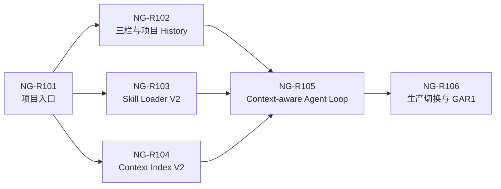

# NovelGainker Agent Rebaseline AM-R1 Story Packet

> 状态：NG-R101～NG-R106 已完成；GAR1 技术提交已生成并停止，等待独立产品评审（`gar1Approved=false`）
>
> 日期：2026-08-30
>
> BMAD 数据包：`execution-packet`
>
> Program：Agent Rebaseline AM-R1——项目入口、对话与上下文基础
>
> 范围：NG-R101～NG-R106、GAR1 技术提交

## 1. BMAD Routing Brief

- Packet type：`brownfield-resume-packet` → `execution-packet`
- Project type：Windows-first、local-first Tauri desktop app
- Project level：4
- Runtime context：Codex / local repository
- Confidence：high
- Current phase：GAR1 technical submission
- Recommended next move：独立评审 GAR1 Manifest 与 Review Report；未批准前不得启动 AM-R2/AM-R3
- Route-out：已批准的 Agent Protocol V2、Context Mark 规格和现有 Rust 安全写入 Kernel
- 不做：AM-R2 Canon 化、Context Mark、冲突决议、AM-R3 长章生成、真实 Provider Live Smoke、Sprint 6

理由：RB-Q001～RB-Q008 与 AP-Q001～AP-Q010 已全部获产品批准。当前最小真实增量不是继续修补 `AgentActionPayloadV1`，而是先建立项目入口、独立 Conversation、项目内 History/Memory、完整 Skill Loader 和可重建 Context Index，并证明新路径在零 Agent Canon 写入下稳定工作。

### 1.1 Draft 2 修订摘要

1. `control` 调用冻结互斥的 Skill Selection/Agent Action 子契约；Context Reader 改为 Host-only；
2. NG-R106 增加精确 IPC/Handler/Capability、质量脚本替换和删除引用清零门；
3. Budget Profile 按 GAR1/GAR2/GAR3 分阶段校准，并为 GAR1 增加客观规模阈值；
4. 首次创建项目 Agent History 前显示隐私/同步提示；
5. History 同步分叉必须由用户选择当前 Branch，不自动合并或删除。

## 2. AM-R1 目标

AM-R1 交付一个可实际使用的只读 V2 对话基础：作者从冷启动弹窗创建或打开项目，在三栏常驻 Workspace 的中栏自然聊天；Agent 根据完整 eligible Skill 集合做语义选择，按需读取项目 Canon，并把独立 Conversation、来源、完整可见聊天和 Host 增量 Memory 保存到工程。

AM-R1 完成后必须具备：

1. 冷启动只出现“新建工程 / 打开现有工程”，不能绕过项目进入 Agent。
2. 新项目只创建最小 Scaffold，不强制角色、世界观、剧情或章节。
3. 中栏只显示用户消息、AI 可见回复和输入框；Skill、Context、来源和工具状态位于右栏。
4. Conversation 正文与 Control JSON 使用不同 Provider 模式、不同解析器和不同持久化契约。
5. 内置 Novelist-compatible Skill 使用完整 instruction、必要模板和参考资料；Host 不用关键词排除 eligible Skill。
6. Context Index 可从 Canon 重建，并返回稳定来源引用、实体、字段/标题路径和 Hash。
7. 完整可见聊天、Turn Record、Host 增量 Memory 保存在 `.novelgainker/agent/`，但不进入 Canon Search、Skill 普通读写或出版输入。
8. DeepSeek/OpenAI Loopback 共用 V2 状态机、累计预算、取消和错误边界。
9. GAR1 的 Agent Canon 写入数固定为 0；项目元数据写入与用户手动编辑不计为 Agent Canon 写入。

## 3. 已冻结上游决策

本 Packet 不重新评审下列产品决定：

- RB-Q001～RB-Q008：三栏常驻、最小 Scaffold、默认 `auto_apply_safe`、项目内 History/Memory、自包含 Novelist Context 路线、V2 协议、Context Mark 和旧 AM1/AM2 合并处置。
- AP-Q001～AP-Q010：五层协议、五种 Provider 模式、`SkillSelectionV2`、项目内历史隔离、中栏边界、稳定 Mark 锚点、Mark 权限、冲突分级、规模校准预算和 V1 退役条件。
- Markdown 与项目资源仍是小说 Canon；`.novelgainker/agent/**` 是可移植项目元数据，不是小说 Canon。
- Provider、Skill 和项目内容都不能决定路径、权限、风险、事务或提交。

权威定义：

- [对话式小说创作重基线 Plan](./agent-conversation-authoring-rebaseline-plan.zh-CN.md)
- [Agent Protocol V2 与 Context Mark 规格](./agent-protocol-v2-context-mark-review.zh-CN.md)

## 4. 授权边界

### 4.1 本 Packet 获批后授权

- 新增并冻结 AM-R1 使用的 V2 Session、Turn、Skill Selection、Context、Conversation、History、Memory 和 read-only Budget Contracts。
- 新增项目内 `.novelgainker/agent/` Manifest、Session、Turn、Memory 和 Draft 配额基础设施；AM-R1 不创建 Draft Artifact。
- 新增或调整项目启动弹窗、三栏 Workspace、中栏 Conversation 与右栏 Agent Activity。
- 在 release 内加载固定版本、固定 Hash、经许可审查的完整 Novelist-compatible Skill Pack；继续禁止外部 Plugin Cache、用户 Skill 和 Python Sidecar。
- 建立可重建 Context Index、专用 History/Memory Reader 和四个有界只读项目工具的 V2 适配。
- 复用 ProjectHandle、Provider/Vault、取消、UTF-8/路径/符号链接校验、Hash、Validator 和错误脱敏。
- 新增 Story 级 Loopback、规模、恢复和安全回归证据；执行完整 `pnpm quality` 与离线 Cargo Gate。

### 4.2 未授权

- V2 `start_composition`、`submit_canon_proposal` 的生产执行，或任何 Agent Canon create/patch。
- Context Mark 的创建、固定、删除和注入；其契约虽已批准，但运行时属于 AM-R2。
- ConflictSet、冲突决议卡、V2 WritePlan、自动 Apply、确认、事务提交或 Undo UI。
- 章节分段生成、连续性/Ledger 迁移和 50 万字完整创作闭环。
- 删除仍被新路径复用的路径、Validator、事务、Undo、Provider 或取消代码。
- 真实 Provider Live Smoke、真实凭据读取、外部网络、第三家 Provider、Sprint 6 或公开发布。

## 5. 实施顺序与切换原则

执行原则：

1. NG-R101～NG-R105 可以在未挂载的 V2 模块和测试 Harness 中逐步完成。
2. NG-R106 之前，release 仍使用当前 as-built 路径；不得同时向用户暴露 V1/V2 切换开关。
3. NG-R106 只有在 V2 read-only E2E、History 恢复、预算和全部 V1 安全负向回归通过后，才能一次性切换生产入口。
4. 切换后 Agent Canon 写入暂时关闭，直到 AM-R2 获批并通过；用户手动 Markdown 编辑继续可用。
5. 生产入口切换失败时回滚 release 变更，不迁移或覆盖用户 Canon，不提供运行时双路径兜底。

### 5.1 GAR1 生产 IPC 与 Capability

NG-R106 切换后，主窗口唯一允许的 Agent 命令为：

- `agent_skill_registry_load`
- `agent_session_load`
- `agent_turn_start`
- `agent_turn_cancel`
- `agent_session_clear`
- `agent_memory_compact`
- `agent_history_branch_resolve`

`agent_turn_start` 必须只接受 V2 DTO 并进入 V2 Session Machine，不能回退到 `AgentActionPayloadV1`。后两项是 AM-R1 新命令：Memory Compaction 只接受 Host 生成的 Session/Memory Hash 绑定；History Branch Resolve 只接受不透明 Branch ID 和用户显式选择，不接受路径或正文。

下列旧产品命令必须从生产 Command Manifest、Tauri Handler、主窗口 Capability 和 TypeScript Client 同时移除；保留的 Rust 模块只能由测试 Harness 直接调用：

- `agent_policy_set / agent_write_confirm / agent_write_reject / agent_undo_apply`
- `provider_chat_start / provider_chat_cancel`
- `router_resolve_local / router_run_start / router_run_cancel`
- `workflow_registry_load / workflow_run_status_load / workflow_source_catalog / workflow_run_prepare / workflow_run_generate / workflow_proposal_apply / workflow_run_cancel / workflow_run_abandon`
- `story_context_catalog / story_context_build / story_context_request_preview`
- `story_chapter_generate_start / story_chapter_status_load / story_chapter_generate_cancel`
- `story_continuity_check / story_continuity_status_load / story_continuity_warning_confirm`
- `story_chapter_patch_preview / story_chapter_patch_status_load / story_chapter_patch_apply`
- `story_chapter_state_preview / story_chapter_lifecycle_status_load / story_chapter_state_apply`
- `story_ledger_update_preview / story_ledger_update_apply`

健康检查、App State UI、Provider 设置/连接和项目离线编辑命令保持当前边界。按当前 60 条命令基线计算，GAR1 生产 Command Manifest 固定为 28 条，其中 7 条为上面的 V2 Agent IPC。边界测试必须直接调用每个移除命令并证明 `command not allowed / command not found`；仅隐藏 UI 不构成通过。

## 6. Stories

### NG-R101——启动项目选择与最小 Scaffold

依赖：GRB0。

验收：

- [x] 无打开项目时显示阻塞式项目选择弹窗，只提供新建、打开和最近项目。
- [x] 新建工程只生成项目标识、`project.md` 和必要目录；人物、世界、剧情、素材和章节均可为空。
- [x] 可选引导通过普通 Conversation 提示呈现，跳过后不产生 Canon 文件。
- [x] 打开已有工程只执行项目边界、Schema 兼容性和 Agent Manifest 检查，不因缺少人物/世界文件拒绝。
- [x] 新建工程或首次为既有工程创建 `.novelgainker/agent/` 前，以简体中文明确提示：完整可见聊天会保存在工程内、可能随 Git/同步工具复制、可能包含私人创作内容，并提供清空 Session/全部历史的入口；用户显式继续前不创建 Agent History。
- [x] 新建/打开/取消不读取凭据、不启动 Provider、不修改现有 Canon。
- [x] 路径逃逸、符号链接、重复 Project ID、损坏 Manifest 和取消矩阵使用临时合成目录验证。

证据：`target/qa/ng-r101/ng-r101-evidence.json`。

### NG-R102——Chat-first 三栏 Workspace 与项目内 History

依赖：NG-R101。

验收：

- [x] 左栏只承载项目/文件/搜索/Provider/Session；中栏只承载 Conversation 和输入；右栏承载文件、来源、Skill、Context 和工具活动。
- [x] 中栏不渲染 Tool、Context、Diff、冲突或确认卡；AM-R1 不显示不可用的写入控件。
- [x] `.novelgainker/agent/**` 使用临时文件、flush、原子替换保存 Manifest、Session、Turn 与 Memory。
- [x] Turn Record 保存完整可见用户/AI 消息、来源引用、终态和 Hash Chain，不保存隐藏 Prompt、原始 Provider 响应、Key、绝对路径或未展示工具正文。
- [x] Agent 元数据目录从文件树普通写工具、Canon Search、Skill 读写和出版输入排除，只能由专用 Reader 访问。
- [x] 打开时验证项目绑定、Schema、序号和 Hash Chain；损坏记录隔离。同步分叉时显示 Branch ID、最近 Turn 时间、消息数和 Hash 状态，由用户显式选择当前 Branch；未选前不启动 Agent，不自动合并、覆盖或删除任何 Branch。
- [x] 重启恢复完整可见聊天；清空 Session 不修改 Canon；Draft 配额接口存在但 AM-R1 固定为零 Draft。

证据：`target/qa/ng-r102/ng-r102-evidence.json`。

### NG-R103——完整 Skill Runtime Loader V2

依赖：NG-R101。

验收：

- [x] release 只从 bundled Pack 加载九项已审查 Skill 的完整 instruction、Manifest、模板和所需参考资料。
- [x] Pack 来源、许可、版本、资源清单、文件 Hash、整体 Hash、未知文件、符号链接和可执行文件检查可重复。
- [x] Host 根据能力、项目状态和授权形成完整 eligible Skill 集合，不按用户关键词排除 Skill。
- [x] Provider 返回严格 `SkillSelectionV2`；未知、重复、超过四项、越出 eligible 集合或扩大能力时安全拒绝。
- [x] 零 Skill 仅允许产品帮助或不涉及项目 Canon 的普通交流；项目读取请求不得通过零 Skill 绕过。
- [x] runtime 不读取 Codex/Novelist Plugin Cache、用户 `SKILL.md`、网络 Skill 或 Python Sidecar。

证据：`target/qa/ng-r103/ng-r103-evidence.json`。

### NG-R104——Project Context Index V2

依赖：NG-R101。

验收：

- [x] 从 Markdown Canon 构建可删除、可重建的项目索引；索引不成为 Canon，不索引 `.novelgainker/agent/**`。
- [x] 覆盖人物、关系、别名、世界规则、剧情线程、章节/场景、时间线、线索和素材查询。
- [x] 每个结果返回 `SourceRefV2`：Turn 内 Source ID、项目相对路径、实体、fieldPath/headingPath、内容/片段 Hash、截断状态和不可信标记。
- [x] `project.list/read/search/validate_markdown` 只由 Host Context Executor 调用；Provider Schema、Prompt 示例和响应中均不存在这些工具名或路径参数，唯一入口是语义 `request_context.queries`。
- [x] Context Plan 合并 Memory、最近消息、项目检索、must-read Canon 和 Skill 资源，并在整个 Turn 累积 Tool Result。
- [x] 写入前 Context Preflight 接口可用但 AM-R1 生产路径不可进入写入状态。
- [x] 在不少于 120 章、50 万中文字符的合成项目上执行至少 48 个带真值来源的四类查询；must-read 与目标 Canon 命中率 100%，Agent 元数据/未授权/项目外来源命中 0，冷构建 ≤30 秒、峰值 RSS ≤512 MiB、热查询 p95 ≤500 ms；参考硬件写入 Evidence。

证据：`target/qa/ng-r104/ng-r104-evidence.json`。

### NG-R105——Context-aware Agent Loop V2

依赖：NG-R102～NG-R104。

验收：

- [x] Host 为每次 `control` 调用冻结 `ProviderInvocationV2.completionContract`：selecting_skills 只接受 `skill_selection_v2`，其余 Control 阶段只接受 `agent_action_v2`；禁止 Union 猜测或跨子契约修复。
- [x] `AgentControlActionV2.start_response` 不包含用户可见正文。
- [x] Host 创建 `ConversationLeaseV1`，Provider 以独立 `conversation` 模式输出普通文本流，Host 创建 `ConversationMessageV2`。
- [x] Conversation 文本永远不能触发 Tool、路径、Policy 或文件写入。
- [x] Provider 每次调用固定一种模式；AM-R1 只激活 `control / conversation / memory_compaction`，Composition/Reconciliation 保持 Policy Blocked。
- [x] 每个终态 Turn 由 Host 确定性应用 `SessionMemoryDeltaV2`；只有阈值达到时，才在下一 Turn Preflight 或用户显式操作中调用 Compaction。
- [x] `TurnBudgetV2` 预扣并累计 Provider Calls/Input/Output、Context Result、修复、耗时和 Token；重试不能使用独立计数器绕过。
- [x] 按 Protocol 2.1 的客观规模门校准并冻结 `BudgetProfileV2(scope=gar1_read_only)`；未激活的 Composition/Reconciliation/Mark/Conflict/Write 能力预算固定 disabled，后续由 GAR2/GAR3 Profile 单独校准。
- [x] 取消、Provider 切换、格式修复、预算耗尽、History 损坏和 Context Hash 漂移形成稳定可见终态，执行零 Agent Canon 写入。

证据：`target/qa/ng-r105/ng-r105-evidence.json`。

### NG-R106——生产路径只读 E2E、回归迁移与单路径切换

依赖：NG-R101～NG-R105。

验收：

- [x] DeepSeek/OpenAI Loopback 从启动弹窗、项目打开、自然语言输入、Skill Selection、Context Query、Conversation 流到重启恢复共用一条 V2 路径。
- [x] 人物、世界规则、剧情线程和最近章节四类问题均命中正确 Canon，右栏显示实际来源，中栏只显示 Conversation。
- [x] 空工程可以自然交流；用户可先讨论角色/世界，但 AM-R1 不自动写入 Canon。
- [x] 关键词误路由、先前 Tool Result 丢失、Control JSON 混入长正文、Compaction 每轮调用、累计预算绕过全部有回归测试。
- [x] V1 的 Prompt Injection、路径逃逸、权限提升、取消、Hash、敏感数据、双 Provider 和零部分写安全回归逐项映射到 V2。
- [x] V2 入口通过后一次性替换生产挂载；`agent_turn_start` 只进入 V2，旧 Agent/Provider Chat/Router/Workflow/Story 命令按 5.1 从 Handler 与 Capability 撤权，直接 IPC 调用全部被拒绝。
- [x] GAR1 Command Manifest 固定 28 条、V2 Agent IPC 固定 7 条；Manifest、Handler、生成权限、Capability、TypeScript Client 和静态边界门逐项相等。
- [x] `scripts/quality.mjs`、`package.json` 与 `check-sprint0-boundaries.mjs` 已按 8.1 的完整映射切换到 V2 Story/GAR1 和未挂载安全 Kernel 测试；旧 AM0～AM2、G3～G5 wrapper 不再锁定 60 Command、Timeline、旧 UI/IPC 或写入口挂载，完整质量门不引用任何待删除文件。
- [x] 完整 `pnpm quality`、Debug/Release Build、桌面 Smoke、离线编辑和既有 Canon/Validator/Recovery 回归通过。
- [x] GAR1 Manifest 保持 `gar1Approved=false`，不推定 AM-R2 授权。

证据：`target/qa/ng-r106/ng-r106-evidence.json`、`target/qa/gar1/gar1-manifest.json`、`target/qa/gar1/gar1-review-report.md`。

## 7. V1 迁移与删除清单

### 7.1 AM-R1 必须复用并保留

- `crates/app-core/src/project.rs`、`workspace.rs`、`search.rs`：项目句柄、相对路径与只读搜索。
- `crates/app-core/src/provider_core.rs`、`credential_vault.rs`、`provider_state.rs`：Provider、取消和凭据安全边界。
- `crates/novelgainker-validation/**`：Markdown Schema 与 Validator。
- `crates/app-core/src/agent_transaction.rs`、`agent_write.rs` 与 `crates/novelgainker-agent/src/authorization.rs`、`transaction_contracts.rs`：AM-R2 将复用的写入安全 Kernel；AM-R1 不挂载它们。
- 所有路径逃逸、Prompt Injection、取消、Hash、事务、Undo、敏感数据和双 Provider 负向测试，直到 V2 等价测试通过。

### 7.2 NG-R106 可移除的产品层

仅当 `target/qa/ng-r106/v1-retirement-manifest.json` 证明零生产/质量门引用且等价回归已经迁移时，NG-R106 才可以移除以下精确文件：

- `resources/contracts/agent-runtime/v1/contract-set.json`
- `resources/contracts/agent-runtime/v1/agent-read-action.schema.json`
- `scripts/agent-migration-am1-contract-lock.mjs`
- `scripts/agent-migration-am1-e2e.mjs`
- `scripts/agent-migration-am2-e2e.mjs`，但仅在其全部安全负向场景进入 `scripts/agent-rebaseline-write-kernel-e2e.mjs` 后
- `apps/desktop/src/components/AgentTimelinePanel.tsx`
- `apps/desktop/src/components/AgentTimelinePanel.test.tsx`
- `docs/stories/agent-migration-am1-story-packet.zh-CN.md`

### 7.3 AM-R1 不得提前移除

- `resources/contracts/agent-action/v1/**`、`resources/contracts/agent-runtime/v2/**`、`resources/contracts/agent-governance/v1/**`、`scripts/agent-migration-am2-contract-lock.mjs`、`agent_write.rs`、`agent_transaction.rs` 和 Undo/Recovery 测试：直到 AM-R2 的 V2 WritePlan/Commit Kernel 等价证明通过。
- `resources/contracts/agent/v1/**` 与 App State v9/v10 migration reader：直到现有活动/恢复状态被安全终结且 V2 project-local History 打开/恢复矩阵通过。
- G3～G5 Workflow/Storytelling 代码：直到 AM-R2/AM-R3 对应能力和回归证据通过。
- `docs/stories/agent-migration-am2-story-packet.zh-CN.md`：直到 GAR2 把全部写入安全约束和证据映射到当前 Packet。

Retirement Manifest 的每一项必须包含“精确路径 → 当前生产调用者 → 当前质量门调用者 → V2/Kernel 替代者 → 等价测试 → 处置状态”。若任一调用者或测试仍存在，停止删除并把该项保留到后续 Story；禁止使用 glob、模糊的“对应测试”或通过删除测试制造零引用。

## 8. 证据与质量门

每个 Story 必须：

1. 使用确定性合成项目和 Loopback Provider，不读取真实用户手稿、真实 Key 或外部网络。
2. 写入 `target/qa/ng-r10x/` 的脱敏机器可读 Evidence。
3. 验证前后 Canon Tree Hash；AM-R1 Agent 路径必须保持不变。
4. 同步 Rust Contract、TypeScript 镜像、Tauri Command Manifest、Handler、Permissions、Capability 和前端 Client。
5. 运行 Story 专用契约/集成/UI/E2E，再运行完整 `pnpm quality`。
6. Cargo 使用 `--locked --offline`；不得弱化 lint、Clippy、边界门或旧安全回归。

### 8.1 GAR1 质量入口迁移

| 当前 `pnpm quality` 入口                                                   | GAR1 入口                                                    | 迁移规则                                                                                                |
| -------------------------------------------------------------------------- | ------------------------------------------------------------ | ------------------------------------------------------------------------------------------------------- |
| `skills:check`、`e2e:nga001`                                               | `skills-v2:check`、`e2e:ngr103`                              | 保留九项 bundled Skill 的来源/许可/Hash/资源检查；移除 60 Command 锁                                    |
| `agent-contracts:check`、`agent-actions:check`、`e2e:nga002`、`e2e:nga003` | `agent-v2-read-runtime:check`、`e2e:ngr101`～`e2e:ngr105`    | Session/Turn/Action 的生产断言迁至 V2；旧写入相关负向用例迁至 Kernel                                    |
| `agent-governance:check`、`e2e:nga004`                                     | `agent-write-kernel:check`、`e2e:agent-write-kernel`         | Authorization/Transaction/Undo 只作为未挂载 Kernel 回归                                                 |
| `agent-runtime:check`                                                      | `agent-v2-read-runtime:check`                                | V2 Contract/Schema/TypeScript/Fixture Lock 通过后替换                                                   |
| `e2e:nga101`～`e2e:nga104`、`e2e:ga1`                                      | `e2e:ngr101`～`e2e:ngr106`、`e2e:gar1`                       | 新 E2E 覆盖 V2 UI、Context、History、Budget 和双 Provider                                               |
| `agent-write-runtime:check`                                                | `agent-write-kernel:check`                                   | 只验证未挂载写入 Kernel 的 Contract/Transaction/Undo，不证明产品写入口                                  |
| `e2e:nga201`～`e2e:nga206`、`e2e:ga2`                                      | `e2e:agent-write-kernel`                                     | 全部安全负向场景逐项迁移；删除旧 UI 挂载和写入产品正向断言                                              |
| `e2e:sprint3`、`e2e:ng401`～`e2e:ng507`                                    | `e2e:canon-kernel`                                           | 保留 Serializer/Schema/Transaction/Recovery/Context/Continuity/Ledger；移除旧产品 Tauri/UI 正向挂载断言 |
| `quality:boundaries` 中旧 Timeline/60 Command 锁                           | V2 Conversation Workspace、28 Command、7 V2 Agent IPC 精确锁 | 同步 Manifest、Handler、Permission、Capability、Client 与直接拒绝矩阵                                   |

`pnpm e2e:sprint1`、Sprint 2 Provider/Vault 与基础 Canon/Validator/Recovery 回归继续作为 `pnpm quality` 的独立步骤。`e2e:canon-kernel` 必须直接运行保留模块的确定性测试，不得经过已经撤权的 Tauri Command、旧 React Workflow/Story UI 或旧 App State 产品流程。更新后的 `pnpm quality` 不得引用 7.2 的任何待删除文件，也不得继续调度表中被替换的旧 wrapper。

AM-R1 新增建议命令：

- `pnpm agent-v2-read-runtime:check`
- `pnpm skills-v2:check`
- `pnpm agent-write-kernel:check`
- `pnpm e2e:agent-write-kernel`
- `pnpm e2e:canon-kernel`
- `pnpm e2e:ngr101`～`pnpm e2e:ngr106`
- `pnpm e2e:gar1`

命令名称随 Packet 一并冻结；实现不得用旧 AM1/AM2 脚本冒充 V2 Evidence。

## 9. Exit Gate GAR1

- [x] 冷启动、新建最小工程和打开既有工程路径通过。
- [x] 三栏职责固定，中栏只出现 Conversation 与输入。
- [x] 完整 Skill Loader、语义 `SkillSelectionV2` 和 Context Plan 在四类项目问答中通过。
- [x] Conversation/Control 分离，正文不能触发工具或写入。
- [x] 项目内完整可见 History、隐私提示、Host Memory、隔离、损坏恢复和用户决议同步分叉通过。
- [x] 50 万字合成项目的 `gar1_read_only` Profile 满足 Protocol 2.1 的 48 查询、正确性、隔离、性能和资源阈值并受锁。
- [x] 双 Provider Loopback、取消、恢复、Prompt Injection、路径、预算和敏感数据矩阵通过。
- [x] Agent Canon 写入数为 0，手动编辑和项目元数据写入边界可证明。
- [x] 28 条 Command、7 条 V2 Agent IPC 与旧命令直接拒绝矩阵通过。
- [x] V1 安全回归与质量入口已映射；Retirement Manifest 中每一项都无生产/质量门引用。
- [x] 完整 `pnpm quality`、Debug/Release Build 和桌面 Smoke 通过。
- [x] GAR1 Manifest 的 `gar1Approved` 保持 `false`，等待独立产品批准。

## 10. Review Gate 与授权记录

AM-R1 Story Packet 技术复审：**通过**（2026-08-30）。AM-R1 产品 Review Gate：**已批准**（2026-08-30）。

本次 AP-Q001～AP-Q010 的批准只关闭 Protocol/RB0 评审并授权创建本 Packet，不自动授权 NG-R101，也不批准 GAR1、AM-R2、AM-R3 或 Sprint 6。

后续授权记录：产品负责人于 2026-08-30 明确批准 AM-R1 Draft 2，授权按 NG-R101 → NG-R106 连续实施并在 GAR1 技术提交停止。该授权不包含 GAR1 产品批准、AM-R2、AM-R3、Sprint 6 或真实 Provider Live Smoke。

### 10.1 Draft 1 评审阻断关闭记录

| ID       | Draft 1 阻断                                   | Draft 2 处置                                                                                  | 状态   |
| -------- | ---------------------------------------------- | --------------------------------------------------------------------------------------------- | ------ |
| AMR1-R01 | Skill Selection 没有明确 Provider 调用契约     | Protocol 2.1 冻结 `ProviderInvocationV2` 和两个互斥 Control 子契约；Context Tool 改 Host-only | 已关闭 |
| AMR1-R02 | 单路径切换与现有 AM0～AM2、G3～G5 质量步骤冲突 | 8.1 逐项冻结 V2/Kernel 质量入口替换，7.2 要求删除前生产与质量引用同时为零                     | 已关闭 |
| AMR1-R03 | V1 写入口只在 UI 隐藏，IPC/Capability 未冻结   | 5.1 冻结 28 条 Command、7 条 V2 Agent IPC 和旧命令直接拒绝矩阵                                | 已关闭 |
| AMR1-R04 | GAR1 只读 Profile 与完整规模 Gate 不一致       | Protocol 2.1 定义 GAR1/GAR2/GAR3 分阶段 Profile，并给出 GAR1 客观阈值                         | 已关闭 |
| AMR1-R05 | 项目聊天隐私提示与同步分叉用户决议缺失         | NG-R101 增加首次 History 提示；NG-R102 增加 Branch 信息与用户显式选择                         | 已关闭 |

建议的执行授权：

1. 产品负责人批准本 Packet 后，按 NG-R101 → NG-R106 的依赖顺序连续实施。
2. Story 技术通过后可自动进入下一 Story，无需逐 Story 重复等待；阻断问题必须先修复。
3. NG-R106 完成后提交 GAR1 技术审查并停止。
4. GAR1 产品批准与 AM-R2 授权仍是独立决定。
5. 真实 Provider Live Smoke 始终需要新的明确授权。

### 10.2 实施与 GAR1 技术提交记录

NG-R101～NG-R106 已于 2026-08-30 按依赖顺序连续完成。唯一完整 `pnpm quality` 以退出码 0 通过，包含严格 Clippy、Rust/React 测试、Debug/Release 构建、两次桌面 Smoke、双 Provider Loopback、写入与 Canon 未挂载 Kernel、六个 Story Evidence 和 GAR1 生成步骤。

最终技术事实：

- Agent V2 Contract Set：`fa5be0e7e7d107f4581dc680abc6e3f84c0ef09135ad2c327d849d389599bf3a`；
- 生产 Command：28；生产 Agent IPC：7；旧 IPC：未注册且未授权；
- NG-R104：120 章、540,960 中文字符、48/48 真值命中，热查询 p95 30.275 ms，峰值 RSS 9,498,624 bytes，Canon Hash 前后相同；
- Agent Canon 写入：0；真实 Provider 请求/凭据读取：0；
- GAR1 Manifest：`target/qa/gar1/gar1-manifest.json`；
- `gar1Approved=false`、`amR2Authorized=false`、`amR3Authorized=false`。

本 Packet 在 GAR1 技术提交处停止。下一步只能是 GAR1 独立产品评审，不得把技术通过解释为产品批准或后续阶段授权。
