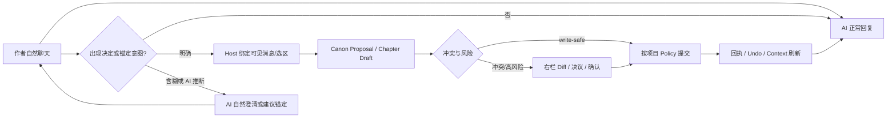
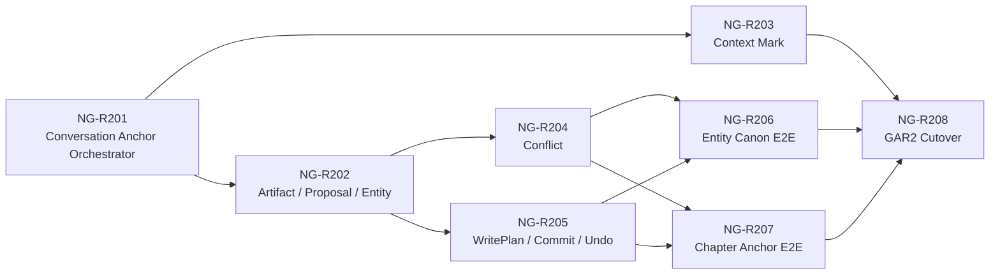

# NovelGainker Agent Rebaseline AM-R2 Story Packet Draft 1（已批准）

> 状态：NG-R201～NG-R208 技术完成；GAR2 技术提交已生成并停止，等待独立产品评审（`gar2Approved=false`）
>
> 日期：2026-08-30
>
> BMAD 数据包：`execution-packet`
>
> Program：Agent Rebaseline AM-R2——Conversation → Anchor → Canon/Chapter Commit
>
> 范围：NG-R201～NG-R208、GAR2 技术提交

## 1. BMAD Routing Brief

- Packet type：`review-gate-packet` → `execution-packet`
- Project type：Windows-first、local-first Tauri desktop app
- Project level：4
- Runtime context：Codex / local repository
- Confidence：high
- Current phase：GAR2 technical submission
- Recommended next move：独立评审 GAR2 Manifest 与 Review Report；未经新授权不进入 AM-R3、Sprint 6 或真实 Provider Live Smoke
- Route-out：已批准的 Agent Protocol V2、Context Mark 规格、GAR1 V2 生产路径和未挂载 Rust 写入安全 Kernel
- 不做：真实 Provider Live Smoke、AM-R3 长章 Composition、跨章连续性/Story Ledger、Sprint 6、出版

理由：用户已明确要求形成 AM-R2 Story Packet Draft 1，并再次确认核心产品不是只读问答，而是“自然聊天 → 识别作者决定 → Host 锚定 → Canon/章节落盘”。当前 GAR1 已提供 Conversation、History/Memory、完整 Skill、Context Index、来源和累计预算；下一最小真实增量应把现有安全写入 Kernel 挂到 V2 对话路径，形成一个可用的纵向闭环。

产品负责人随后明确回复“无修改，明确批准 Packet 及连续实施授权”。因此 AMR2-Q001～AMR2-Q010 已冻结，并授权按 NG-R201 → NG-R208 连续实施、在 GAR2 技术提交停止。该授权不自动把 `gar1Approved` 改为 `true`，也不授权 AM-R3、Sprint 6 或真实 Provider Live Smoke。

## 2. 产品结果

AM-R2 交付的不是一组脱离聊天的表单或工作流，而是一个由 Conversation 驱动的小说工程编辑闭环：

1. 作者在中栏持续与 AI 讨论人物、世界、剧情和正文，不要求预先建立人物卡、设定或章节。
2. 当作者表达明确决定、确认 AI 候选或发出“固定/写入/锚定”指令时，Host 把可见消息绑定为 `AnchorIntentV1`。
3. Provider 负责语义理解、候选事实和创作内容；Host 负责消息范围、实体归一、目标文件、Schema、来源 Hash、冲突、风险、Diff、事务和 Undo。
4. 无冲突、来源明确的安全新建或局部补充按项目策略处理；默认 `auto_apply_safe` 可自动提交并显示回执与撤销入口。
5. 模糊决定、AI 自己推断的决定、多个候选之间的短确认、冲突和高风险修改必须先让作者澄清或确认。
6. 已显示的聊天正文可以锚定为 `chapters/` 下的 Canon Draft；AM-R2 不负责长章节的分段生成，也不自动提升章节状态。
7. Commit 成功后立即刷新 Context Index、Memory 和 Mark；下一轮以新的 Markdown Canon 为准。

### 2.1 作者应感知的正常流程



### 2.2 非谈判 UX 边界

- 中栏只显示作者消息、AI 可见自然语言回复、失败/取消终态和简短等待状态。
- `visibleReason`、Skill Selection、Context 查询、Reconciliation、路径、风险分类和事务状态只进入右栏活动面板，不伪装成 AI 回复。
- 普通聊天不会因为“没有可沉淀决定”而失败，也不会每轮强制生成 Proposal。
- AI 可以在自然回复中询问“是否固定这项设定”或“是否把这段作为第一章开头”，但该句本身不获得写入权限。
- 等待 Conflict 或 always-confirm WritePlan 时自动打开右栏并暂时禁用中栏输入；普通 Anchor Candidate 不阻断继续聊天。
- Commit 回执在中栏使用简短自然语言说明，在右栏显示实际文件、Diff、Hash、风险和 Undo。

## 3. 已冻结上游决策

本 Packet 继承且不重新打开：

- RB-Q001～RB-Q008：三栏常驻、最小 Scaffold、默认 `auto_apply_safe`、项目内 History/Memory、自包含 Skill Pack、Host-governed 写入、Context Mark 和旧 AM1/AM2 合并处置。
- AP-Q001～AP-Q010：Conversation/Control/Content/Canon/Persistence 分面、五种 Provider 模式、Host-only Context、项目内历史、稳定 Mark、冲突五种决议、分阶段 Budget 和 V1 退役条件。
- Markdown 与项目资源是唯一小说 Canon；`.novelgainker/agent/**` 是可移植元数据，不能成为隐藏 Canon。
- Provider、Skill、聊天和项目内容都不能决定路径、权限、风险、提交、确认或 Undo。
- 一个 Turn 最多一个 Canon 事务；混合风险采用最高风险；冲突、取消、Hash 漂移和前置失败保持零写入。

权威定义：

- [对话式小说创作重基线 Plan](./agent-conversation-authoring-rebaseline-plan.zh-CN.md)
- [Agent Protocol V2 与 Context Mark 规格](./agent-protocol-v2-context-mark-review.zh-CN.md)
- [AM-R1 Story Packet](./agent-conversation-authoring-am-r1-story-packet.zh-CN.md)
- [旧 AM2 写入安全迁移证据](./agent-migration-am2-story-packet.zh-CN.md)

## 4. AM-R2 范围

### 4.1 本 Packet 获批后授权

- 激活 `BudgetProfileV2(scope=gar2_canon)` 下的 `reconciliation`、Canon Proposal、Anchor、Context Mark、Conflict、Write Preflight/Commit 和 Undo；`composition` 仍固定 disabled。
- 扩展 `agent_turn_start`，接受当前可见用户消息和可选的 Host 校验 `anchorReference`；不得接受目标路径、权限、风险或未显示正文。
- 新增 Host-owned `AnchorIntentV1`，把明确作者决定、确认回复、可见消息或 UTF-8 选区绑定到 Proposal/Artifact。
- 把完整可见聊天消息或用户选区物化为有来源 Hash 的短 `DraftArtifactV1`；只允许已经向作者显示的正文。
- 激活 `submit_canon_proposal` 和 `CanonProposalV1` Reconciliation；不激活长内容 `start_composition`。
- 新增人物、世界、素材、剧情与 Canon Draft 章节的安全 create/局部 merge/extend 产品路径。
- 挂载 Context Mark、ConflictSet、五种冲突决议、WritePlanV2、策略、确认、拒绝、事务、恢复和 Undo UI。
- 复用 ProjectHandle、Context Index、Provider/Vault、取消、路径/符号链接/UTF-8/Schema/Validator、Writer、Recovery、DPAPI Undo 和旧安全负向回归。
- 新增 NG-R201～NG-R208 的 Contract、Rust/TypeScript、IPC、UI、Loopback、规模和恢复证据，并在 GAR2 技术提交停止。

### 4.2 未授权

- `composition` Provider 模式、6000～12000 字符章节分段生成、截断续写、Planner → Composer → Reconciler 长内容流水线。
- accepted/final 章节的自动修改、章节状态提升、Story Ledger、跨章批量修订或跨章连续性自动 Apply。
- 自动整章/整文件覆盖；允许的 always-confirm 替换也必须受本 Packet 明确目标和现有安全 Kernel 约束。
- 删除、移动、重命名、任意文件操作、绝对路径、项目外读取/导入、Shell、Process、URL、Opener 或浏览器网络。
- 写入 `AGENTS.md`、`CLAUDE.md`、Skill/安全配置、隐藏路径、`published/`、资产或未注册文件类型。
- 真实 Provider Live Smoke、第三家 Provider、自动跨 Provider Fallback、后台 Provider 调用、Sprint 6、视觉资产、EPUB 或公开发布。
- 把 AI 推断、低置信度语义、未展示 Provider 原文或 Session Memory 摘要直接写入 Canon。

## 5. Conversation Anchor 契约

### 5.1 Anchor 与 Context Mark 不同

| 对象 | 作用 | 是否包含候选正文 | 是否可导致 Canon 写入 |
| --- | --- | --- | --- |
| `AnchorIntentV1` | 绑定作者决定、消息或选区，准备 Canon 化 | 只引用已显示消息/Artifact，不复制隐藏内容 | 是，但仍需 Proposal、Conflict 和 WritePlan |
| `ContextMarkV1` | 让后续 Context Planner 优先读取既有 Canon | 否 | 否 |
| `DraftArtifactV1` | 保存已显示、尚未提交的候选内容 | 是 | 只有 complete + validated 才能进入 Proposal |
| `CanonProposalV1` | 描述目标实体、事实、来源与操作 | 引用 Artifact/消息/Canon Source | 不是写入授权 |

尚未写入 Canon 的聊天决定不能只靠 Context Mark 长期保存。Commit 成功后，Host 可以把新 Canon 位置转成 Mark 建议。

### 5.2 AnchorIntentV1

`AnchorIntentV1` 是 Host-owned 结构，不新增 Provider 权限。至少包含：

- App 生成的 `anchorId`、Project/Session/Turn 绑定和创建时间；
- `intentKind`：`decision_declaration / write_directive / candidate_acceptance / text_selection / agent_suggestion`；
- `targetKind`：`character / setting / material / plot / chapter`；
- 可选稳定实体引用和作者可见 display name；
- 一个或多个 `sourceMessageId`、消息正文 Hash；
- 可选 `startUtf8Byte / endUtf8Byte / selectionHash`；
- 可选 `draftArtifactId` 或当前 Turn `SourceRefV2`；
- `confirmationProvenance`：明确作者消息、唯一候选短确认、右栏确认或仅 AI 建议；
- `state`：`suggested / confirmed / materialized / committed / discarded / stale`；
- Anchor Hash。

硬性规则：

1. UTF-8 范围必须位于已经持久化并向作者显示的消息正文内，不能拆分字符；Host 回读正文并重算消息/选区 Hash。
2. UI 只能提交消息 ID、字节范围、Hash 和不透明 Candidate ID；不得把隐藏正文、目标路径或风险从前端回传给 Writer。
3. “上面这段”默认只可绑定唯一、紧邻且完整的可见消息；存在多个候选、混合叙述/说明或目标不明确时必须澄清。
4. 选区锚定优先于整条消息；未选择正文时不能凭模型猜测需要复制的段落范围。
5. AI Suggestion 只能形成 `suggested`，不能把自己生成的内容视为作者已确认。
6. Anchor 过期、消息 Hash 变化、Branch 改变或 Draft 被丢弃时进入 `stale`，不得重新猜测绑定。

### 5.3 自然语言确认语义

| 作者表达 | Host 处理 |
| --- | --- |
| “主角就叫林舟”“这个规则确定了” | `decision_declaration`；目标唯一且无冲突时可进入 Proposal，并受项目 Policy 处理 |
| “写进人物设定”“固定到世界观” | `write_directive`；绑定明确来源和目标后进入 Proposal |
| “把上面这段作为第一章开头” | 绑定唯一可见消息/选区，生成 Chapter Draft Artifact 和 Proposal |
| “就按这个”“选第二个” | 只有一个可验证 Candidate 或明确 ordinal 时才确认；否则自然澄清，零写入 |
| “也许”“要不”“可以考虑” | 仍是讨论，不形成 confirmed Anchor |
| AI 自己提出“建议固定” | 只显示建议；等待作者消息或右栏确认 |

置信度只能决定“是否需要澄清”，不能授予写入权限。作者的明确决定可以省去重复语义确认，但不能绕过 Conflict、Hash、Risk 或 always-confirm WritePlan。

### 5.4 Conversation 与 Anchor 的 Turn 路径

普通聊天：

```text
accepted → selecting_skills → planning/gathering_context
  → responding → memory_delta → completed
```

明确决定或锚定：

```text
accepted → selecting_skills → planning/gathering_context
  → reconciling → conflict_check
    → write_safe commit
    → awaiting_conflict_resolution / awaiting_write_confirmation
  → committing → refreshing_context → responding → memory_delta → completed
```

AM-R2 不经过 `planning_composition / composing`。AI 在普通回复中提出的 Anchor Suggestion 随当前 Turn 完成，不保持活动 Turn；作者下一条确认消息启动新的 Anchor Turn。

Reconciliation 或 Anchor Candidate 的可选生成失败时，不得把已经完成的普通 Conversation 回滚成 failed；只在用户当前明确要求写入而 Canon 化本身失败时，当前 Turn 才以 `agent-canon.* / agent-write.*` 稳定错误终止。

## 6. Canon 与章节提交规则

### 6.1 实体 Canon

AM-R2 write-safe 候选：

- 无冲突的新人物、世界、素材和普通剧情文件；
- 现有 Draft/普通实体文档中经过字段/标题定位的安全局部补充；
- 不改变稳定 ID、受保护 Frontmatter、章节状态、Ledger 或关键项目元数据；
- 每个事实都绑定可见 Turn 消息、Draft Artifact 或当前 Canon Source。

Host 必须用固定模板/Serializer 生成结果文档。Provider 不能提供最终路径、Frontmatter、稳定 ID、Patch Envelope、风险或提交状态。

### 6.2 Chapter Anchor

AM-R2 中的“正式章节落地”定义为：写入 `chapters/` 下、可被项目索引和后续 Agent 读取的 Canon Markdown，章节状态固定为 Draft。

允许：

- 把一个完整可见 AI/作者消息或明确 UTF-8 选区创建为新的 Draft 章节；
- 把已确认的可见正文安全追加/局部合并到既有 Draft 章节；
- 使用 Host 固定章节模板、ID、序号、标题和状态；
- 新 Draft 章节无冲突创建在 `auto_apply_safe` 下归 write-safe；
- 整个既有 Draft 章节替换只能进入 always-confirm，并展示完整 Diff。

不允许：

- 在 AM-R2 内调用长内容 Composition 生成整章；
- 将聊天中的说明性文字、选项列表或 AI 自评静默混入正文；
- 自动修改 accepted/final 章节、章节状态、Story Ledger 或跨章文件；
- 因目标章节不存在而猜测覆盖其他章节；
- 把不完整、cancelled、truncated 或 invalid Artifact 提交为章节。

作者说“写第一章”但没有可锚定正文时，AI 应继续在 Conversation 中共同创作或说明下一步；AM-R2 可以把后续已显示正文锚定为 Chapter Draft，但不会启动 AM-R3 长章 Composition。

### 6.3 Conflict 与风险

继续使用批准的九类 Conflict 和五种作者决议。以下始终确认：

- 任意 Conflict Resolution 形成的变更；
- 整文档/整章替换和跨文件批量修订；
- accepted/final 章节正文；
- 章节状态、Story Ledger、关键 `project.md` 元数据；
- 规则、出版、资产和项目外能力。

其中 accepted/final、章节状态、Ledger、规则/出版/资产和项目外能力在 AM-R2 产品入口保持不可达；“始终确认”不等于本 Packet 自动授权这些能力。

## 7. IPC、Capability 与 UI 边界

### 7.1 AM-R2 Agent IPC 候选清单

保留 GAR1 的 7 项：

- `agent_skill_registry_load`
- `agent_session_load`
- `agent_turn_start`
- `agent_turn_cancel`
- `agent_session_clear`
- `agent_memory_compact`
- `agent_history_branch_resolve`

新增 7 项 V2 产品命令：

- `agent_write_policy_set`
- `agent_context_mark_upsert`
- `agent_context_mark_remove`
- `agent_conflict_resolution_submit`
- `agent_write_confirmation_submit`
- `agent_write_plan_reject`
- `agent_write_undo_apply`

按 GAR1 的 21 条非 Agent 命令不变计算，GAR2 候选生产 Command 总数为 35，其中 Agent IPC 为 14。NG-R208 必须逐项同步 Command Manifest、Tauri Handler、生成 Permission、Capability、TypeScript Client、DTO/Contract Test 和直接拒绝矩阵。

AM-R1 退役的旧命令名继续不可达，不能用旧 DTO 重新挂载：

- `agent_policy_set`
- `agent_write_confirm`
- `agent_write_reject`
- `agent_undo_apply`

### 7.2 DTO 边界

- `agent_turn_start` 可新增可选 `anchorReference`，只包含 source message ID、UTF-8 范围、Hash 和不透明 Candidate ID；当前用户可见消息仍是必需字段。
- Policy Set 只接受枚举和当前 Session/Policy Hash；有活动 Turn、Pending Conflict/Confirmation 时拒绝。
- Mark Upsert/Remove 只接受当前可见 Source/Mark ID 与绑定 Hash；Host 解析最终 Canon 路径和锚点。
- Conflict Resolution 只接受 ConflictSet ID/Hash、固定 resolution 枚举和 `confirmed=true`；不接受正文。
- Write Confirmation 只接受 Pending ID、Plan/Source/Policy Hash 和 `confirmed=true`；不接受 Diff 或正文。
- Write Reject 丢弃 Pending Plan 和无引用 Draft，项目零写入。
- Undo Apply 只接受 Receipt ID/Result Hash 和明确确认；Hash 漂移时拒绝覆盖人工修改。

### 7.3 右栏产品面

右栏增加：

- Anchor Candidate：来源消息、选区、候选类型、目标逻辑实体、状态；
- Draft Artifact：仅显示作者已经看过的内容；
- Canon Proposal：事实、来源和目标逻辑实体，不显示 Provider 隐藏输出；
- Context Mark：session/project、来源、active/stale/rebound；
- Conflict：新旧可见证据、五种决议；
- Write Preview：逐文件 Diff、风险、Validator、来源/结果 Hash；
- Commit Receipt 与 Undo。

右栏不得接受任意路径编辑、任意 JSON、隐藏 Provider 原文或绕过 Policy 的“强制写入”。

## 8. 实施顺序



执行原则：

1. NG-R201～NG-R207 先在 V2 模块、确定性 Harness 和隐藏产品挂载中完成。
2. 任一 Story 不得临时恢复 V1 Agent Action、旧 Timeline、旧 Router/Workflow/Story 表单或旧 Tauri 命令作为双路径兜底。
3. NG-R208 只有在正向闭环、安全负向矩阵、迁移清单、`gar2_canon` 规模门和所有 IPC 精确一致后，才能一次性挂载生产能力。
4. 生产切换失败时保留 GAR1 只读路径和用户 Canon；不得以部分挂载或跳过冲突/事务门降级。
5. NG-R208 完成后只生成 GAR2 技术提交并停止；GAR2 产品批准、AM-R3 和真实 Provider Smoke 都是独立决定。

## 9. Stories

### NG-R201——Conversation Anchor Orchestrator

依赖：GAR1 技术基线；实施需本 Packet 获批。

验收：

- [x] 中栏保持纯 Conversation；Control `visibleReason`、Skill/Context/Reconciliation 活动只在右栏显示。
- [x] `agent_turn_start` 支持无 Anchor 的普通聊天和可选 `anchorReference`，普通聊天不会因为无 Proposal 而失败。
- [x] Host 创建并校验 `AnchorIntentV1`；消息/选区 Hash、UTF-8 边界、Branch、Candidate 和 Turn 绑定不可伪造或复用。
- [x] 明确决定、写入指令、唯一候选短确认、探索性语言和 AI Suggestion 的矩阵符合 5.3。
- [x] 多个候选、含糊代词或无法唯一定位“上面这段”时自然澄清，执行零 Canon 写入。
- [x] AI Suggestion 不阻断下一轮；明确 Anchor Turn 等待 Conflict/Confirmation 时遵守唯一活动 Turn。
- [x] Follow-up Skill/Memory/Context 连续性不依赖把历史正文重复暴露给 Skill Selection。

证据候选：`target/qa/ng-r201/ng-r201-evidence.json`。

### NG-R202——Draft Artifact、Canon Proposal 与实体归一

依赖：NG-R201。

验收：

- [x] 激活 `reconciliation / canon_proposal_v1`，`composition` 保持 Policy Blocked。
- [x] 已显示完整消息或有效选区可物化为 bounded `DraftArtifactV1`；未显示、partial、cancelled、truncated、invalid 内容拒绝。
- [x] `CanonProposalV1` 对每个事实绑定可见消息、Artifact 或 Canon Source；无来源事实不能进入 WritePlan。
- [x] Host 对人物、设定、素材、剧情和章节执行稳定实体归一；Provider 不能指定最终 ID、路径、模板、Frontmatter 或风险。
- [x] 新实体同名、已有实体别名、多个候选目标和路径碰撞进入确定性澄清/Conflict，不静默新建重复文件。
- [x] Proposal/Artifact 配额、原子持久化、重启恢复、丢弃和 History Hash Chain 通过；`.novelgainker/agent/**` 继续排除 Canon Search/Skill/出版。

证据候选：`target/qa/ng-r202/ng-r202-evidence.json`。

### NG-R203——Context Mark 产品挂载

依赖：NG-R201、GAR1 Context Index。

验收：

- [x] AI 只能直接创建当前 Turn 实际读取 Source 的 medium session Mark；用户可 upsert/remove、设置 high 和升级 project Mark。
- [x] Mark 使用 fieldPath/headingPath、anchorHash 和 documentHash，不复制 Canon 或聊天事实。
- [x] 未 Canon 化的聊天候选不能创建 Mark；Commit 后可建议标记新 Canon 锚点。
- [x] 无关段落修改、目标内容修改、标题移动、多候选和删除场景分别 active/re-read/rebound/stale，且均可见。
- [x] AI 不能删除用户 Mark；64 个活动 Mark 上限、Session 归档、跨 Session project Mark、重启和同步 Branch 通过。
- [x] Mark 的创建/删除不修改 Canon；损坏 Marks 可由 Turn History 与 Canon 重建。

证据候选：`target/qa/ng-r203/ng-r203-evidence.json`。

### NG-R204——Conflict Engine 与作者决议

依赖：NG-R202、GAR1 Context Preflight。

验收：

- [x] identity、field_value、relationship、timeline、world_rule、plot_thread、chapter_state、source_hash 和 semantic 九类 Conflict 通过确定性矩阵。
- [x] 只有同时引用旧 Canon 和新候选、且命题不可共存的 `confirmed_conflict` 进入阻断 ConflictSet；低置信度进入自然澄清。
- [x] 右栏显示新旧可见证据、来源位置、受影响 Proposal 和简短解释，不显示隐藏推理。
- [x] 固定提供 keep_existing、adopt_candidate、merge_manual、save_as_alternative、cancel_change；确认绑定不能复用、跨项目或跨 Branch。
- [x] 未决 Conflict、取消、来源 Hash 变化和无效决议保持整个关联事务零写入。
- [x] adopt/merge 重新执行实体归一、Context Preflight、冲突、风险和 Diff，并始终进入 always-confirm。

证据候选：`target/qa/ng-r204/ng-r204-evidence.json`。

### NG-R205——Host WritePlanV2、Commit、Recovery 与 Undo

依赖：NG-R202；复用现有未挂载安全 Kernel。

验收：

- [x] Rust 根据 Proposal/Artifact 生成固定模板结果、项目相对路径、完整 Diff、Schema/Validator、风险、Source/Result/Plan/Transaction Hash。
- [x] 一个 Turn 最多一个、最多八文件的原子事务；混合风险按最高风险，禁止部分提交。
- [x] `auto_apply_safe` 只提交 write-safe + Ready Undo；`review_every_write` 全部等待确认；`plan_only` 永不提交。
- [x] always-confirm 使用一次性 Pending ID 与 Project/Session/Turn/Plan/Source/Policy/Conflict Hash；IPC 不接受正文。
- [x] Commit 前重新获取 Writer、重查全部 Hash、准备 DPAPI Undo；任一失败零写入或进入受控 Recovery。
- [x] Commit 后回读 Result Hash、刷新 Index/Memory/Mark 并写入可见 Receipt；Undo 不覆盖人工修改。
- [x] 路径逃逸、符号链接、隐藏/保护目录、绝对路径、任意文件操作、Prompt Injection、取消和敏感数据负向矩阵全部通过。

证据候选：`target/qa/ng-r205/ng-r205-evidence.json`。

### NG-R206——人物/世界/素材/剧情 Conversation-to-Canon E2E

依赖：NG-R201、NG-R202、NG-R204、NG-R205。

验收：

- [x] “主角就叫林舟”“海禁规则确定为……”“把第二个转折写进主线”等自然消息无需复制粘贴即可进入对应 Markdown。
- [x] AI 建议的设定在作者确认前零写入；确认后复用原可见消息来源，不要求作者重新描述内容。
- [x] 无冲突新建/局部补充在 `auto_apply_safe` 下自动提交，并在中栏回执、右栏显示 Diff/Undo。
- [x] 多 Skill、多实体、最多八文件事务保持来源、实体、风险和原子性；任一冲突阻断关联事务。
- [x] Commit 后下一轮 Context Query 命中新 Canon；清空 App State 后可从 Markdown 重建，清空 Session 不删除 Canon。
- [x] DeepSeek/OpenAI Loopback 共用同一 V2 Contract/Writer；不自动 Fallback，不读取真实凭据。

证据候选：`target/qa/ng-r206/ng-r206-evidence.json`。

### NG-R207——Conversation-to-Chapter Anchor E2E

依赖：NG-R201、NG-R202、NG-R204、NG-R205 和保留的 Chapter Serializer/Validator Kernel。

验收：

- [x] 作者可把唯一完整可见消息或明确选区锚定为新的 `chapters/` Canon Draft，不复制粘贴正文。
- [x] Host 从可见内容中分离说明/选项与正文；无法确定范围时必须让作者选择，不能由模型静默裁剪。
- [x] 新 Draft 章节使用 Host ID/序号/标题/模板并可 write-safe；目标碰撞、来源变化或序号冲突保持零写入。
- [x] 既有 Draft 的安全局部追加/合并经过 Diff/Validator；整章替换 always-confirm；accepted/final、状态和 Ledger 产品入口不可达。
- [x] Commit 后章节被文件树、Context Index 和下一轮 Agent 正确读取；Undo 遇人工修改拒绝覆盖。
- [x] `composition` 调用数、Segment 数和跨章写入数均为 0，证明没有提前实现 AM-R3。
- [x] DeepSeek/OpenAI Loopback 覆盖“建议锚定 → 作者确认”“明确写入”“含糊上文”“选区”“拒绝”“取消”“Hash 漂移”。

证据候选：`target/qa/ng-r207/ng-r207-evidence.json`。

### NG-R208——GAR2 单路径生产切换、规模门与技术提交

依赖：NG-R201～NG-R207。

验收：

- [x] Release 中只有一条 V2 Conversation → Anchor → Proposal/Conflict → Commit 路径；旧 V1/Timeline/Router/Workflow/Story 写入口不可达。
- [x] Command Manifest 固定为候选 35 条、Agent IPC 14 条；Handler、Permission、Capability、Client、DTO 和直接拒绝矩阵逐项相等。
- [x] `gar2_canon` Profile 由确定性规模测试观测 p99 + 至少 25% 余量冻结；`gar3_long_form` 仍 disabled。
- [x] 在不少于 120 章、50 万中文字符合成工程上通过 Anchor/Proposal/Mark/Conflict/Commit/Undo/Recovery 场景，不读取真实手稿。
- [x] 双 Provider Loopback、取消、重启、同步 Branch、配额、Prompt Injection、路径、Hash、事务和敏感数据矩阵通过。
- [x] 旧 AM2 安全 Kernel 的每项正/负向用例映射到 V2 或保留 Kernel；Retirement Manifest 证明删除项生产/质量引用为零。
- [x] 完整 `pnpm quality`、Debug/Release Build、桌面 Smoke、离线编辑和 GAR1/G1～G5 安全回归通过。
- [x] 生成 `target/qa/gar2/gar2-manifest.json` 和 Review Report；保持 `gar2Approved=false`、`amR3Authorized=false`、`realProviderLiveSmokeExecuted=false`。

证据候选：`target/qa/ng-r208/ng-r208-evidence.json`、`target/qa/gar2/gar2-manifest.json`。

## 10. GAR2 规模与质量门

### 10.1 确定性场景

GAR2 合成工程继续满足 120 章、至少 50 万中文字符和 GAR1 48 个真值查询，并增加不少于 72 个写入闭环场景：

- 12 个新人物/世界/素材/剧情 Anchor；
- 12 个安全局部 merge/extend；
- 12 个 Conversation-to-Chapter Anchor；
- 12 个 confirmed/clarification Conflict；
- 8 个 Mark active/rebound/stale 生命周期；
- 8 个取消、Hash 漂移、Branch、配额和恢复场景；
- 8 个多文件事务、确认、拒绝和 Undo 场景。

通过条件：

- 期望成功的目标路径、正文 Hash、Diff、实体和来源命中率 100%；
- 期望阻断场景 Canon 写入数为 0；成功事务无部分写入；
- `.novelgainker/agent/**`、隐藏/未授权/项目外目标命中数为 0；
- Chapter Anchor 的来源消息/选区 Hash 与写入正文可逐字节追踪；
- 冲突漏报、错误自动提交、错误实体合并和人工修改覆盖数均为 0；
- Commit/Undo/Recovery 后 Canon Tree 与预期 Manifest 完全一致；
- DeepSeek/OpenAI Loopback 使用相同 Contract、Profile、风险和 Writer；
- `compositionCalls=0`、`segmentCount=0`、`agentCanonWriteOutsideApprovedScope=0`。

### 10.2 Budget 冻结

测试必须记录每 Turn 和累计的 Provider Calls/Input/Output、Context Result、Reconciliation、修复、Anchor/Artifact、Conflict、修改文件、事务、Undo、耗时和 Token。`gar2_canon` 的受锁值覆盖通过场景观测 p99 加至少 25% 余量，并受协议硬上限约束；任一场景未通过时不能冻结 Profile。

### 10.3 质量入口候选

本 Packet 获批后实施时新增：

- `pnpm agent-v2-write-runtime:check`
- `pnpm e2e:ngr201`～`pnpm e2e:ngr208`
- `pnpm e2e:gar2`

现有 `skills-v2:check`、`agent-v2-read-runtime:check`、`agent-write-kernel:check`、`e2e:agent-write-kernel`、`e2e:canon-kernel`、`e2e:ngr101`～`e2e:ngr106`、`e2e:gar1` 和基础 Sprint 1/2 安全回归继续存在，直到 NG-R208 的逐项映射证明替代或保留。不得通过删除测试制造零引用。

每个 Story 必须使用确定性临时合成项目、Locked/Offline Cargo 和 Loopback Provider；不得读取真实用户手稿、Credential Vault 或外部网络。完整 `pnpm quality` 是 GAR2 技术提交前的唯一最终本地门。

## 11. 迁移与保留

### 11.1 必须复用

- GAR1 的 Project/Session/Turn、Conversation、History/Memory、Skill Loader、Context Index、SourceRef、Budget、取消和错误边界。
- `agent_write.rs`、`agent_transaction.rs`、Authorization/Transaction Contracts、Recovery、DPAPI Undo 和路径/Hash/Validator 安全 Kernel。
- 人物/世界/素材/剧情/章节 Serializer 与既有 Canon 格式回归。
- Prompt Injection、敏感数据、路径逃逸、符号链接、取消、Hash 漂移、故障注入和双 Provider 负向测试。

### 11.2 NG-R208 前不得删除

- `resources/contracts/agent-action/v1/**`、`resources/contracts/agent-runtime/v2/**`、`resources/contracts/agent-governance/v1/**` 和旧 AM2 Contract Lock；直到 V2 Write Runtime 覆盖同等安全语义。
- [旧 AM2 Story Packet](./agent-migration-am2-story-packet.zh-CN.md)；直到每条已接受安全决定和测试都进入 GAR2 Retirement Manifest。
- G3～G5 Workflow/Storytelling 后端安全 Kernel；章节锚定只复用必要 Serializer/Validator，长篇能力留给 AM-R3。

### 11.3 Retirement Manifest

每项必须记录：精确旧路径、当前生产调用者、当前质量调用者、V2/Kernel 替代者、等价正/负向测试、处置状态。任一调用者或测试仍存在时保留；禁止 glob、模糊“对应测试”或先删测试再宣称零引用。

## 12. Exit Gate GAR2

- [x] 作者可以持续聊天；普通讨论不要求 Proposal，不显示 Control 文字为 AI 回复。
- [x] 明确决定、写入指令和唯一候选确认无需复制粘贴即可进入人物/世界/素材/剧情 Markdown。
- [x] AI 推断、探索性措辞、含糊短确认和多候选在作者确认前零写入。
- [x] 可见消息/选区可以锚定为 `chapters/` 下的 Canon Draft；AM-R2 不调用长内容 Composition。
- [x] Context Mark 可创建、固定、删除、重定位和失效；Mark 不成为 Canon。
- [x] 九类 Conflict、五种作者决议和 always-confirm 风险门通过。
- [x] WritePlan、三种 Policy、八文件原子事务、Recovery、Receipt 和 Undo 通过；不覆盖人工修改。
- [x] Commit 后 Context Index、Memory 和 Mark 刷新，重启后从工程继续，清空 Session 不删除 Canon。
- [x] 120 章/50 万字、48 查询和 72 写入闭环场景通过；`gar2_canon` Profile 受锁。
- [x] Command 35、Agent IPC 14、旧命令直接拒绝矩阵和单生产路径通过。
- [x] 双 Provider Loopback、全部安全负向回归和完整 `pnpm quality` 通过。
- [x] GAR2 Manifest 保持 `gar2Approved=false`、`amR3Authorized=false`、真实 Provider Live Smoke 未执行。

## 13. Draft 1 评审问题

### AMR2-Q001——什么算作者已决定

建议：明确的决定声明、明确写入指令和可唯一绑定的短确认视为 confirmed Anchor；探索性措辞和 AI Suggestion 不确认。作者语义确认可以省去重复提问，但不能绕过 Conflict/Hash/Risk/always-confirm。

状态：**已接受**（2026-08-30）。

### AMR2-Q002——普通聊天与 Canon 化的关系

建议：普通 Conversation 不每轮强制 Reconciliation；只有明确 Anchor 意图或 Control 识别到需要作者确认的候选时进入 Canon 化。可选 Anchor Suggestion 失败不回滚已经完成的普通回复。

状态：**已接受**（2026-08-30）。

### AMR2-Q003——聊天正文如何锚定

建议：支持完整可见消息、唯一紧邻消息和显式 UTF-8 选区；全部绑定 Message/Selection Hash。含糊“上面那段”或混合说明/正文必须澄清，不由模型静默裁剪。

状态：**已接受**（2026-08-30）。

### AMR2-Q004——AM-R2 的章节边界

建议：允许已显示正文进入 `chapters/` Canon Draft、新 Draft 创建和既有 Draft 安全局部合并；不开放长章 Composition、accepted/final、章节状态、Ledger 或跨章批量修订。

状态：**已接受**（2026-08-30）。

### AMR2-Q005——默认自动写入

建议：继续默认 `auto_apply_safe`。无冲突新实体、新 Draft 章节和受控局部补充可以自动提交；AI 推断、Conflict、高风险、整章/整文件替换仍等待作者。

状态：**已接受**（2026-08-30）。

### AMR2-Q006——三栏与等待行为

建议：中栏只保留自然对话；Anchor Candidate 不阻断聊天；只有 Pending Conflict 或 always-confirm WritePlan 自动打开右栏并禁用输入。所有 Control/Host 技术文字留在右栏。

状态：**已接受**（2026-08-30）。

### AMR2-Q007——IPC 与旧命令

建议：保留 GAR1 7 项并新增 7 项明确 V2 语义命令，候选为 35 Command / 14 Agent IPC；AM-R1 已退役的旧写入命令名不复活，避免旧 DTO 误接入。

状态：**已接受**（2026-08-30）。

### AMR2-Q008——Pending、Draft 与隐私

建议：只持久化作者已看到的 Draft、来源引用和脱敏状态；Pending WritePlan 正文只在当前进程内，关闭/切换/重启丢弃并零写入；未决 Anchor Candidate 有配额、可见清理和 Hash Chain。

状态：**已接受**（2026-08-30）。

### AMR2-Q009——GAR2 规模与 Provider 验证

建议：以 120 章/50 万字、GAR1 48 查询和新增至少 72 个写入闭环场景冻结 `gar2_canon`；只使用双 Provider Loopback。真实 Provider Live Smoke 继续需要单独明确授权。

状态：**已接受**（2026-08-30）。

### AMR2-Q010——连续实施与停止点

建议：本 Packet 获批后按 NG-R201 → NG-R208 依赖连续实施；Story 技术通过后可自动进入下一 Story，阻断先关闭；NG-R208 后生成 GAR2 技术提交并停止，不自动进入 AM-R3。

状态：**已接受**（2026-08-30）。

## 14. Review Gate 与授权记录

AM-R2 Story Packet Draft 1：**无修改通过并获连续实施授权**（2026-08-30）。

授权记录一：产品负责人明确要求“形成 AM-R2 Story Packet Draft 1：Conversation → Anchor → Canon/Chapter Commit”，只授权创建评审稿。

授权记录二：产品负责人随后明确回复“无修改，明确批准 Packet 及连续实施授权”，批准 AMR2-Q001～AMR2-Q010，并授权按 NG-R201 → NG-R208 连续实施、在 GAR2 技术提交停止。

本授权不自动批准 GAR1 或 GAR2，不授权 AM-R3、Sprint 6、真实 Provider Live Smoke、第三家 Provider、出版或公开发布。实施必须遵守本 Packet 的 Story 依赖、完整质量门和停止点。

## 15. GAR2 技术提交记录

NG-R201～NG-R208 已于 2026-08-31 按获批依赖连续完成。最终本地门使用一次无中断 `pnpm quality` 运行并以退出码 0 结束，覆盖 Prettier、ESLint、TypeScript、164 个前端测试、严格 Clippy、Rust workspace、Debug/Release Build 与桌面 Smoke、Sprint 1/2、保留安全 Kernel、NG-R101～NG-R106、GAR1 回归、NG-R201～NG-R208 和 GAR2 生成。

技术提交的冻结证据：

- 生产 Command 35 条、Agent IPC 14 条，Agent V2 Contract Resource 6 份；
- 合成工程 120 章、540,960 中文字符、48 个真值查询、72 个写入闭环场景；
- `gar2_canon` 累计预算保持至少 25% p99 余量，单 Turn Canon 写入上限 8，Composition 调用与 Segment 均为 0；
- 双 Provider 仅使用确定性 Loopback；外网调用、真实凭据读取、真实 Provider Live Smoke 均为 0；
- Marks 损坏隔离可由 Turn History 与当前 Canon 保守重建，Session Mark 按 Session/Branch 隔离，Project Mark 可跨 Session；
- Manifest 与 Review Report 位于 `target/qa/gar2/`，并保持 `gar2Approved=false`、`amR3Authorized=false`、`sprint6Authorized=false`。

AM-R2 已在 GAR2 技术提交停止。下一合法动作仅为独立 GAR2 产品评审；未经新的明确授权，不进入 AM-R3、Sprint 6 或真实 Provider Live Smoke。
