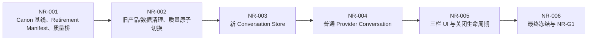

# NovelGainker NR-0 Clean Slate Story Packet Draft 2

> 状态：Draft 2 已于 2026-08-31 获最终批准；NR-001～NR-006 连续实施已授权
>
> 日期：2026-08-31
>
> BMAD 数据包：`execution-packet`
>
> 范围：NR-001～NR-006、NR-G1 技术提交

## 1. BMAD Routing Brief

- Current phase：Implementation Planning / Packet Review
- Approved upstream gate：NR-G0（2026-08-31）
- Recommended next move：评审 Draft 2；批准后才按 NR-001 → NR-006 连续实施，并在 NR-G1 技术提交停止
- 本阶段不做：Memory/压缩、Novelist Skill Runtime、Agent Tool Loop、Canon 自动维护、长篇 Context、真实 Provider Live Smoke、发布

NR-G0 与本次对齐只授权形成 Draft 2，没有授权删除代码、数据或实施 Story。本 Packet 先彻底退出旧 Anchor/线性 Control 产品，再建立一条不依赖 Skill、Context、Tool、Canon 或 Control JSON 的自然 Conversation 基线。

### 1.1 Draft 2 修订摘要

1. 旧 `.novelgainker/agent/**` 的 Conversation、Memory、Anchor、Mark、Proposal、WritePlan 和 Runtime 状态均视为不重要，直接退役；不转换、不迁移、不读取。
2. 小说 Canon 与资产严格保留；既有工程从新的 `.novelgainker/conversation/` 开始空白 Conversation。
3. 调用 Provider 前保存用户消息和 `running`；终态保存 AI 文本。不做逐 Delta 日志、自动重试或断点续传。
4. 应用存活并完成终态处理时，有 AI 文本一律保留；异常结束显示 `本次内容未生成完成。`。窗口确认关闭时不等待终态落盘，遗留 `running` 下次显示 `本次回复未生成。`。
5. 用户可见通道只有自然语言；未来 Skill/Tool 使用独立机器通道，不把 Control JSON 混入回复，也不使用关键词 Router。
6. 中栏展示新 Store 中的完整可见对话；Provider 只接收最近对话子集。右栏没有 History 窗口。
7. 窗口关闭仅受未保存的手动 Markdown 阻挡，此时显示 `保存 / 放弃 / 取消`；原始关闭请求不得提前取消 AI，确认关闭后才自动取消并立即退出。
8. NR-002 原子切换质量入口；每个 Story 都运行完整 `pnpm quality`。不增加真实 Provider Live Gate。

## 2. NR-0 交付目标

1. Anchor、Context Mark、Canon Proposal、WritePlan、强制 Skill Selection、Control JSON 和旧 AM/GAR 路径从生产面与质量面删除。
2. 不保留 Agent V1/V2 双路径、Feature Flag、Compatibility Adapter、旧 Reader 或数据转换器。
3. `project.md`、`characters/`、`world/`、`materials/`、`plot/`、`chapters/` 和资产内容不变；旧 Agent 数据直接清理。
4. 应用仍可新建、打开、编辑、保存和关闭项目，并保持三栏常驻布局。
5. 小说相关或无关的普通消息均可进入同一 Provider 文本路径并流式显示。
6. 最小 Conversation 为零 Skill、零 Canon/Context 读取、零 Tool、零 Canon 写入、零 Control JSON。
7. 除已确认的窗口立即关闭边界外，任何非空 AI 文本都保留；结束原因只决定是否附加未完成提示。
8. 停止、关闭和重启恢复不再卡在“AI 活动中”“正在停止”或 `runtime.unknown`。
9. 新质量入口只验证当前产品路径和通用安全 Kernel，不依赖旧 AM/GAR wrapper。

NR-0 是清场和可靠聊天底座。Memory/压缩、Tool Loop、Novelist Skill 和 Canon 更新分别留给 NR-1～NR-4。

## 3. 冻结的职责与阶段边界

- AI 与相关 Novelist Skill 后续负责语义、任务规划、内容、工具请求，并判断哪些内容进入 Canon。
- Host 负责 Runtime、Provider、Context 组装、工具和文件执行、事务、History/Memory、恢复、取消与安全；Host 不用关键词替代 AI/Skill 判断。
- 用户看见自然语言；后续机器工具调用通过独立 Tool Request/Result 通道传给 Host。
- Conversation、Task、Mutation 具有独立终态，可选任务失败不得抹除可见回复。
- 交付顺序固定为：NR-0 自然聊天 → NR-1 History/Memory/压缩 → NR-2 Host Agent Loop/工具通道 → NR-3 Novelist Skills 语义判断 → NR-4 Canon Upsert。
- 旧 Agent 数据可丢弃；小说 Markdown Canon 和资产不可丢弃。

原 Rebaseline Plan 已在 NR-0 Clean Slate 中退役；当前产品定义以 [当前架构](../architecture.zh-CN.md) 与当前 Sprint Plan 为准。

## 4. 授权边界

### 4.1 本 Packet 获批后授权

- 按 NR-001 → NR-006 清理旧产品层并重建最小 Conversation。
- 删除旧 Agent 代码、IPC/UI、Contracts、Tests、Docs、Evidence 和质量 wrapper。
- 经过项目根与路径安全校验后，删除旧项目内 `.novelgainker/agent/**`；不解析其中内容。
- 新建 `.novelgainker/conversation/` Store 和最小 Session/Turn/Event 契约。
- 保留 Provider、取消、项目编辑和通用安全 Kernel；仅抽取数据中立能力。
- 更新三栏 UI 和关闭生命周期，重建离线质量证据。
- 生成 NR-G1 Manifest/Review Report，令 `nrG1Approved = false` 后停止。

### 4.2 未授权

- Skill Registry/加载、Memory/Compactor、历史摘要、长篇 Context 或规模预算冻结；
- Agent Tool Loop、语义 Canon 工具、自动写入、Diff、冲突、确认或 Undo 产品挂载；
- 自动测试、评审或 Smoke 读取真实 Credential、访问真实 Provider/外部网络；新增 Credential IPC、导出或暴露 Key；出版或公开发布；
- 删除或修改小说 Markdown Canon 与资产；
- 进入 NR-1～NR-6。

## 5. 实施顺序与质量切换



执行原则：

1. NR-002 先清旧，NR-003/NR-004 只重建最小 Conversation。
2. 清理前后比较 Canon Tree Hash；旧 History/Memory 不进入保留基线。
3. 旧 `.novelgainker/agent/**` 不映射到新 Store；既有工程的新对话从空白开始。
4. NR-001 建质量桥，NR-002 原子切换 `package.json`、`quality.mjs` 与边界脚本；每个 Story 都运行完整 `pnpm quality`。
5. NR-0 每 Turn 最多一次 Provider 调用，无 Tool Loop、Skill 或 Canon 操作。
6. 应用存活并处理终态时，任何非空 AI 文本都保存；Provider 结束信号只决定 `complete` 或 `incomplete`。窗口确认关闭不等待该终态。
7. 除 dirty Markdown 外，窗口关闭不等待 Agent 或项目生命周期动作。

## 6. Clean Slate 数据边界

### 6.1 保留与删除矩阵

| 数据类别                                    | NR-0 处置        | 硬边界                                     |
| ------------------------------------------- | ---------------- | ------------------------------------------ |
| 小说 Markdown Canon 与资产                  | 原样保留         | 清理前后 Canon Tree Hash 相等              |
| 项目编辑、Provider/Vault、取消、安全 Kernel | 保留数据中立能力 | 不保留旧产品容器和名字                     |
| 旧 `.novelgainker/agent/**`                 | 整体删除         | 不解析、不迁移、不生成 Canon               |
| 新 `.novelgainker/conversation/**`          | 从空白创建       | 只保存 NR-0 起的新可见对话                 |
| 不安全重解析点/符号链接                     | 不跟随、不递归   | 只移除安全确认的项目内节点，否则忽略并报告 |
| 其他未知项目文件                            | 不处理           | 不扩大删除范围                             |

必须删除的产品面包括：Anchor/Mark/Proposal/WritePlan、Skill Selection、Control、Context Index、旧 Memory/预算状态；Selection/Control/Reconciliation Prompt 和解析/修复循环；旧 Agent IPC/权限/Client/UI；旧 Contracts、AM/GAR wrapper、Evidence 与过期 Packet。

生产清理不使用真实用户项目做测试。合成 Fixture 必须证明旧 Agent 根被清理或安全忽略，小说 Canon 和其他未知文件不变。

生产清理采用惰性触发：用户成功打开某个工程并取得安全 `ProjectHandle` 后，只检查该工程内的精确路径 `.novelgainker/agent/`。安全目录直接删除；删除失败不阻断工程打开，记录脱敏诊断并在下次打开时重试；重解析点不跟随。应用不扫描最近工程或其他磁盘位置，新 Runtime 永远不读取未能删除的旧数据。

### 6.2 新 Conversation Store

新根固定为 `.novelgainker/conversation/`。NR-0 可用单一原子替换文件实现，最少保存：

- Schema 与项目绑定；
- Session、Turn、Message ID 和顺序；
- 用户/AI 可见文本、时间与终态；
- 可选的稳定、脱敏 Provider 错误阶段/代码。

不得保存 Skill ID、Policy、Mark、Tool、Canon 路径、隐藏 Prompt、原始 Provider 响应、Key 或绝对路径。Canon Index、Skill 和出版输入排除 `.novelgainker/**`。

## 7. Stories

### NR-001——Canon 基线、Retirement Manifest 与质量桥

- [ ] 生成机器可读 Retirement Manifest，列出精确代码/Contract/IPC/Docs/Scripts/Evidence 清理目标、调用者、替代测试和状态。
- [ ] 建立空工程、普通 Canon、含旧 Agent 根、不安全重解析点、损坏旧 Agent 根五类合成 Fixture。
- [ ] 只记录小说 Canon/资产 Tree Hash 与旧 Agent 根状态；不为旧 History/Memory 建迁移或保留 Hash。
- [ ] 增加 NR-0 Retirement/Canon Harness，同时保持现有质量入口可通过；本 Story 不删除生产代码或用户数据。
- [ ] 完整 `pnpm quality` 通过。

### NR-002——旧产品/数据直接清理与质量原子切换

- [ ] 按 Manifest 删除旧产品、Contracts、IPC、UI、Docs、Scripts、Evidence，不建立双路径、Adapter、旧 Reader 或转换器。
- [ ] 清除 Provider 的 Skill Selection、Control JSON、Reconciliation 与修复循环，保留普通文本 Adapter。
- [ ] 合成项目中的安全 `.novelgainker/agent/` 根直接删除，Canon Tree Hash 不变。
- [ ] 生产路径只在工程成功打开后惰性清理该工程的旧 Agent 根；删除失败或不安全重解析点不阻断打开、不进入旧 Reader，并可在下次打开重试。
- [ ] 删除旧 Agent 的 14 条生产 IPC 及 Handler、Permission、Capability、Client。
- [ ] 通用能力先迁入数据中立模块/测试，再删除旧容器。
- [ ] `package.json`、`quality.mjs`、边界脚本和 CI 在同一 Story 原子切换到当前路径。
- [ ] 源码可编译、离线编辑可用、完整 `pnpm quality` 通过；允许 Conversation 暂未挂载。

### NR-003——新 Conversation Store 与最小终态

- [ ] 建立全新、项目绑定、原子替换的 Store，不读取旧 `.novelgainker/agent/**`。
- [ ] 契约中不存在 Skill、Control、Anchor、Canon、Tool 或文件路径字段。
- [ ] Provider 调用前先原子保存用户消息和 `running` Turn。
- [ ] 不逐字符持久化；终态时保存完整 AI 文本或未生成结果。
- [ ] 启动发现遗留 `running` 时终态化并显示 `本次回复未生成。`，不自动重试。
- [ ] 中栏加载全部新可见 Turn；清空/分支/旧 History 迁移不属于 NR-0。
- [ ] 不实现 Memory、摘要、Compactor、Provider cursor、断点或专用“继续”状态机。
- [ ] 完整 `pnpm quality` 通过。

### NR-004——单次普通 Provider Conversation

- [ ] Host 创建 Turn、组装最近可见对话、调用一次 Provider 普通文本模式并转发 Delta。
- [ ] 不运行 Skill、Control JSON、Context Query、Memory、Tool Loop 或 Canon Reader/Writer。
- [ ] 空/既有工程、小说问题和无关闲聊进入同一路径，不因缺少设定/草稿拒绝回复。
- [ ] 用户可见回复只有自然语言；未来 Tool Request/Result 使用独立机器通道。
- [ ] Provider 只接收受现有请求上限约束的最近对话；中栏仍显示完整已保存对话。
- [ ] DeepSeek/OpenAI Loopback 共用“非空文本必保存”规则；每 Turn Provider Calls = 1，其余操作 = 0。
- [ ] 正式应用只在用户主动发送消息时，通过现有 Rust `CredentialVault` 在 Host 内使用已配置 Key；不新增 Credential IPC，不向前端、日志或项目数据暴露 Key。
- [ ] 只新增 `conversation_session_load`、`conversation_turn_start`、`conversation_turn_cancel`；事件为 `conversation-turn-event`。
- [ ] 手动 Cancel 幂等；Loopback 中 2 秒内保存当前累计文本并到达唯一终态，活动租约必须释放。
- [ ] 完整 `pnpm quality` 通过。

### NR-005——三栏 UI 与关闭生命周期

- [ ] 冷启动只要求新建/打开工程；不强制人物、世界、剧情或章节。
- [ ] 左栏为项目/文件/Provider；中栏只有完整可见对话与输入/停止/终态；右栏无 History，只显示真实活动或空白。
- [ ] UI 无 Anchor、Mark、Proposal、WritePlan、Skill 卡、Control JSON、Router 或内部 Schema。
- [ ] 用户消息在 Provider 前可见且已保存；首个 Delta 立即显示；等待时显示真实连接状态。
- [ ] dirty Markdown 关闭弹出 `保存 / 放弃 / 取消`：保存成功或放弃后关闭；保存失败或取消则保持窗口。
- [ ] 关闭未确认时不取消 AI Turn；保存失败或选择取消后 AI 继续。
- [ ] Rust/前端不得在原始 `CloseRequested` 上提前取消；关闭确认后才自动取消活动 Turn 并立即退出。
- [ ] 关闭确认后不要求先关闭项目，不等待 Provider、Conversation flush 或项目清理；允许丢失尚未终态保存的内存 Delta，下次打开将遗留 `running` 显示为 `本次回复未生成。`。
- [ ] 项目清理错误不弹 `runtime.unknown`；下次打开由遗留 `running` 显示 `本次回复未生成。`。
- [ ] 完整 `pnpm quality` 通过。

### NR-006——最终冻结与 NR-G1 技术提交

- [ ] 质量入口只调度当前 Conversation、Provider、Project、Persistence 与通用 Kernel 测试。
- [ ] 生产 Command 冻结为 24 条，其中 Conversation IPC 为 3 条；Manifest、Handler、Permission、Capability、Client 完全相等。
- [ ] Release 只有一条 Conversation 路径，无旧别名、Feature Flag、Router 或隐藏旧 UI。
- [ ] 零旧引用门覆盖源码、Contracts、IPC、UI、Tests、Scripts 和权威 Docs。
- [ ] `pnpm quality`、Rust Debug/Release、前端生产构建和 Windows 离线桌面 Smoke 通过。
- [ ] Canon Tree Hash 不变；新 Conversation 从空白开始。
- [ ] 生成 NR-G1 Report/Evidence，声明未执行真实 Provider Live Smoke。
- [ ] `nrG1Approved = false`，状态停在 `NR-G1-technical-submission`。

## 8. 冻结契约

### 8.1 自然语言与未来工具通道

NR-0 的用户可见输出只包含自然语言，且不调用 Skill/Tool。NR-2～NR-4 后续另行设计机器 Tool Request/Result（如 `character.upsert`）；Host 执行 Markdown 操作，AI 再自然语言说明。它不依赖关键词、Anchor、任务卡或回复前置 Control JSON。

因此，“只输出自然语言”只约束可见 Conversation，不会阻止未来 Host 写 Markdown。

### 8.2 Conversation IPC

1. `conversation_session_load`
2. `conversation_turn_start`
3. `conversation_turn_cancel`
4. `conversation-turn-event`（Event，不是 Command）

NR-0 不提供 Skill、Mark、Proposal、Policy、Conflict、Memory Compact、History Branch/Clear 或 Canon Write Command。

### 8.3 History、Context Window 与 Memory

- 中栏展示 `.novelgainker/conversation/` 中全部新可见对话；无独立或右栏 History。
- Provider Context Window 不可见，只取最近可见对话并受现有请求上限约束。
- NR-0 无 Memory；NR-1 重设增量维护、阈值压缩、摘要和长对话预算。
- 用户说“继续”时不进入关键词 Router；AI 根据收到的最近对话按语义续答。

### 8.4 Provider 结果规则

| 结果                                         | 持久化               | 用户可见                                |
| -------------------------------------------- | -------------------- | --------------------------------------- |
| 非空文本 + 正常 `stop`                       | `complete`           | 原文本                                  |
| 非空文本 + length/EOF/error/unknown/手动取消 | `incomplete`         | 原文本 + `本次内容未生成完成。`         |
| 空文本 + error/cancel/unknown                | `not_generated`      | `本次回复未生成。` + 可用的脱敏错误信息 |
| 启动发现 `running`                           | 转为 `not_generated` | `本次回复未生成。`                      |

`finish_reason` 不决定是否保存文本。上述文本保留规则适用于应用仍存活并完成终态处理的 Turn；窗口确认关闭不等待这一过程，尚未落盘的内存 Delta 可以丢失。NR-0 不自动重试、不保存 Provider cursor、不做断点续传。

### 8.5 关闭状态机

```text
request close
  ├─ editor clean ─────────────────────────> commit close
  └─ dirty Markdown -> 保存 / 放弃 / 取消
       ├─ 保存成功 ────────────────────────> commit close
       ├─ 保存失败 ────────────────────────> keep open; AI continues
       ├─ 放弃 ────────────────────────────> commit close
       └─ 取消 ────────────────────────────> keep open; AI continues

commit close -> cancel active AI Turn -> exit immediately
```

原始 `CloseRequested` 只负责触发 dirty 判断，不得直接取消 Provider。`commit close` 不等待 Provider、项目关闭、Conversation flush 或清理完成。只有 dirty Markdown 可阻断关闭。

## 9. 最小确定性验证

DeepSeek/OpenAI 离线 Loopback 均覆盖：

1. 非空文本 + `stop` → 保存完整文本；
2. 非空文本 + 任意非 `stop`、EOF、错误或手动取消 → 保存文本并显示未完成提示；手动取消在 2 秒内终态化；
3. 空文本 + 错误或取消 → `本次回复未生成。`；
4. dirty 关闭选择取消或保存失败 → AI Turn 继续；保存成功、放弃或 clean 关闭 → 不等待 Provider 立即退出，重启后遗留 `running` 显示未生成。

不建立穷举协议矩阵，不执行真实 Provider Smoke，不增加自动重试、断点或复杂恢复。

## 10. Draft 1 阻断关闭记录

| 阻断                                              | Draft 2 关闭方式                                                              |
| ------------------------------------------------- | ----------------------------------------------------------------------------- |
| NR0-R01 旧 History/转换器                         | 旧 Agent 数据直接删除；新 Conversation 根从空白开始                           |
| NR0-R02 Hash/逐 Delta/Memory 过重                 | 只冻结 Canon Hash；发送前保存用户 + `running`，终态保存文本；Memory 延至 NR-1 |
| NR0-R03 质量顺序                                  | NR-001 建桥、NR-002 原子切换；每个 Story 完整 `pnpm quality`                  |
| NR0-R04 自然语言、Host 写入、History UI、关闭边界 | 可见语言和未来 Tool 通道分离；无右栏 History；dirty Markdown 是唯一关闭阻断   |
| NR0-R05 Provider 证明过度                         | “非空文本必保存” + 双 Provider 四例；无 Live Gate                             |

## 11. Draft 2 对齐结论

| 决策                     | 结论                                                              |
| ------------------------ | ----------------------------------------------------------------- |
| NR0-Q001 清理            | 删除旧 Agent 产品/质量/数据；保留 Canon、资产与通用 Kernel        |
| NR0-Q002 旧数据          | 旧 Conversation/Memory/派生状态不迁移；新 Conversation 空白开始   |
| NR0-Q003 持久化          | 调用前保存用户 + `running`；终态保存；不逐 Delta                  |
| NR0-Q004 未完成          | 有文本必保存并补未完成提示；无文本显示未生成                      |
| NR0-Q005 History/Context | 中栏完整历史；Provider 最近历史；NR-1 Memory/压缩；无右栏 History |
| NR0-Q006 关闭            | 仅 dirty Markdown 弹三选项；确认关闭后取消 AI 并立即退出          |
| NR0-Q007 IPC             | 基于当前 35/14，删除旧 14 并增加 3，冻结 24/3                     |
| NR0-Q008 Provider        | 双 Provider 四种离线语义用例；无真实 Live Smoke                   |

## 12. Draft 2 评审关闭记录

| 评审项                                         | 产品决定               | Packet 落点                                                                                           |
| ---------------------------------------------- | ---------------------- | ----------------------------------------------------------------------------------------------------- |
| NR0-D2-R01 手动停止与窗口关闭的持久化边界      | 按建议接受             | 手动停止 2 秒内终态化并保存已有文本；窗口确认关闭不等待落盘；dirty 取消/保存失败不取消 AI             |
| NR0-D2-R02 旧 Agent 数据的生产清理触发点       | 按建议接受             | 成功打开工程后按安全 `ProjectHandle` 惰性清理精确旧根；失败不阻断、不读取、下次重试                   |
| NR0-D2-R03 现有 CredentialVault 的生产使用权限 | 按建议接受             | 用户主动发送时 Host 可使用已配置 Key；不新增 Credential 能力；测试/Smoke 不读真实 Key、不访问真实网络 |
| NR0-D2-R04 NR-0 Context 选择细化               | 产品拒绝作为本阶段阻断 | 不新增 Session 管理或复杂 Context 策略；NR-0 维持现有上限内的最近对话，NR-1 再设计                    |

Draft 2 的评审阻断已全部关闭，但这不等于实施授权；仍需产品负责人对整个 Packet 作最终批准。

## 13. NR-G1 Exit Gate

必须证明：零旧 Agent 产品/Reader；新 Conversation 空白起步；Canon Hash 不变；普通聊天零 Skill/Tool/Canon；非空文本不丢；停止/关闭不挂；dirty Markdown 三选项正确；完整质量、构建和离线 Smoke 通过；24/3 IPC 一致；`nrG1Approved = false`。

## 14. Review Gate

当前 Gate：`NR0-PACKET-REVIEW` 已于 2026-08-31 关闭。产品负责人已明确批准：

> 批准 NR-0 Clean Slate Story Packet Draft 2，授权按 NR-001 → NR-006 连续实施，并在 NR-G1 技术提交停止。

实施边界：按 NR-001 → NR-006 连续执行并在 NR-G1 技术提交停止；不自动批准 NR-G1，不进入 NR-1～NR-6，不执行真实 Provider Live Smoke。
