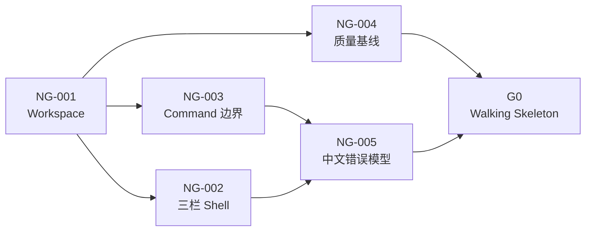

# NovelGainker Sprint 0 Story Packet

> 状态：Sprint 0 与 G0 已通过并关闭——Sprint 1 Story Packet 已获准创建  
> 日期：2026-08-20  
> BMAD 数据包：`execution-packet`  
> Sprint：0——可运行桌面骨架  
> 范围：NG-001～NG-005  
> 上游计划：[sprint-plan.zh-CN.md](../sprint-plan.zh-CN.md)（已批准）  
> 上游架构：[architecture.zh-CN.md](../architecture.zh-CN.md)（已批准）

## 1. Sprint 目标

在 Windows 11 x64 上建立一个最小但真实的 Tauri 2 + React/TypeScript + Rust 纵向链路。Sprint 结束时，用户可以启动一款简体中文的三栏 NovelGainker 桌面骨架，折叠左右栏和 API 设置卡，并由前端完成一次受限、带类型的 Rust 健康检查调用。

该 Sprint 的核心不是“做出假 UI”，而是证明以下基础成立：

- Windows 桌面构建链可重复；
- React 与 Rust 的可信边界可工作；
- 三栏交互符合已批准架构；
- 未注册能力不能从前端调用；
- 本地质量检查可以一条路径执行；
- 后续 Story 不需要推翻目录、错误模型或 UI Shell。

## 2. Sprint 0 可演示结果

演示应按以下顺序完成：

1. 在 Windows 11 x64 启动开发构建；
2. 看到简体中文三栏界面；
3. 折叠/展开 API 设置卡、左栏和右栏；
4. 缩窄窗口，确认中间对话区保持可用；
5. 在“系统状态”入口触发 Rust 健康检查；
6. UI 显示经过类型校验的成功结果；
7. 触发一个受控错误，UI 显示中文错误而不是堆栈或原始内部信息；
8. 运行统一质量命令并通过全部 Sprint 0 检查。

## 3. 范围边界

### 3.1 本 Sprint 包含

- Tauri/React/Rust Workspace；
- Windows 开发构建；
- 三栏 Shell 和折叠交互；
- 不落盘的 Markdown 编辑占位视图；
- 不保存真实 Key 的 Provider 设置占位视图；
- 一个只读 Rust 健康检查 Command；
- 统一 AppError 与简体中文错误呈现；
- 格式化、静态检查、单元测试和最小 Smoke Test；
- 开发环境与质量命令说明。

### 3.2 本 Sprint 不包含

- 真实项目目录选择、文件树扫描或 Markdown 保存；
- SQLite、Stronghold、Windows 凭据库或真实 API Key；
- DeepSeek/OpenAI 网络请求；
- 对话历史、Streaming、取消或 Token 用量；
- Workflow Pack、Manager、提案、Diff 或 Canon 写入；
- 安装器、代码签名、自动更新或公开分发；
- Android、第三家 Provider、图片生成和 Multi-agent。

任何实现若需要上述能力才能演示，应退回重新切片，不得用临时明文 Key、任意文件访问或通用 Shell 绕过。

## 4. 依赖与执行顺序

推荐执行顺序：

1. NG-001；
2. NG-003 与 NG-004；
3. NG-002；
4. NG-005；
5. G0 综合验收。

这是一条依赖顺序，不是日历承诺。单人开发时顺序执行；多人开发时只能在 NG-001 完成后并行 NG-002、NG-003 和 NG-004。

## 5. NG-001——建立 Tauri/React/Rust Workspace

### Story

作为开发者，我需要一个可重复构建的 Windows 桌面 Workspace，以便后续 UI、Rust Core 和测试都建立在同一结构上。

### 用户价值

用户可以在真实 Windows 桌面窗口中启动 NovelGainker，而不是只能查看网页原型。

### 实施范围

- 生成 Tauri 2 桌面应用和 React/TypeScript 前端；
- 建立架构要求的 apps、crates、packages、resources 和 tests 顶层边界；
- 至少创建 app-core 与 novelgainker-domain Rust Crate 骨架；
- 设置应用名称、应用标识、窗口标题和简体中文默认页面；
- 固定一个 JavaScript 包管理器并提交 Lockfile；
- 记录 Node、Rust 和 Windows 构建前置条件；
- 提供开发启动、前端构建、Rust 测试和桌面构建入口；
- 不添加 Shell/Process 能力、Python 或 Novelist 资源。

### 明确不做

- 不实现项目文件格式；
- 不引入 Provider SDK；
- 不建立 SQLite 或 Vault；
- 不创建正式安装器。

### 验收条件

- [x] 在受支持的 Windows 11 x64 开发机上，可以从干净 Workspace 安装依赖。
- [x] 开发命令可以启动带 NovelGainker 标题的 Tauri 窗口。
- [x] Release/Test 构建入口可以产出可启动的未签名内部构建。
- [x] React 和 Rust 编译均无错误。
- [x] Workspace 目录与批准架构一致，偏差有 ADR 或明确说明。
- [x] 依赖锁文件存在，构建不依赖全局安装的业务脚本。
- [x] 仓库中不存在 Python Sidecar、Novelist Plugin Cache 或通用 Shell 执行入口。

### 测试与证据

- Windows 开发启动截图或 Smoke Test 记录；
- 前端构建日志；
- Rust Workspace 测试日志；
- 目录清单；
- 依赖锁文件；
- 构建前置条件文档。

### 完成定义

NG-001 只有在另一位开发者或全新环境能够按文档启动窗口时才算完成；“在原作者电脑上偶然能运行”不算完成。

## 6. NG-002——实现中文三栏 Walking Skeleton

### Story

作为中文小说作者，我希望看到与 Codex 类似的三栏工作台，以便理解未来在哪里配置 API、对话和编辑项目文件。

### 用户价值

用户可以在首个可运行版本中验证核心信息架构和折叠体验。

### 实施范围

- 左栏：Provider 区、DeepSeek/OpenAI 占位卡、API 设置卡和连接状态占位；
- 中栏：对话空状态、消息区域和禁用的发送入口；
- 右栏：文件树空状态和可直接输入的 Markdown 临时缓冲区；
- 左栏、右栏和 API 设置卡可以独立折叠；
- 桌面宽度充足时使用三栏；窄窗口时左右栏转换为抽屉或覆盖层；
- 中栏保持最小可用宽度；
- 折叠控件支持键盘操作、焦点状态和中文可访问标签；
- Sprint 0 只维护当前进程内状态，不实现重启持久化。

### 安全约束

- API Key 输入框应禁用或只接受明显的测试占位值；
- 不得把输入保存到 Local Storage、日志或 Rust；
- Markdown 缓冲区不绑定真实项目文件；
- UI 不发起网络请求。

### 验收条件

- [x] 默认启动显示左、中、右三栏。
- [x] API 设置卡可以在左栏内部折叠。
- [x] 左栏和右栏可以分别折叠，并可恢复。
- [x] 折叠任一侧栏后，中间对话区自动占用可用空间。
- [x] 窄窗口下左右栏不会把对话区压到不可用。
- [x] 右栏可直接输入 Markdown 临时文本，但刷新/重启后不承诺保留。
- [x] DeepSeek/OpenAI 仅为占位显示，不能保存或发送真实 Key。
- [x] 所有按钮可通过键盘聚焦和操作。
- [x] 首屏无韩语文案或韩语专用入口。

### 测试与证据

- 三栏组件测试；
- 左右栏/API 卡折叠状态测试；
- 窄窗口布局测试；
- 键盘焦点和中文标签检查；
- 无网络请求断言；
- 无浏览器存储 Key 断言。

### 完成定义

三栏必须在真实 Tauri 窗口中演示；只通过浏览器开发服务器不算完成。

## 7. NG-003——建立带类型的 Tauri Command 边界

### Story

作为应用安全负责人，我需要前端只能调用明确注册且带类型的 Rust Command，以便后续文件和 Provider 能力不会退化成任意系统访问。

### 用户价值

用户可以信任 WebView 中的界面不能自行执行 Shell、访问任意文件或读取秘密。

### 实施范围

- 建立一个只读 health_check Command；
- 返回稳定的 HealthStatus 数据结构，例如应用版本、平台、状态和契约版本；
- 建立 Rust 输入/输出类型与 TypeScript 调用类型的一致性路径；
- 建立 AppError 错误代码、用户消息键和可选脱敏诊断字段；
- 在 Tauri Capability/Permission 中只开放 health_check；
- 建立 Command 注册位置和后续新增 Command 的审查规则；
- 为未注册调用、错误序列化和成功响应建立测试。

### 安全约束

- health_check 不读取文件、环境变量、密钥或网络；
- 不返回用户目录、机器用户名或绝对路径；
- 不引入 Shell、Process 或任意命令插件；
- 前端不能传入可执行路径、命令行或 URL。

### 验收条件

- [x] 前端可调用 health_check 并解析为带类型的 HealthStatus。
- [x] 成功响应不包含用户、路径、环境变量或秘密。
- [x] Rust 返回的受控错误可被前端识别为 AppError。
- [x] 未注册 Command 不可调用。
- [x] Capability 配置只包含 Sprint 0 必需权限。
- [x] 代码搜索确认不存在通用 Shell/Process 调用。
- [x] 输入/输出契约变化会使类型检查或契约测试失败。

### 测试与证据

- Rust Command 单元/集成测试；
- TypeScript 类型检查；
- 成功与受控错误组件测试；
- Capability/Permission 快照；
- 禁止 Shell/Process 的静态检查结果。

### 完成定义

health_check 必须通过真实 Tauri IPC 完成往返，不能用前端 Mock 冒充最终演示。

## 8. NG-004——建立质量基线

### Story

作为开发者，我需要一套统一、可重复的质量命令，以便每个后续 Story 都在相同门槛下构建和验证。

### 用户价值

减少“某次修改能运行但无法重复构建”的风险，保护后续手稿与密钥功能的可靠性。

### 实施范围

- 前端格式化、Lint、Type Check 和 Unit Test；
- Rust fmt、Clippy 和 Test；
- 桌面开发构建或最小 Smoke Test；
- 一个聚合质量入口，按固定顺序运行必要检查；
- 测试目录、Fixture 目录和命名规范；
- 开发环境文档和常见失败排查；
- 依赖锁定与构建产物忽略规则。

### 约束

- 不要求远程 CI 服务或 Git 产品功能；
- 本地统一质量入口必须独立可运行；
- 不用跳过检查、永久 allow 警告或空测试代替通过；
- Smoke Test 不得依赖真实 API Key 或网络。

### 验收条件

- [x] 前端格式化检查可以检测未格式化文件。
- [x] TypeScript 类型错误会使质量入口失败。
- [x] React 单元测试失败会使质量入口失败。
- [x] Rust fmt、Clippy 或测试失败会使质量入口失败。
- [x] 桌面构建或 Smoke Test 失败会返回非零状态。
- [x] 聚合质量入口的执行顺序和前置条件有文档。
- [x] 所有 Sprint 0 测试不依赖网络、真实 Key 或用户项目。

### 测试与证据

- 一次完整通过的质量日志；
- 各子命令列表；
- 故意引入一个前端类型错误和一个 Rust 测试失败时的阻断证据；
- 干净环境执行说明。

### 完成定义

开发者无需猜测多个隐含命令，即可通过一个文档入口判断当前 Workspace 是否满足 Sprint 0 质量门。

## 9. NG-005——建立简体中文资源与错误模型

### Story

作为中文用户，我希望看到清晰、安全且一致的中文状态与错误，以便理解当前功能为何不可用，而不会看到内部堆栈或英文技术异常。

### 用户价值

应用从第一个可运行版本开始就以简体中文为默认体验，并为后续文件、Provider 和恢复错误建立统一表达。

### 实施范围

- 集中管理 Sprint 0 的简体中文 UI 字符串；
- 定义 AppError 的稳定错误码、用户消息和脱敏诊断；
- React Error Boundary；
- health_check 成功、失败和加载状态；
- 三栏空状态、API 未启用状态、Markdown 临时缓冲区提示；
- 开发模式可查看脱敏诊断，普通 UI 不显示堆栈；
- 对未知错误提供通用中文恢复建议。

### 明确不做

- 不建立完整多语言切换；
- 不添加韩语资源；
- 不把 Rust 原始错误直接显示给用户；
- 不记录完整前端状态或用户输入。

### 验收条件

- [x] 默认 UI 字符串为简体中文。
- [x] health_check 加载、成功和失败均有清晰中文状态。
- [x] 受控 AppError 映射到稳定错误码和用户消息。
- [x] 未知错误被 Error Boundary 捕获，不导致白屏。
- [x] 普通 UI 不显示 Rust Debug、JavaScript Stack 或绝对路径。
- [x] 错误诊断不包含输入内容、机器用户名、环境变量或秘密。
- [x] UI 资源和测试中不存在韩语专用字符串。
- [x] 空状态告诉用户真实能力边界，不把占位 UI 表述为已连接 API 或已保存文件。

### 测试与证据

- 错误映射单元测试；
- Error Boundary 组件测试；
- 成功/失败/未知错误快照；
- 中文资源清单；
- 敏感字段负面断言。

### 完成定义

NG-005 完成后，Sprint 0 演示中的每个状态都必须对用户说真话：占位功能明确是占位，受控失败提供下一步，内部信息不泄露。

## 10. 跨 Story 验收矩阵

| 能力 | NG-001 | NG-002 | NG-003 | NG-004 | NG-005 |
| --- | --- | --- | --- | --- | --- |
| Windows Tauri 构建 | 主责 | 使用 | 使用 | 验证 | 使用 |
| 中文三栏 UI | 支撑 | 主责 | 状态入口 | 测试 | 文案/错误 |
| Command 安全边界 | 支撑 | 调用 | 主责 | 静态/集成检查 | 错误呈现 |
| 无真实网络/Key | 约束 | 约束 | 约束 | 回归 | 回归 |
| 质量入口 | 提供基础 | 组件测试 | 契约测试 | 主责 | 错误测试 |
| G0 演示 | 必需 | 必需 | 必需 | 必需 | 必需 |

## 11. Sprint 0 Gate G0

只有全部条件满足，Sprint 0 才能结束：

- [x] NG-001～NG-005 均满足 Definition of Done。
- [x] Windows 11 x64 上可重复启动开发构建。
- [x] 三栏、左右折叠、API 卡折叠和窄窗口交互通过。
- [x] health_check 完成真实 React → Tauri IPC → Rust → React 往返。
- [x] 未注册 Command 与通用 Shell/Process 能力不可用。
- [x] 统一质量入口全部通过。
- [x] 所有 UI 与错误默认简体中文。
- [x] 没有真实 API Key、Provider 请求、项目文件写入、SQLite 或 Vault。
- [x] Sprint Review 可以复现第 2 节的完整演示。
- [x] 产品负责人批准进入 Sprint 1 Story Packet。

## 12. 实施时的决策权限

以下属于 NG-001～NG-005 内部、可由实施者选择并记录的低风险决定，不需要新增产品问题：

- Tauri 官方脚手架提供的具体目录细节；
- 符合架构的前端样式组织方式；
- 单元测试与格式化工具的具体配置；
- 临时 Markdown 缓冲区的组件内部状态结构；
- AppError 错误码命名，只要稳定、脱敏且可测试。

以下改变范围，必须停止并请求新决定：

- 真实保存 API Key；
- 真实项目文件读写；
- 新增 Provider 或网络请求；
- 添加 Shell/Process 权限；
- 使用 Electron、Flutter 或替换批准技术栈；
- 引入 Novelist 插件、Python Sidecar 或 Multi-agent；
- 为了演示而提前实现 Sprint 1 以后的能力。

## 13. Story Packet Review Gate

进入 NG-001 实现前，需要产品负责人确认：

1. Sprint 0 的演示结果符合预期；
2. NG-001～NG-005 的范围和验收条件可接受；
3. Sprint 0 不接入真实 API、项目文件或密钥；
4. G0 通过后才创建 Sprint 1 Story Packet。

批准结论：通过。团队规模为 1 人，执行从 NG-001 开始，严格顺序推进，不并行启动 NG-002～NG-005 或 Sprint 1～7。

## 14. NG-001 执行记录

执行日期：2026-08-20。结论：通过。

### 已交付

- Tauri 2 + React/TypeScript + Rust Cargo/pnpm Workspace；
- `apps/desktop`、`crates/app-core`、`crates/novelgainker-domain`、`packages/ui`、`resources/workflows/v1` 和 `tests` 边界；
- 简体中文 NovelGainker 启动页；
- 固定 Node.js 24.11.1、pnpm 11.19.0、Rust 1.97.1（MSVC）及两个依赖锁文件；
- 开发、前端构建、Rust 测试与无安装包桌面构建入口；
- 最小 Tauri Capability，仅包含 `core:default`。

### 验证证据

| 验证项 | 命令或证据 | 结果 |
| --- | --- | --- |
| 依赖安装 | `pnpm install` | 通过；只批准 `esbuild` 构建脚本 |
| 前端构建 | `pnpm build:frontend` | 通过；29 个模块，TypeScript/Vite 无错误 |
| Cargo 边界 | `cargo metadata --no-deps --format-version 1` | 通过；识别 3 个 Workspace 成员 |
| Rust 测试 | `cargo test --workspace` | 通过；2 passed，0 failed |
| 内部测试构建 | `pnpm build:test` | 通过；使用 `tauri build --no-bundle` |
| 开发启动 | `pnpm --filter @novelgainker/desktop tauri dev --no-watch` | Vite 就绪，Debug EXE 实际启动；验证后手动终止 |
| Release 启动 Smoke Test | 隐藏启动 Release EXE 5 秒 | 进程保持运行，随后由测试主动关闭 |
| 安装器边界 | `target/release/bundle` | 不存在 |
| 安全扫描 | 源代码与清单静态搜索 | 无 Shell/Process/Opener/Python/Novelist；`.py` 文件数为 0 |

内部测试产物：`target/release/novelgainker-desktop.exe`，8,698,880 bytes，SHA-256 `331A66E88100C60E661CDE92261F03FA4890949F7DCF159512352CF0F567332D`。该文件属于本机生成且已被 `.gitignore` 排除，不是正式分发包。

### 已知环境说明

- 仓库固定 Rust 1.97.1；本机通过已安装的 `stable-x86_64-pc-windows-msvc` 复用同一版本完成验证。
- MSVC 链接器输出“正在创建库”被 Rust 记录为 linker message，不影响 Debug 测试或 Release 构建。
- NG-001 与 NG-002 已完成；NG-003～NG-005 仍按各自 Story 实施，未提前加入 IPC、质量聚合或统一错误模型。

## 15. NG-002 执行记录

执行日期：2026-08-20。结论：通过。

NG-002 在依赖图中只依赖 NG-001，产品负责人已明确授权先实施；完成后按单人顺序回到 NG-003，再进入 NG-004。

### 已交付

- Codex 风格的简体中文三栏工作台：左侧 Provider、中央对话、右侧文件预览与编辑；
- 左栏、右栏和 API Key 填写卡独立折叠与恢复；
- DeepSeek/OpenAI 固定配置占位卡，以及保持禁用的 Key 输入；
- 中栏对话空状态、真实能力边界说明和可聚焦但语义禁用的发送按钮；
- 仅存在于 React 内存状态的 Markdown 临时编辑器；
- 窄于 900px 时自动保护中栏，侧栏以互斥覆盖式抽屉打开；
- 中文 ARIA 标签、原生键盘按钮和可见焦点样式；
- Vitest + Testing Library 的 NG-002 组件与交互测试。

### 验证证据

| 验证项 | 命令或证据 | 结果 |
| --- | --- | --- |
| 组件与交互测试 | `pnpm test:frontend` | 通过；1 个测试文件，5 passed，0 failed |
| 前端生产构建 | `pnpm build:frontend` | 通过；TypeScript/Vite 无错误，29 个模块 |
| 冻结依赖 | `pnpm install --frozen-lockfile` | 通过；锁文件与供应链策略有效 |
| Rust 回归 | `cargo test --workspace --locked` | 通过；2 passed，0 failed |
| Tauri 内部构建 | `pnpm build:test` | 通过；Release、`--no-bundle` |
| 安全扫描 | 应用源码静态搜索 | 网络调用 0、浏览器持久化调用 0、韩语 UI 命中 0 |
| 权限边界 | `capabilities/default.json` | 仍只有 `core:default` |
| 真实窗口 Smoke Test | 隐藏启动 Release EXE 5 秒 | 标题 `NovelGainker`，主窗口句柄有效 |
| 宽屏视觉 QA | DPI-aware Tauri 截图 1618×1047 | 三栏完整，无横向裁切或遮挡 |
| 窄屏视觉 QA | 最小宽度 Tauri 截图 1125×900 | 两侧栏自动收起，中栏完整可用 |

内部测试产物：`target/release/novelgainker-desktop.exe`，8,703,488 bytes，SHA-256 `D1BD483BD9414C5C94A1D240800474505A8E1898BFECF2236244A3DC241EEB5F`。视觉 QA 截图位于 `target/qa/`，两者均由 `.gitignore` 排除。

### 已知验证说明

- 内置浏览器控制进程受当前 Windows sandbox helper 初始化故障阻塞；未改用独立 Playwright。
- 视觉验收改由真实 Tauri Release 窗口的 DPI-aware 截图完成，不依赖浏览器开发服务器截图。
- NG-003～NG-005 尚未开始；真实 IPC、错误模型、Provider 请求、Key 保存和项目文件读写仍不存在。
## 16. NG-003 执行记录

执行日期：2026-08-21。结论：通过。

### 已交付

- 无参数、只读的 Rust `health_check` Command，以及唯一的 `generate_handler!` 注册位置；
- 稳定的 `HealthStatus v1`：应用名、版本、平台、状态和契约版本；
- 稳定的 `AppError v1`：错误码、用户消息键和可选脱敏诊断；
- `contracts/ipc/` 共享 JSON 夹具，以及 Rust 序列化和 TypeScript 运行时解析的双端契约测试；
- 前端唯一的类型化 `requestHealthStatus()` 入口，不接受命令名或参数；
- 三栏左侧“系统状态”卡和顶部运行状态，支持自动检查、手动重试、成功与安全错误显示；
- 构建期 App Command Manifest 自动生成 `allow-health-check`/`deny-health-check`，主窗口 Capability 只引用 `allow-health-check`；
- 后续 Command 的六点登记与审查规则，记录在 `docs/development.md`。

### 验证证据

| 验证项 | 命令或证据 | 结果 |
| --- | --- | --- |
| Rust 单元与契约测试 | `cargo +stable test --workspace --locked` | 通过；8 passed，0 failed |
| 前端契约与组件回归 | `pnpm test:frontend` | 通过；2 个测试文件，13 passed，0 failed |
| 前端生产构建 | `pnpm build:frontend` | 通过；TypeScript/Vite 无错误，32 个模块 |
| Tauri 内部构建 | `pnpm build:test` | 通过；Release、`--no-bundle` |
| Command 注册负面测试 | `APP_COMMANDS` 注册表单元测试 | 通过；只有 `health_check`，`unregistered_command` 不在注册表 |
| 成功响应白名单 | Rust 序列化字段断言与 TS 精确字段解析 | 通过；只允许 `application/version/platform/status/contractVersion` |
| 受控错误 | Rust `AppError` 共享夹具 + TS/React 错误测试 | 通过；UI 只显示安全错误码，不显示诊断 |
| Capability 快照 | 构建生成的 `capabilities.json` 与 `acl-manifests.json` | 通过；主窗口只有 `allow-health-check`，其 allow 列表只有 `health_check` |
| 禁止危险能力 | 源码与清单静态搜索 | Shell/Process/Opener 命中 0 |
| 真实 IPC 往返 | Release Tauri WebView 的 DPI-aware 窗口内容截图 1618×1047 | 通过；显示“核心就绪 · v0.1.0 · 契约 v1”与 `windows` |

内部测试产物：`target/release/novelgainker-desktop.exe`，8,477,696 bytes，SHA-256 `52FD2C6FBD4213FB58486CF5BF0109E5ADC1F5F0E8A40EEF1981E28A964BED6E`。真实 IPC 视觉证据位于 `target/qa/ng-003-ipc-dpi-aware.png`；两者均由 `.gitignore` 排除，不是正式分发包。

### 边界说明

- `health_check` 不读取文件、运行时环境变量、用户目录、用户名、密钥或网络；平台来自 Rust 编译目标常量。
- Sprint 0 没有通用 `invoke(commandName)` UI 接口；前端只能调用固定的无参数 `health_check` 客户端函数。
- `core:default` 已从主窗口 Capability 移除，避免无关 Core API 随默认权限集开放。
- NG-004～NG-005 尚未开始；本 Story 未接入 Provider 请求、Key 保存、项目文件读写或统一中文资源系统。
## 17. NG-004 执行记录

执行日期：2026-08-21。结论：通过。

### 已交付

- 根级唯一完整入口 `pnpm quality`，遇到首个失败即非零退出；
- 固定十步顺序：Prettier、ESLint、TypeScript、React 测试、Sprint 0 边界、rustfmt、Clippy、Rust 测试、Tauri Release 内部构建、Windows 主窗口 Smoke Test；
- Prettier 3.9.6、ESLint 10.8.1 Flat Config、typescript-eslint 与 React Hooks/Refresh 规则，Lint 使用 `--max-warnings 0` 并禁止内联配置绕过；
- 固定 Rust 1.97.1 工具链新增 rustfmt 与 Clippy 组件，Cargo 检查使用 `--locked --offline`，Clippy 使用 `-D warnings`；
- `quality:boundaries` 静态检查：单一 Command/Permission，且运行时无网络、环境变量、文件或进程访问；
- `quality:verify-gates` 临时故障探针：格式、TypeScript、React 和 Rust 失败均验证后自动清理；
- 固定路径、隐藏启动、窗口句柄检查和精确进程清理的 Windows Smoke Test；
- `.editorconfig`、Prettier 配置、依赖锁定以及 Tauri Schema/coverage/tsbuildinfo 产物忽略规则；
- 干净环境准备、子命令顺序、测试/Fixture 命名和常见失败排查文档。

ESLint 首次运行识别出窄屏布局在 Effect 内同步折叠侧栏的问题。实现已改为派生的单抽屉状态：窄屏只允许 `left`、`right` 或无抽屉三种状态，不再通过 Effect 级联更新；原 NG-002/NG-003 测试全部保持通过。

### 验证证据

| 验证项 | 命令或证据 | 结果 |
| --- | --- | --- |
| 完整本地质量门 | `pnpm quality` | 通过；10/10 阶段，日志为 `target/qa/ng-004-quality.log` |
| 前端格式门 | Prettier Check + 故障探针 | 正常源码通过；未格式化探针退出 1 并在第一阶段阻断 |
| ESLint | Flat Config、`--max-warnings 0`、禁止 inline config | 通过；0 error，0 warning |
| TypeScript 阻断 | 类型错误探针执行完整 `quality` | 在 TypeScript 阶段退出 1 |
| React 阻断与回归 | 失败测试探针 + 正常测试 | 探针在 React 阶段退出 1；正常 2 文件、13 passed |
| Rust 格式与 Clippy | `cargo fmt --check` + Clippy `-D warnings` | 通过；无 allow 或跳过检查 |
| Rust 测试阻断与回归 | 失败测试探针 + 正常测试 | 探针在 Rust Test 阶段退出 101；正常 8 passed |
| 故障探针清理 | `target/qa/ng-004-failure-gates.json` + 文件扫描 | 4/4 阻断成功；残留探针 0 |
| 冻结离线安装 | `pnpm install --frozen-lockfile --offline` | 通过；锁文件最新且无需解析更新 |
| Sprint 0 边界 | `pnpm quality:boundaries` | 通过；无运行时网络、环境、文件、进程访问 |
| Tauri 构建 | `pnpm build:test`（由聚合入口调用） | 通过；Release、`--no-bundle` |
| 桌面 Smoke Test | `pnpm smoke:desktop`（由聚合入口调用） | 通过；15 秒内创建主窗口并按 PID 关闭 |
| 构建产物忽略 | `git check-ignore` | `node_modules`、`dist`、`target` 和 Tauri 生成 Schema 均被忽略 |

内部测试产物：`target/release/novelgainker-desktop.exe`，8,477,696 bytes，SHA-256 `E8ECBAAE6B96331DCCFD4B56617B3C0911232B1D609CDB7A32B222FDC5E8F84B`。完整质量日志和故障探针报告位于 `target/qa/`，均由 `.gitignore` 排除，不是正式分发包。

### 已知环境说明

- 质量入口假定开发者已经执行依赖准备；它不会在测试中自动安装或联网。全新机器先运行 `pnpm install --frozen-lockfile` 和 `cargo fetch --locked`。
- MSVC 为 Tauri `cdylib` 创建导入库时会输出本地化 linker message；没有为此添加 allow。Clippy 的 `-D warnings` 仍真实通过。
- 本 Story 不引入远程 CI、Git 托管集成、安装包或签名流程。
- NG-005 尚未开始；统一中文资源、Error Boundary 和完整错误呈现仍由下一 Story 负责。

## 18. NG-005 执行记录

执行日期：2026-08-21。结论：通过。NG-001～NG-005 均已完成，当前停在 Sprint 0 Gate G0，未启动 G0 或 Sprint 1。

### 已交付

- 单一只读 `ZH_CN` 资源对象，集中管理 Sprint 0 的品牌、面板、Provider、API、连接、健康检查、对话、文件、页脚与错误恢复文案；
- 稳定 AppError 错误对与简体中文呈现：本地核心不可用、契约响应无效和未知错误；
- Rust 固定错误工厂与诊断脱敏：只允许 1～80 位安全 token，其余内容在序列化前替换为 `diagnostic-redacted`；
- React Error Boundary，未知渲染异常显示中文恢复页和稳定错误码，不呈现原始异常或 JavaScript Stack；
- health_check 等待、加载、成功、受控失败和未知失败的完整中文状态；
- 普通生产 UI 不显示诊断；仅显式开发诊断模式可展开已经过白名单校验的诊断 token；
- 三栏空状态更新为真实能力边界：API 未启用、项目目录未打开、Markdown 只在当前窗口临时编辑；
- 静态边界新增集中中文、无韩语和无原始错误日志检查。

### 验证证据

| 验证项 | 命令或证据 | 结果 |
| --- | --- | --- |
| 完整本地质量门 | `pnpm quality` | 通过；10/10 阶段 |
| 前端组件与契约测试 | `pnpm test:frontend` | 通过；6 个测试文件，24 passed，0 failed |
| 错误映射快照 | 已知错误、无效响应、未知/错配错误 Inline Snapshot | 通过；稳定中文标题、消息、恢复建议和错误码 |
| Error Boundary | 未知渲染异常组件测试 | 通过；显示恢复界面，无白屏、路径、用户名或 Key |
| 中文资源清单 | `zh-CN.test.ts` 递归清点 | 通过；11 个文案域、超过 70 条字符串，默认 `zh-CN` |
| 无韩语扫描 | `pnpm quality:boundaries` | 通过；UI 资源、源码和测试中韩语字符命中 0 |
| 敏感字段负面断言 | TypeScript 与 Rust 测试 | 通过；输入、用户名、绝对路径、环境式参数和 Secret 不进入呈现结果 |
| Rust 格式与 Clippy | `cargo fmt --check` + Clippy `-D warnings` | 通过 |
| Rust Workspace 测试 | `cargo test --workspace --locked --offline` | 通过；9 passed，0 failed |
| Tauri Release 内部构建 | `pnpm build:test`（由完整质量门调用） | 通过；37 个前端模块，Release `--no-bundle` |
| Windows 主窗口 Smoke Test | `pnpm smoke:desktop`（由完整质量门调用） | 通过；真实 Release 进程创建主窗口 |
| 真实成功态视觉 QA | `target/qa/ng-005-zh-cn-success.png` | 通过；1618×1047，三栏与真实 IPC 成功态完整 |
| Sprint 0 安全边界 | 单 Command/Permission 与运行时静态扫描 | 通过；无网络、环境变量、文件、Shell 或 Process 能力 |

内部测试产物：`target/release/novelgainker-desktop.exe`，SHA-256 `A17545B3A63038AA8F08C029403FB88A5B52D83208BE7709EA8038B50F841BA9`。视觉证据 SHA-256 为 `F363100991AAA148F57FB95EF34C54DD99B61A1E57BF4F2D443DED7370A1DB79`；两者均由 `.gitignore` 排除，不是正式分发包。

### G0 交接说明

- 没有为失败演示修改无参数 `health_check` 契约，也没有添加生产环境“强制报错”入口；
- 受控失败和未知失败已通过生产同源的错误映射、状态组件与 Error Boundary 自动化测试；
- G0 若要求现场点击触发受控错误，需要产品负责人决定是否接受自动化证据，或另行批准只在开发构建出现的演示夹具；
- 在 G0 获得明确授权和产品负责人验收前，不创建 Sprint 1 Story Packet，不启动 NG-101。

## 19. Sprint 0 Gate G0 技术验收记录

执行日期：2026-08-21。BMAD 数据包：`review-gate-packet`。项目等级：Level 3。G0 结论：通过；产品负责人已批准进入 Sprint 1 并创建 Story Packet。

### 验收证据

| G0 条件 | 证据 | 结论 |
| --- | --- | --- |
| NG-001～NG-005 Definition of Done | Story Packet 中 Story 验收项未完成数为 0 | 通过 |
| Windows 开发构建 | Vite 265ms 就绪；Rust Debug 构建 4.41s；窗口标题 `NovelGainker`、句柄 `11536422`、`Responding=True` | 通过 |
| 三栏与交互 | React 详细报告覆盖默认三栏、左右栏/API 卡折叠、窄屏互斥抽屉、键盘操作和临时 Markdown | 通过 |
| 真实 IPC 往返 | Release 视觉证据同时显示顶部和左栏 `NovelGainker v0.1.0 · windows · 契约 v1` | 通过 |
| Command/Permission 边界 | `APP_COMMANDS` 仅 `health_check`；主窗口 Permission 仅 `allow-health-check` | 通过 |
| 统一质量入口 | `pnpm quality` 独立重跑，10/10 阶段通过 | 通过 |
| 中文与错误恢复 | 24 项前端测试覆盖集中中文、加载/成功/失败、受控错误、未知错误和 Error Boundary | 通过 |
| 无越界能力 | 直接依赖清单扫描命中 0；运行时无网络、环境、文件写入、SQLite、Vault、Shell 或 Process 入口 | 通过 |
| Sprint Review 可复现 | 真实 Debug 启动、Release Smoke/截图、交互测试和按批准方案执行的自动错误证据齐全 | 通过 |

Rust Workspace 共 9 项测试通过；前端共 6 个测试文件、24 项测试通过。Release 验收产物为 `target/release/novelgainker-desktop.exe`，SHA-256 `4EC19EA71ADA66B08C6EF8B8A902D31B02380BAD5BBC834344CC30919C605A09`。视觉证据为 `target/qa/g0-walking-skeleton.png`，1618×1047，SHA-256 `4C008BD09685670DCE64ACC297818DCE995C157799C4C8F0A1BFA5A645C3105A`。

### 审计说明

- 产品负责人已批准以“真实桌面成功路径 + 生产同源自动化失败路径”验收受控错误，不添加生产或开发环境强制报错 Command；
- `Cargo.lock` 中的 `reqwest` 来自 Tauri 的条件性传递依赖；项目清单没有直接声明，当前 Windows Workspace 反向依赖树不启用，生产源码也没有网络调用；
- Rust 源码中的假路径和 `sk-secret` 只位于 `#[cfg(test)]` 负面脱敏测试，不进入 Release；
- Debug 与 Release 验收进程均已停止，没有遗留后台窗口；
- 产品负责人于 2026-08-21 批准进入 Sprint 1 并创建 Story Packet；G0 已关闭，Sprint 1 Packet 进入评审，NG-101 尚未启动。