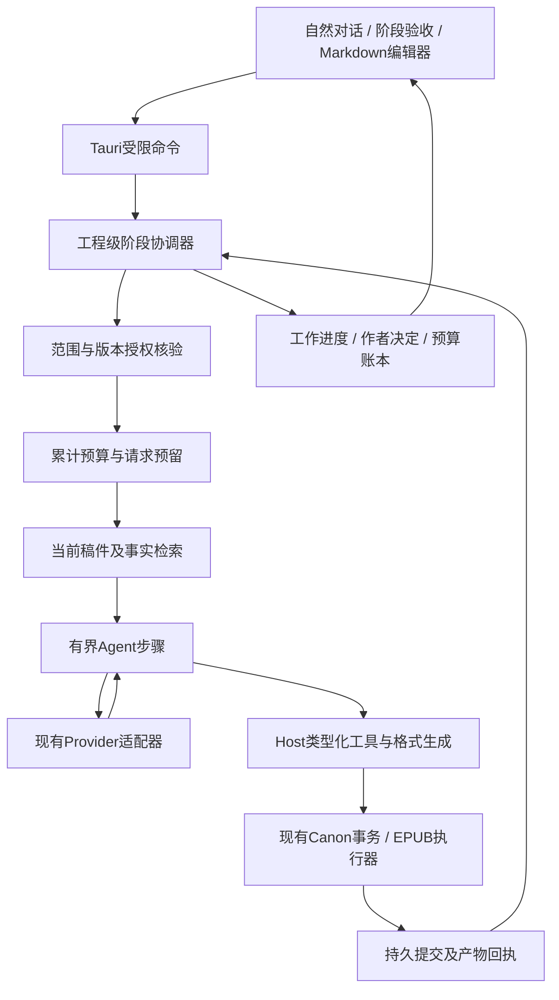

# NovelGainker 技术方案 v1.2（本轮方向已确认，待实现验证）

日期：2026-09-09；更新：2026-09-10。依据：[产品策划](product-spec.zh-CN.md)中已确认的Q1～Q17及既有产品基线。产品访谈及本轮技术取舍已确认；G01～G15与合并的T3～T5均按用户建议选择收口，T1先持久后显示已确认；T2已改为逐轮上下文审核及主动审稿，T2a确认包含别称和指代，详见[专项记录](reviews/technical-design-alignment-2026-09-09.zh-CN.md)。本文提出目标实现结构、交付顺序及验收，不代表已经修改生产代码、实施或通过新增功能验收。当前源码架构另见[当前实现](architecture.zh-CN.md)。

## 1. 需要解决的实际问题

当前实现能在一次聊天里读取资料、写入一个章节、维护设定并本地出版，但工作生命周期仍受单轮Agent控制。模型暂时失败会使回复未生成，作者常需重试或再次催促；工具参数和候选格式错误反馈不足，模型可能重复失败；没有跨轮的阶段目标、执行授权和恢复进度。

目标是让作者从hook开始，在方向、大纲、首章和故事阶段验收点决定，其余已授权工作由应用持续完成；至少产出10～20万字情节完整、基本一致、可阅读的初稿。聊天、工作完成、文件保存、阶段验收、全书定稿及EPUB生成各自有真实依据。

复用现有Tauri 2、React/TypeScript、Rust app-core、受控Provider适配器、Markdown工程、检索、凭据库和Canon事务。不为本轮引入云服务、后台无人值守、任意程序执行、外部Skill运行时或全新桌面技术栈。

## 2. 保留与改造

| 现有基础                     | 目标改造                                         | 保留的约束                               |
| ---------------------------- | ------------------------------------------------ | ---------------------------------------- |
| Conversation单轮执行         | 增加跨轮阶段协调器，一次对话可创建或控制阶段工作 | 用户消息真实持久化，不伪造用户“继续”     |
| 有界Agent及3工具             | 每个工作步骤仍有界，由协调器接续必要步骤         | 不放开无限工具/请求，不并行写同一工程    |
| 来源、方法和完整读取回执     | 加入具体阶段授权、计划版本、步骤身份             | Hash证明来源，不冒充意图识别             |
| Canon快照、Committed、Undo   | 幂等操作标识、阶段版本清单和恢复核对             | CAS、dirty保护、writer lease、不可变回执 |
| 章节定稿与EPUB               | 增加阶段验收及全书一次确认的版本清单             | 阶段认可不能直接当作全书定稿             |
| 最近历史与派生摘要           | 全书摘要、阶段摘要、有效事实和按需原文检索       | 派生内容可重建，原文才是稿件依据         |
| 零自动网络重试、一次显式重试 | 有限自动恢复与参数纠错，累计预算不重置           | 已提交副作用不重放，服务持续失败可暂停   |
| 内联工具记录                 | 作者能看懂的进度、停点、保存和检查结果           | 不暴露密钥、隐藏提示、原始工具协议       |

## 3. 运行结构

协调器归Rust Host所有，生命周期与进程一致。React显示状态、发送作者操作和编辑保护请求，不在组件里维护生成循环。工程仍只允许一个活跃创作运行；会话切换不转移工作归属。既有只读会话与普通讨论无需创建创作阶段。

## 4. 状态与数据模型

### 4.1 不能合并的对象

| 对象                               | 必要信息                                                             | 用途                                                            |
| ---------------------------------- | -------------------------------------------------------------------- | --------------------------------------------------------------- |
| ConversationTurn                   | 真实消息、显示内容、生成状态、attempt                                | 对话交流；不是整个阶段的进度                                    |
| StagePlan                          | stageId、计划revision、目标、章节范围、验收条件、预计工作量          | 作者能理解并确认的工作范围                                      |
| StageRun                           | runId、stageId、绑定会话、计划revision、执行状态、暂停原因、下一步骤 | 一次执行，可跨请求/重开；不等于作者验收                         |
| WorkStep                           | stepId、输入版本、目标、允许动作、状态、输出回执引用                 | 规划/起草/上下文核验/修改等有界单元；正式审稿须另有作者请求来源 |
| AuthorDecision                     | 作者消息或操作来源、确认类型、计划/成果revision、范围、时间          | 证明作者批准了哪个版本及动作                                    |
| BudgetLedger / RequestAttempt      | budgetId、上限与追加决定；每次物理请求的预留/发送/用量/估价版本      | 防止重试、重开、换run或返工绕过累计预算                         |
| StageReview / ReviewValidity       | 不可变成果清单、全文件Hash、事实与检查清单；逐项有效性               | 作者验收快照，名称不代表自动审稿；内容或依赖过期可局部复验      |
| ContextAudit                       | turn/step身份、涉及实体、来源版本、覆盖范围、冲突/缺证结果           | 当前话题的上下文核验；不存隐藏推理，不代替整书审稿              |
| EditorialReviewRequest / Result    | 真实作者请求、明确范围/版本、预算引用、发现及覆盖                    | 仅作者请求才创建的正式审稿任务，不能从阶段计划或关键词命中推断  |
| FactReference / RevisionDependency | 来源文件/版本/位置、阶段归属、事实标识、依赖边、复核回执             | 关联原文、传播影响；不是隐藏的另一份稿件                        |
| EffectSlot / IntentRevision        | 稳定逻辑效果标识、不可变候选Hash、来源版本、提交回执                 | 区分无副作用纠错、重复请求与获准的新改写                        |
| BookFinalization                   | 全书有序章节及元数据/资产版本清单、作者决定、有效性                  | 一次确认整书，导出前核对版本                                    |

这些名称是方案中的领域对象，不是已存在的IPC或磁盘schema。新增严格schema需在实现任务中冻结，包括每字段尺寸、引用范围、目录数量和拒绝行为；不能透传任意JSON状态或执行路径。

### 4.2 稿件与内部状态

事实内容保存在实际Markdown章节/人物/设定等资料中。暂定事实必须有可查看的来源文字；内部记录只关联阶段、来源版本和是否已验收，不能在隐藏状态里另建一份覆盖稿件的“事实真相”。取上下文时连同当前有效性和暂定状态提供，不把暂定内容伪装成作者已确认。

技术方向采用项目内受控 `StageControlStore`（独立SQLite数据库）作为阶段计划/执行、作者决定、预算、事实引用、审查有效性、收件登记和操作意图的唯一权威。它不是现有应用数据目录下的UI偏好数据库，也不是可以删除重建的索引。表结构、数据库路径、逐字段边界、总量及恢复余量须由首个实现合同冻结。持久化失败不得启动请求或取得新写入权限；不得存Provider原始续接、隐藏提示或密钥。可见草稿与进度摘要可以持久化，中间推理过程不能作为用户可见记录。

稿件字节及Committed证据仍分别归Markdown和现有Canon ChangeStore所有；可见聊天仍归ConversationStore，既有身份与路径保留。控制库只引用这些记录并验证Hash，不能复制一套可独立修改的权威正文；索引、UI缓存和阶段概览均由权威状态生成。T1已确认先持久后显示；具体检查点规则见§7，显示不能领先于持久记录。

控制库内“阶段批准、该快照的有效事实转确认、已展示下一阶段的授权”使用同一数据库事务，事务提交后才能派发下一阶段。它们不需要再次修改事实来源Markdown；事实文字已在此前的Canon提交中存在。提交前在本机工程短临界区核对实际版本与依赖；外部编辑随后发生时使相应有效性过期。

数据库事务不包含任意Markdown写入。跨Store操作使用先落盘意图、受控效果、核对回执、登记结果的恢复协议：意图含来源版本、目标候选Hash和稳定效果身份；实际稿件只经Canon提交；控制库失败而Canon已Committed时，恢复先按身份/Hash关联原回执，不重放写入。作者消息先存ConversationStore再登记收件引用；登记失败保持派发/提交屏障，重开本地扫描未消费消息补齐登记，不能通过多发一次模型请求补状态。各步都有可中断点，不能把它们宣称为单个原子事务。

数据库若使用WAL，需冻结同步设置、checkpoint、文件配额及一致备份/恢复合同；运行中只复制主数据库不能视为完整备份。SQLite能力不等于已经证明本工程的崩溃恢复；另需对跨文件提交注入失败。[SQLite原子提交](https://www.sqlite.org/atomiccommit.html)、[WAL](https://www.sqlite.org/wal.html)、[备份API](https://www.sqlite.org/backup.html)

默认旧会话路径及现有session/message/change身份保持不变。新增运行状态不要求重置项目或批量改写所有文稿。未找到有效的作者验收证据时，已有稿件仍可阅读、编辑和讨论，但不能推断它已经获得新阶段或整书批准。

### 4.3 生命周期

分别维护执行、验收及当前有效性，禁止使用同一个 `completed` 代表三个结论：

- StagePlan每版不可变，作者决定批准明确revision及范围；变更形成新版，不覆盖旧计划。
- StageRun执行状态为 `queued / running / paused / interrupted / completed / cancelled`。进入queued/running必须有有效授权与预算。completed仅表示该运行的必需步骤结束；暂停原因包括预算、Provider、无进展、方向变化、源冲突、存储和重开。
- StageReview保存不可变成果快照；作者决定为批准、要求返工等独立记录。当前待审清单可被新清单替代，旧批准不抹除。ReviewValidity按成果项记录 `current / needs_review / superseded`，整阶段可呈现部分失效。
- 同一阶段可有多个run和review revision。它们仍引用同一阶段累计budgetId，返工或内部换run不授予新额度。WorkStep运行结果、工具结果及Canon效果分开；Provider Stop、Task Succeeded、NoChange或PendingConfirmation均不能证明章节已保存或阶段通过。

| 事件                                    | 执行层                              | 验收与有效性                                                 |
| --------------------------------------- | ----------------------------------- | ------------------------------------------------------------ |
| 必需写作、相关上下文及格式/版本核验完成 | run completed                       | 提交作者验收快照；未请求的正式审稿不是必需步骤，尚未作者批准 |
| 作者批准当前Review                      | 不重写已完成run                     | 原子记录批准与有效事实；是否启动下一阶段依Q15                |
| 作者要求返工                            | 原run/快照保留；确认范围后创建新run | 记录要求与新计划；旧有效性只对受影响项失效                   |
| 作者手改或依赖改变                      | 暂停受影响的后续工作                | 标记变更项与受影响项需复核，不取消整本历史批准               |
| 崩溃后重开                              | 原运行标interrupted；仅本地对账     | 不自动请求模型，不假定已经验收；确认继续后恢复               |
| 停止                                    | 先禁止新工作；完成必要状态收尾      | 已Committed与已作出的作者决定保留                            |

- 方向、大纲、首章及阶段计划均有实际可读候选；确认绑定具体版本，不从历史赞许文字继承无限权限。
- 批准阶段只授权本阶段内容、普通细节及未验收草稿修订（Q5～Q7）。发现必须改变已确认主线或已验收内容时暂停相应执行。
- 工作步骤到达局部上限但有有效进展时，协调器在阶段范围和总预算内接续新步骤；内部轮换不制造新的用户消息、不刷新授权。
- 阶段成果提交验收时附下一阶段目标与费用估算。Q15允许一个明确“通过并继续”记录本阶段验收并授权展示的下一阶段；“只验收”不启动后续请求。
- 自然语言决定由模型理解，Host校验真实作者来源、待决对象、版本和封闭动作；不按关键词直接判定，也不声称Host能机械证明语义。意思不清时澄清一次，不猜测其扩大范围。
- 任何新方向导致计划revision变化，原授权不能自动扩展到新计划。

### 4.4 新输入与执行交错

分离收件顺序与执行授权：每条真实作者消息形成持久message引用与单调 `inboxSeq`；存在未处理新输入时，设置提交/派发屏障。`authorityEpoch`只在停止、改方向、改授权范围等真正影响执行权的事件发生时变化。普通讨论处理完后可解除屏障而不变更epoch；不能因为作者说一句无关的话就丢弃已付费生成的有效候选。

同一工程协调器优先处理作者输入。停止操作直接请求取消；普通消息由语义处理决定是补充、讨论还是改方向，不按关键字重写计划。G11/T3已确认普通输入优先：新输入持久化后取消在途生成，保留已持久文字与已Committed内容，先处理消息及相关上下文。取消不等于远端免计费；本地短提交先行进入时须可靠完成结果登记。普通讨论处理完且原授权/预算仍有效时可恢复未完成工作，明确停止/关闭或授权暂停不能被闲聊自动解除。无论调度选择如何，未知新要求下都不提交旧候选，收到无歧义的停止也不等待语义模型判断。

每个准备写入的意图绑定获准计划revision与authorityEpoch。在短提交临界区再次核对两者、收件屏障、编辑保护及源Hash；同一工程的停止/提交使用同一协调边界确定先后，不跨HTTP持有项目锁。停止先到则不能开始新效果；效果先进入受保护的本地提交则保留其结果并完成必要回执，不能只因取消token已置位便谎称没有写入。显示上区分“正在停止”和“已停止”；强制退出后的未知结果交给本地恢复核对。

过期结果可保留为未采用候选，不能继续写入。仅解除普通讨论屏障时，候选仍需重新验证来源与权限才可采用。已先行Committed的写入继续显示已保存；必要的终态、预算和恢复记录允许收尾持久化。用户消息已落盘但语义判断失败时保持后续执行暂停。

普通聊天与阶段步骤由同一个协调器串行安排，不启动第二个写作循环。暂停后可讨论和修改计划；恢复只处理仍未完成的步骤。跨阶段授权由Host生成opaque决定引用，内部步骤引用原始真实作者决定及当前计划，不伪造一条新的用户消息满足旧“当前轮用户来源”检查；这需要显式扩展现有来源合同，不能简单移除来源校验。

### 4.5 会话归属与窗口

持久阶段归属和短期请求预留必须分开。没有在途HTTP不等于阶段已经结束：阶段可能正等待作者、预算或本地修订；会话列表恢复旧Turn不能释放或删除StageRun。重开只修复进程状态并显示停点。

后台完成通知及所有写入使用启动时捕获的project/session/run身份，切换当前会话不改这些身份。同工程别名窗口可显示状态，但每个控制/写入命令仍验证物理工程权限，History lease不授予Canon写权限。分支只复制可见聊天，不复制阶段运行、预算或授权。G11/T5已确认“暂停并归档”：停止新工作、完成必要本地收尾并保存阶段归属/预算后登记归档，不等待远端请求自然结束；中断可恢复核对。恢复会话后须明确继续才重新执行，不能通过长期占用旧请求预留实现保护。

## 5. 内容版本、暂定事实与质量

本阶段新细节标为暂定，后文保持一致；阶段验收绑定实际成果清单，将其中有效事实转为已确认。来源章节发生改写后，旧事实引用标记过期并触发复核，不能只修改一份摘要假装矛盾消失。

AI可修改当前未验收阶段的草稿，变更前后版本和回执可回看。用户笼统说“这段不行”时，先分析并提出具体保留/修改范围；作者确认后形成新的返工计划，再自主执行（Q13）。返工不得在撤销旧内容时顺带清除作者的后续编辑。

Q16已确认：先列出受影响的章节与设定，作者一次确认整组改动范围；返工后只重新验收受影响部分，其余保留原验收结果和可回看版本。建立依赖影响清单，区分文件字节变更与正文未变但依据已过期两类；后者也标记待复核，不能因为Hash相同就保留语义有效结论。

执行只修改已确认范围。过程中发现新增的范围外影响时，补充影响说明并取得对应授权；依赖图只帮助定位，不能自行授予改写权限。旧验收记录保持不可变，新修订使其对受影响版本不再适用；无影响章节无需重复验收。若重新生成整书定稿清单，依照Q14确认变更后的全书版本，不要求作者重读无影响章节。

事实引用和影响图需要独立的新合同，不能直接把现有 `chapter_dependencies` 当作章节间语义依赖。每条引用绑定可查看的原文位置、全文件版本与所属阶段；边关联被引用的事实版本、使用它的成果及检查回执。源版本改变先标旧引用失效，以有限队列传播到依赖成果；按节点去重以处理环，超出容量或未知覆盖时标记需复核，不默认为无影响。模型判断事实是否被保留/删除及影响范围，Host只核验真实来源、版本和检查覆盖。正文Hash未变但依据失效也需复核；恢复执行、阶段验收和全书定稿都使用这份有效性。

Q17已确认：保存作者手改，作为当前文稿；在仍获授权的当前未验收阶段内可同步普通细节。涉及已验收章节、主线或主要人物动机时，先呈现影响并确认后执行。作者手改/外部编辑触发源Hash和依赖重新检查，但不能据此扩大AI改写范围，更不能以过期内部事实把原文改回去。

### 5.1 每轮自动上下文审核

T2已按2026-09-10用户纠正替换：每次对话一旦涉及关键词，就自动核对相关上下文；T2a确认别称和前文可识别的指代同样触发。不再默认安排独立阶段或全书审稿。Q12的情节、人物、规则、伏笔及实际正文质量目标继续成立，达成目标的过程要依据相关上下文，不能自动扩展成未请求的编辑评阅任务。

处理链为：持久作者消息及当前会话背景 → 识别本轮实体/关键词/指代 → 检索相关当前原文与有效事实 → 对照本轮意图 → 带依据回答或继续获准工作。每个新对话轮都执行识别，不能只在阶段结束时检查。无需作者说“审核”，也无需维护一张人工触发词表；明确名称可借助索引命中，别称、指代及意图由语义判断关联。没有相关实体时不进行无关的全书扫描；生成中新引入的相关实体或事实需要补取相应上下文后才能作为既有事实使用。

ContextAudit保留有界的实体身份、源路径引用/Hash、已确认或暂定状态、匹配的文本位置、覆盖与发现。关联上下文来自当前Canon、有效事实及当前会话，聊天候选不能覆盖作者已确认资料。不存在的条目标为新候选或缺证；指代多解先澄清。派生索引按项目/实体/源版本隔离，复用缓存前核对Hash与事实有效性，外部改稿和其他会话写入必须使旧引用过期。摘要能定位来源，不能替代实际原文证据或完整写入回执。

审核通常复用本轮语义处理与有界read_context读取，无需每次另开一个审稿模型。关键词/别称命中触发取证，不直接选择写入方法、授予修改权限或启动审稿。重复提及相同且仍有效的来源可合并读取；读取范围/体积受限，必要调用计入当前已授权预算，不能暗中给每轮加整章/整书审稿费用。

有矛盾时给出简短事实对照与来源，区分“与现稿冲突”和“作者在讨论改动”。可以继续讨论候选；确需改动时按Q5～Q7、Q16/Q17处理。缺证、检索失败或预算不足如实说明未完成的核对，不宣称通过；保留能可靠继续的讨论和本地查看，不能为了清除冲突自动改稿。只有依赖该未知事实的提交或执行暂停，不把一次审核失败变成全部聊天的形式门槛；Provider整体不可用时仍如实告知无法生成新回复。

### 5.2 正式审稿仅由作者请求触发

只有真实作者在对话中明确要求审稿或语义等价评阅时，才创建EditorialReviewRequest。请求绑定本章/选定章节/整书范围及当前版本；范围含糊先澄清，不能默认全书。引文中出现“审稿”、“怎么审稿”或“不要审稿”都不等于执行请求。阶段结束、全书完成、实体命中、阶段计划和AI自评均不能创建该请求。

被请求的审稿可对结构、节奏、人物塑造、语言和一致性提出有证据的发现；具体只检查作者所要求的范围。整书审稿可分章检查、跨章依赖检查及主线汇总，列明覆盖和未决项；未读取的部分列为未覆盖。审稿结果不自动授权改稿，执行修订仍需已有有效范围或新的作者决定。独立审稿上下文可作为实现手段，但只有真实审稿请求存在时才使用。

阶段成果交付汇总已有上下文审核和必要格式/版本核验结果；没有审稿请求时，不安排正式审稿、不预留其模型费用，也不要求一份审稿报告才能验收或定稿。未请求显示未请求，不能标为审稿失败；已有局部核对不能标为全文审稿通过。未解决问题如实列出，作者验收和整书版本确认照常保留。

验收清单采用生成成果当时的稳定快照，提交验收后停止自动改动该快照对应内容。作者决定到达时重新核对文件版本；若已变化，先呈现差异再形成新的待验收清单，不能把旧验收按钮套用到更新后的文字。阶段通过、有效事实转确认及下一阶段授权按§4.2在控制库同一事务落盘；其中任一环节未落盘就不启动下一阶段。

### 5.3 G01～G08已确认的补充合同

2026-09-10用户对一次性列出的15项技术缺口明确“1-8按建议”。以下方向已确认，详细流程、故障处理及验收反例见[缺口处理方案](reviews/technical-gap-closure-proposal-2026-09-10.zh-CN.md)。用户随后对9～15答复“按建议”，该文件G01～G15现均已确认；其中实现及测试仍未完成。

| 编号 | 已确认方向                       | 对现有方案的补充                                                                          |
| ---- | -------------------------------- | ----------------------------------------------------------------------------------------- |
| G01  | 实体/别称/指代完整生命周期       | 稳定身份、增量索引、重名和改名处理；临时指代按会话隔离；无命中不能证明不存在              |
| G02  | 事实按故事时间和人物知情范围判断 | 区分转移、倒叙、谎言/猜测与客观事实；不以最后写入值覆盖所有时间                           |
| G03  | 聊天确认衔接正式资料             | 候选版本→作者决定→Canon提交→引用登记，分别显示确认与保存状态，中断不重复批准/写入         |
| G04  | 上下文补查衔接流式显示           | 受影响片段补查或明确为候选/缺证后，先持久再发布；后来发现错误追加有依据更正，不静默改历史 |
| G05  | 冲突处理形成可恢复闭环           | 绑定双方源版本、适用时间和作者决定；相同冲突不重复问，来源实质变化才重开                  |
| G06  | 审核失败有限降级                 | 有依据回答、缺证候选讨论、本地故障说明分开；预算不足不再付费生成解释；暂停依赖写入        |
| G07  | 阶段目标对应实际成果             | 批准目标关联章节/场景与结果，写够字数不等于达成；过程记录不触发正式审稿                   |
| G08  | 循环改写不算净推进               | 识别重复问题及A/B回摆，Hash/callId/run变化不刷新预算和无进展计数                          |

## 6. 工具协议与错误纠正

继续由模型选择写作方法，Host决定固定字段、路径、事务和结果投影。G09已确认新增明确版本的工具合同：模型提供类型化创作内容与目标意图，Host生成受约束的frontmatter、身份与文件表示，避免让模型反复猜UUID、schema或YAML格式。旧协议和回归保留原范围，更新生产协议时同步两种Provider定义和全部执行校验。

读取某写作方法时一并提供该方法必需的模板/字段约束；超出工具结果预算时分段提供并签发完整回执，不默默截断为可写证据。批量维护仍按目标数、正文和实际序列化体积限制拆分，单章执行单元保留有界文件合同。

参数或候选失败返回有界诊断：错误分类、字段位置、期望类型/允许值、能否修正、是否已有副作用。错误反馈应足以形成不同的修正请求，但不回显密钥、绝对路径或不必要的全文。纯格式错误可以在无副作用时纠正；模糊目标、缺少授权、原文变化不能靠格式修复绕过。

不得用宽松JSON/YAML解析、正则“猜修”、忽略来源、直接落盘模型字符串或无限重复相同参数解决报错。纠错请求同样计入步骤和阶段预算。

## 7. 自动恢复、取消与幂等

| 情况                           | 目标处理                                           | 不能做的事                               |
| ------------------------------ | -------------------------------------------------- | ---------------------------------------- |
| 暂时超时、连接失败、可恢复限流 | 可取消的有限退避重试；计入预算并展示恢复中         | 无限等待、换模型继续花费、不计费重复请求 |
| 参数/候选校验失败              | 提供具体诊断，生成修正请求                         | 原样重复无效参数、放松文件保护           |
| 身份/来源/方法回执过期         | 重新读取当前版本，在仍有效授权内准备               | 复用过期证明强写                         |
| 已经Committed，最终回复失败    | 展示已保存事实，继续尚未完成的检查或下一步骤       | 重放已完成文件写入、把保存显示为失败     |
| 事务结果不确定                 | 先本地核对持久意图、Hash及回执；未知外改则暂停写入 | 凭聊天文字猜测成功，盲目重试副作用       |
| 持续无进展/预算不足            | 保留成果、停点及下一动作并暂停                     | 要求作者重新描述整项任务才能继续         |
| 用户停止/改方向/关闭           | 取消在途请求，停止后续派发，保护已提交成果         | 在后台继续生成或自动重开执行             |

将三种身份分开，并由Host分配：

- RequestAttempt是一次实际网络发送的身份，关联所属run/step及budgetId；模型的callId不是账本主键，也不是副作用身份。
- EffectSlot是某个获准工作步骤要完成的一项逻辑效果。它关联不可变IntentRevision，每版包含目标、完整候选Hash、来源版本、授权epoch和前版引用。同一意图身份不能配不同内容。
- 参数错误且已证明没有副作用时，修正创建新的IntentRevision，旧版保留为Rejected，由同一EffectSlot引用新版本。处于Applying或结果未知时必须先核对，不允许换新版重试。EffectSlot已Committed时重复请求返回原核验回执；后续确需改稿必须由仍有效范围内的新WorkStep和新EffectSlot执行，并引用前次提交。

这样既允许错误参数真正改正，又不靠换callId重放已提交内容。意图先落盘，再执行副作用；模型不能自行制造新身份逃避检查。重开先本地对账再重建模型上下文，不依赖旧Provider cursor，不存原始Continuation，也不重放已完成工具。

流式回复中断时保留已持久化的可见部分并标明未完成。恢复请求使用该部分和已核验成果建立新上下文；新生成以续写或修订段落呈现，不把重复文本直接拼接，也不把半截工具JSON当作已执行操作。完成事实来自Host回执。

请求已发出而响应丢失时，服务端可能已计费；只能保证本地副作用不重复，不能承诺远端 exactly-once 或免除重复网络费用。不确定用量保持预留，直到取得可靠依据；不能因超时就把账本当零。

工程起始候选参数：单次请求至多额外2次自动恢复；可纠正参数至多2次；同一输入/错误重复且没有新依据时提前停止。退避建议1秒、3秒并加小幅抖动，尊重服务端等待提示；超出剩余运行/预算边界则暂停，所有等待均可立即取消。这些是待定向验证的工程提案，不能宣称已经在当前版本生效。阶段另设总尝试/用量/无进展上限，不能通过不断创建新step刷新恢复额度。

恢复循环唯一归协调器；底层适配器只执行一次实际发送。现有通用Provider接口另有重试，不能被新外层循环直接包住，否则次数相乘。单次接口需返回有界错误类别、发送阶段及有效的服务端等待提示；超过本地等待上限就暂停，不能把长等待截短后提前请求。每次网络重发与模型参数纠错分别计入局部限次，并共同计入阶段累计额度。恢复状态持久化，重开不能重置连续失败计数或绕过等待。

有效进展包括：提交目标成果、补齐确实缺失的当前来源、完成覆盖新增内容的检查、解决一个已列问题。重复读取相同内容、反复重述计划或只有流式文字增长不自动算进展。判定结合步骤目标和有限运行时间，阈值经合成故障测试及真实试用校准；后台检查不能凭“质量还能更好”无限循环。

进展凭据绑定成果回执、此前缺少的来源版本、实际新增检查范围或已列问题的修复/复核记录；不能由模型提供一个新ID就算新增进展。规范化输入Hash、源版本和错误类别形成重复失败指纹，避免换callId原样重复。工具Succeeded、NoChange、PendingConfirmation、请求Stop分别如实登记，不自动清零无进展计数。语义问题是否解决仍需证据审查，Host不能只凭一个布尔值证明文稿质量。

关闭沿用现有手工脏稿选择；确认关闭后取消并退出，不为等待Provider或最后刷盘拖住窗口。运行中需持久化文字检查点，并在请求前/副作用前/提交后写入关键状态。文件Committed结果不得因最终回复失败而假称未保存；重开只展示停点与未完成工作，作者确认继续才发起新请求（Q11）。

T1已确认（用户答复“1. 按建议”）：小批持久化成功后再显示，接受约0.2～0.5秒批量显示延迟；在本地磁盘正常的前提下，应用崩溃/强制退出后可恢复已显示内容。这替代v1允许已显示尾部丢失的提案。0.2～0.5秒为批量刷新目标，不允许为了满足时间而先发布未落盘内容。当前源码在终态才保存AI正文，此项尚未实施。

G13已确认采用ConversationStore有序追加分段与持久检查点，避免每批重写全部聊天历史；旧快照/新增段的唯一权威及归并切换按缺口处理方案冻结。检查点带持久正文位置和revision；UI按位置合并、去重，事件丢失时从Store补齐，而不是重新请求模型。按时间与字节双阈值刷盘，定时器不依赖下一delta到来；成功提交后才发布该批。失败时不发布该批，并停止相关请求、保留此前已持久化内容及明确恢复状态。关闭不等待最后未显示批次。可见聊天检查点不等于章节Canon保存。

## 8. 预算与费用

预算按阶段授权累计，包含规划、Compactor、生成、检查、纠错和自动恢复。请求前预留预计输入、最大输出和其他已知计费项；收到可靠usage后核对，取消/超时但可能已计费的请求保留不确定量。新内部轮次、重试、切会话、重开程序不能清零阶段账本。

每次物理发送单独形成RequestAttempt，先完成精确序列化体积校验，再持久预留并记录模型/配置与价格版本、body字节数、输入估量、最大输出及请求类别；不保存原始请求body。`prepared`阶段禁止发送；先持久标记 `dispatching` 才能进入HTTP。重开仍为prepared且未进入dispatching的请求可证明未发出并释放预留；dispatching以后响应缺失，即使实际上尚未发出，也只能按可能计费保守保留，不能假装零费用。

可靠usage由Rust按请求身份幂等登记与核对，覆盖Agent、Compactor、纠错、上下文审核及作者实际请求的审稿；前端事件只作显示。预留与观测用量分栏，不把当前“请求输出上限累计”冒充实际token或费用。估量不足需显示差异并停止新增请求；不确定预留只能凭可靠结算依据释放，等待一段时间或重开不是依据。支持补充预算不代表抹掉历史不确定量。

尚未建立阶段的候选规划与普通聊天也必须绑定已获授权的可见预算，不允许只有阶段创建后才开始记账。阶段返工、模型上下文压缩或内部重建run沿用原budgetId；只有作者明确追加才提高该预算。G10已确认聊天/阶段/主动审稿采用用途额度及统一请求账本：默认聊天额度首次集中设置，额度内不逐消息确认；每次实际请求只计一次，需同时满足适用用途及已设置的总上限。不能借用阶段授权为无关请求付费，追加不清除历史不确定费用。

提供可调整默认额度、阶段预计范围、已用/已预留/尚不确定量及剩余额度。金额估算基于选定Provider/model的已核验价格版本，标明来源与日期；未知价格不能显示0元或假精确总价。若作者设置的只有金额上限，价格无法核实就暂停付费自主执行，待补全价格或作者明确选择token/调用额度后继续；不能私自换成另一种预算绕过金额限制。配置上限与单次最坏预留不足时，在下一请求前暂停，追加需要作者决定；模型建议质量提升不是预算授权。

本地能严格限制请求次数和请求输出上限；服务商最终计费、缓存折扣及丢响应请求的账单可能不同，不能把本地估算上限包装为绝对账单保证。对话中临时追加的付费任务同样需要进入可见预算，不允许“聊天不阻断”绕开作者设定的限制。

当前单步的8 Agent/1 Compactor、工具/字节上限可作为首批回归基线；整个阶段不能仅沿用一次Turn总额。阶段默认值依据章数、单章长度、相关上下文核验范围与Provider估价形成；未请求的正式审稿不计入预留，主动审稿按请求范围在有效预算内估算，正式实施前以合成和真实试用数据冻结，并展示给作者。本文不虚构人民币价格或承诺任意预算必定写完全书。

## 9. 上下文与长期工程

每次工作上下文包含当前任务目标、已批准方向与约束、有效阶段计划、必要已确认/暂定事实、相关章节原文和当前执行结果摘要。按实体/事件/章节关系加现有检索取证；全文写入前仍需完整原文回执。摘要不能替代更新目标的完整读取，也不能覆盖相冲突的原文。

目录、正文Hash和修订号变化后使派生摘要、引用及检查结果过期；检索只返回标明当前/过期状态的记录，必要时重建。长对话可以压缩派生记忆，但保留可见原始聊天；分支复制的“已保存”文字显示为历史引用，不创建新提交证据或新阶段授权。导出不包含隐藏执行状态或原始协议。

32非归档会话和256总条目保持既有决定。阶段协调状态不靠制造大量聊天消息维持。运行前计算历史、工作记录、变更快照和临时写入的所需容量；不足时暂停相应工作，告诉作者具体类别、已保存内容及可行处理方式。归档仅释放非归档名额，不释放全部存储；增加配额或显式导出后的清理不得伪装成自动策略，也不能删除仍被Undo、验收或恢复依赖的记录。

已有容量范围先用于合成20万字完整流程与多轮返工压力验证；若不足，调整负责存储的工程合同并保留恢复余量。当前尚无完整历史释放流程，技术实现不能用手动删除隐藏文件作为普通用户操作指南。

首版不承诺无限历史。容量达到上限时，显示具体类别、现有用量和所需预留；仅非归档名额满时提供归档入口。磁盘不足与配置配额满分别处理：前者释放项目外的可安全管理空间或选择完整项目备份位置后由作者操作，后者可在经过边界验证的范围内显式调整本地额度；任何方式均不能自动删除仍被引用的回执。完整历史裁剪涉及新的不可逆产品规则，排除出本次默认流程；需要保留受控调容路径和暂停后的恢复，不将“归档”误说为释放所有空间。

归档历史保持只读。查看原变更不需要恢复会话，执行原Undo使用“恢复会话后撤销”路径并重新核对当前Hash和编辑状态；32名额满时让作者选择先归档的会话，不能替作者任意归档。聊天分支不复制原执行权，历史回执引用只能回到原记录核验。

## 10. 全书定稿和导出

作者最终确认的是可查看、可比对的当前全书版本清单（Q14）：有序章节内容Hash、有效阶段结果、必要出版元数据和资产版本。复用当前定稿合同：Hash覆盖实际完整文件字节，包括final状态字段，批准回执保存在Canon外。批量确认前先生成确定的最终候选表示并计算Hash，作者确认后提交的必须是这些字节；不能通过排除状态字段或复用旧Hash来规避版本变化。

draft→final会改变文件Hash，必须补充受控的批准衔接凭据 `ApprovalTransferReceipt`：绑定原阶段批准及beforeHash、确定的final候选afterHash、整书作者决定、转换版本和实际Canon回执。只接受闭合的定稿状态字段变化，正文、标题、章节身份、顺序及其他字段保持同一内容；验证的是精确差异，不能任意重新格式化YAML后声称只改状态。原阶段批准不修改，新最终文件通过这份凭据引用它；普通手改final没有凭据，不能继承批准。其他内容变化先按对应影响复核。

新增 `BookFinalizationBatch` 保存全书有序成员及每章精确前后Hash、批准衔接和提交回执，最后才写整书完成标记。允许有界逐章执行，但不是同一聊天Turn里循环调用旧接口；现合同只允许一个有效章节记录，需增加绑定整书决定的内部执行来源和批次协议，保留单章保护，不伪造作者消息绕过预算或来源校验。

这是可恢复批次，不承诺任意多文件瞬间原子替换。某章失败时保留已经Committed的成员并标“定稿未完成”；后续先核对实际成员回执与版本，缺失部分只能在Q11继续授权及原整书决定仍有效时接续。无论从哪一入口出版，目标协议都要求完整且当前有效的批次及整书清单，不能退回旧的“找到部分final章节就导出”路径。作者只作一次整书决定，不因本地逐章执行而反复点击。

任一成员、依据或必要元数据/资产变更使对应清单失效，界面展示范围，不把原确认扩展到新正文。批次部分成功不能显示整书已定稿；旧作者批准与局部保存仍作为历史证据保留。

EPUB构建前再次核对全部实际版本和当前有效决定，读取一致的受控输入，生成新产物路径并记录输入清单与产物Hash。并发外改、缺章或过期定稿使该次构建暂停并说明原因；既有EPUB仍作为旧版本产物可识别，不否认其曾成功生成。章节/阶段/全书清单是内部批准证据，不作为正文插入EPUB。

## 11. 界面与操作结果

保留三栏：左侧文件树→多会话→Provider，中间自然对话与阶段进度，右侧真实Markdown。侧栏拖拽调宽，不恢复用户已取消的加减按钮。阶段结果使用对话内摘要，可展开具体章节、差异、工具结果和检查发现。

常态只展示：正在做什么、已保存哪些成果、完成/剩余哪些目标、是否需要作者决定、费用估算和暂停原因。工具参数修复、schema和内部轮次数不成为作者的常规任务。

停止、恢复、验收、只验收、通过并继续、确认返工范围、整书定稿均指向当前具体对象和版本。新IPC只接受opaque标识、revision及封闭动作；新增命令数量以冻结合同为准，同步Manifest/Handler/Permission/Capability/生产客户端。界面监听异常通过Store对账恢复，不再发模型请求。

遇到网络或工具失败，作者仍能查看和编辑已有内容、讨论替代方案；具体依赖未解决时暂停相应自动执行。Provider不可用时如实说明无法获得新模型回复，不生成假回复。状态存储故障或容量不足不允许偷偷绕过持久化和预算，仅提供仍可可靠完成的本地操作及恢复说明。

## 12. 兼容与实施顺序

新增模块独立接入现有commands和app-core，不先拆掉已验证的事务/Provider基础。实现顺序建议如下；这是新方案的工作顺序，不更改旧NR-604～606完成状态，也不预先编号为已批准Story。

| 次序 | 交付切片                                               | 可检验出口                                                                        |
| ---- | ------------------------------------------------------ | --------------------------------------------------------------------------------- |
| A    | 源码/Release对应核验、自动提供必需模板、明确候选诊断   | 原截图的参数和候选错误可定位并纠正；固定构建可追溯                                |
| B    | durable StagePlan/Run/Step/Decision与范围核验          | 空hook形成候选；批准后阶段连续运行，到验收点停止，不伪造用户消息                  |
| C    | 累计预算、有限自动恢复、幂等及关闭重开                 | 短暂失败无需手动重试；已保存内容不重复；预算与停止有效                            |
| D    | 逐轮实体/别称/指代上下文审核、暂定事实、成果版本及返工 | 每轮相关话题自动取证；不会升级成正式审稿；落实Q16局部复验、Q17手改同步边界        |
| E    | 作者主动审稿、整书一次定稿和EPUB                       | 有请求才按范围审稿；无请求也可在必要版本/格式核验与作者确认后导出，不声称全文已审 |
| F    | 升级、容量/长篇、真实用户与最终构建验证                | 保留旧数据，覆盖完整流程与失败恢复，不把mock成功当真实质量                        |

B/C/D的最小能力应共同构成首条可用闭环：已批准范围内连续工作、持久预算与恢复、逐轮上下文审核、暂定事实、稿件保护、成果验收及手改边界都必须存在。模块可分批内部测试，但不能先交付没有Q6/Q7保护的自主阶段，或单独上线没有幂等/预算的自动恢复。之后再扩大章节数、复杂依赖及返工规模。每个实现切片按现有质量纪律验证。源码和当前Release不一致问题先核实，不从上一轮文字交付记录直接恢复未知文件。

新增状态需要严格版本、完整性、持久写入及恢复配额，但仅在新目录里加schema挡不住旧exe。当前旧代码检查project.json的工程级schema，合法v2继续可写、未知版本才拒绝；进程lease释放后旧程序仍可重新取得写权限。未发现“旧版必然删除未知阶段目录”的证据，确定风险是旧版可能绕过新批准状态修改Canon。

G12/T4已确认保留原工程，在受控副本上迁移与验证，通过后使用新工作工程；采用旧版入口确实拒绝的工程格式，具体版本值在实现合同冻结。旧版可继续使用升级前工程，升级后的进度不自动合并回去。副本运行、缓存与lease按物理工程作用域隔离，保留原身份/回执引用。未知新状态不使用既有v1派生状态重置；当前生产v2合同尚未实施此升级。

正式实现需用真实旧二进制生成的合成工程验证备份、升级中断、首次打开、旧版拒绝及失败回退；不能以修改版本整数或目录复制代替迁移。跨Store转移必须保存session/message/change身份和已有关联。迁移失败保留原工程与证据，不自动删除新记录以假装成功降级。

## 13. 验证与验收

| 层次           | 必须证明                                                                                                 |
| -------------- | -------------------------------------------------------------------------------------------------------- |
| 有界单步与协议 | 双Provider参数/模板/错误反馈、序列化边界、工具调用顺序、最终回复空间                                     |
| 授权和版本     | 未确认方向不得写；过期计划/阶段/整书决定不可复用；分支历史不授新权限；手改和跨阶段范围按最终裁决         |
| 故障与恢复     | 首次请求短暂失败、限流、格式错误、流式中断、写前/写后/回执后崩溃、重开、取消竞态、未知外部写入           |
| 费用和进度     | 每次尝试计账、超时不清零预留、重开不刷新预算、重复无进展停止、确认关闭无后台请求                         |
| 创作链         | 从空hook到阶段计划、首章、多阶段、返工、事实验收、整书定稿与EPUB；成果为真实正文                         |
| 规模与升级     | 10～20万字完整流程；保留既有30万/100万字检索与语义范围、10000文件/消息、冷/热P95、旧数据升级及最终包复验 |
| 实际体验       | 目标新手能自主完成关键决定，无需修工具参数、重述失败任务或逐段催促；真实Provider与人工阅读判断质量       |

合成测试使用隔离工程及loopback，断网/限流/脏稿/崩溃注入验证Host不变量；不触碰真实小说或凭据。章节数与模拟字数通过不代表模型能写出好小说。真实Provider测试由已安排的参与者在固定包上自行进行，仍需批次、覆盖和费用安排，助手不自动调用Live或分发。

真实语义沿用既有门槛：严重安全错误0；核心任务完成率≥90%；指定事实引用准确率≥95%；实用性和连贯性分别平均≥4/5。按Provider/model/规模逐格报告，任何安全或核心项不能由平均分抵销；本轮10～20万字完整书籍初稿还必须满足Q12的人工质量评定。

为避免“有效尝试”挑选结果，测试开始前固定任务单元、起始工程版本、预算和允许的作者介入。一次任务包含系统自动恢复，不把每个内部请求另计成功；需作者按重试才能完成的记录为首轮自主失败，补测单列。服务失败保留在体验分母；仅明确未开始且无应用执行的行政原因可列not_run，并保留原因和缺口。缺少日志/产物无法判断时标unverified，不当成功。

引用准确率以预设必须提供的事实—来源对为分母；缺来源、错版本或不支持该结论均失败，未请求的额外引用单列。写作评分沿用明确1～5锚点，缺评分列缺证。记录首次成功与返工后成功、人工介入次数、暂停原因及实际已观测用量，不只报最终满意。

P95与同机同语料基线比较，回退超过20%按既有严格Story要求解释并修复或另获预算变更，不能只写“已调查”。正式多用户/长篇/安装升级/最终包未完成时仍保留not_run/unverified；现有9/12完成数和最终NR-G7不因本方案自动改变。

### 13.1 决策对应的验收例子

| 依据      | 给定场景                                   | 预期结果                                                                   |
| --------- | ------------------------------------------ | -------------------------------------------------------------------------- |
| Q1/Q3/Q12 | 新作者只给hook并逐阶段参与，目标10～20万字 | 得到实际完整初稿；人工检查情节/一致性/可读性，字数不单独判成功             |
| Q2/Q4     | 已确认方向、大纲和首章，开始一个批准阶段   | 阶段内连续写多章并维护资料；到阶段验收点停止等待作者                       |
| Q5        | 尚无姓名、反派动机和结局                   | 提出完整候选供讨论，明确新增设想；未确认主线前不擅自扩写整书               |
| Q6        | 第三章新增伤疤，第四章引用                 | 有可查看的暂定事实来源，第四章保持一致；只有阶段通过才转确认               |
| Q7        | 第五章需要补第二章伏笔                     | 第二章仍属当前未验收阶段时可在授权内修订；已验收则先说明并确认             |
| Q8        | 旧请求在途时作者要求改结局                 | 待处理输入先形成提交屏障；改方向再撤销旧授权epoch；既成保存仍保留          |
| Q8        | 旧请求在途时作者只讨论无关细节             | 处理后解除屏障，不无故改变授权；候选通过当前来源/权限核验后仍可采用        |
| Q9        | 首次超时，随后恢复；或工具参数可纠正       | 在预算内自动恢复，不要求作者点整轮重试；重复失败或无进展则保留进度暂停     |
| Q9        | 章节Committed后最终文本回复断开            | 显示章节已保存，后续恢复不重复写同一操作                                   |
| Q10       | 下一请求的预留量将超出作者预算             | 发请求前暂停；追加必须有作者决定，重开不刷新已用量                         |
| Q11       | 关闭/崩溃后重开                            | 显示最后持久检查点和未完成工作；未确认继续前没有新模型请求                 |
| Q13       | 作者说“第五章不对”但未给改法               | 先给具体返工方案，经确认后自主执行，保留版本和受影响事实复核               |
| Q14       | 整书确认时有章节被外部编辑                 | 原候选版本失效，展示差异；不能将新字节沿用旧决定导出                       |
| Q15       | 作者说“不错”、只验收、或明确通过并继续     | 只有最后一种启动已展示的下一阶段；前两种不产生后续生成请求                 |
| Q16       | 修改早期已验收章节牵连后期章节             | 一次确认整组影响范围，修改后只复验受影响部分；其余保留原验收，旧版本可回看 |
| Q17       | 作者把左手伤改右手伤                       | 手改保留；阶段内普通细节可同步，已验收范围/主线/动机变化先确认             |

每个用例的实现验证仍须包含正向、取消/重开或过期版本的关键反例；无需为文档段落本身创建与实现重复的测试。本轮只检查设计是否覆盖决定，没有执行这些运行时用例。

### 13.2 专项对齐新增反例

| 风险                | 必须验证的反例                                                                                                                                  |
| ------------------- | ----------------------------------------------------------------------------------------------------------------------------------------------- |
| 状态混用            | run完成但作者未批准；要求返工后旧run仍完成；仅一个依赖过期时保留其他批准                                                                        |
| 跨Store中断         | Canon已Committed、控制库尚未登记；作者消息已保存、收件登记失败；阶段决定事务提交前/后中断                                                       |
| 幂等与纠错          | 无效果的错误意图可创建修正版；Applying未知不能换意图；已Committed改写必须是新的获准步骤                                                         |
| 自动恢复/费用       | 底层单次发送、不会双层重试；prepared与dispatching中断分开；usage去重；Compactor/纠错均计费；重开不清零                                          |
| 会话与停止          | 无在途请求但StageRun尚存时查列表；切会话后旧事件；同工程别名窗口；停止与提交的先后竞态                                                          |
| 全书定稿            | draft→final不丢阶段批准来源；正文变化不能使用衔接凭据；批次半成功时任意导出入口均拒绝整书成功                                                   |
| 升级                | 旧二进制拒绝新格式；副本迁移任一步失败可退回；不调用v1重置删除证据                                                                              |
| T1（已确认）        | 持久化前崩溃不显示该批；显示后崩溃可恢复该批；事件丢失/重复用Store补齐且不重发模型；定时器无新delta也刷新；写盘失败不先显示；关闭不等未显示批次 |
| T2/T2a 关键词与指代 | 明确提“铜钱”及随后说“那枚钱”均自动找回相关来源；“他”多解须澄清；每个新轮均识别，不要求说“审核”                                                  |
| T2 当前版本         | 另一会话/外部编辑改变铜钱去向后，旧缓存不能沿用为当前事实；草案想法不能覆写已确认设定                                                           |
| T2 冲突与故障       | 发现矛盾提示依据，可讨论改法而不自动改稿；检索失败/预算不足标缺证，限制依赖写入而不伪造通过                                                     |
| T2 无请求           | 阶段结束、全书完成、关键词命中均产生零正式审稿请求及费用预留；无审稿报告不阻断作者验收/定稿                                                     |
| T2 有请求           | “审第五章”仅审第五章；“怎么审稿”“不要审稿”及稿件引文不启动；审稿不隐含改写授权                                                                  |
| T2 覆盖             | 生成中引入相关新实体补取必要上下文；局部核对不能显示全书审稿通过，显式整书请求报告真实覆盖                                                      |

## 14. 方案状态与实施前合同

Q1～Q17、T1、T2/T2a及G01～G15均已确认，T3/T5随G11、T4随G12一并收口。本轮已列的设计取舍没有待答项；不再逐条追问。详细流程见[缺口处理方案](reviews/technical-gap-closure-proposal-2026-09-10.zh-CN.md)，来源与确认记录见[专项记录](reviews/technical-design-alignment-2026-09-09.zh-CN.md)。G14故障验证方案及G15专项指标已采纳为验证方向，未运行不等于已通过。实施前由负责切片冻结阶段字段/配额、事实引用格式、预算估算配置、精确重试/无进展阈值、语义样本和状态迁移合同；这些工程常量不交由作者猜测。

本文不承诺未经验证的排期或人民币成本。建议A先定位基础故障及工具纠错，B/C/D的最低能力合成第一条阶段闭环，再完善复杂事实/返工、E整书交付和F完整验证。当前已开始A切片的模板和诊断基础修复，范围与验证见[实现记录](reviews/implementation-slice-a-2026-09-10.zh-CN.md)。B/C/D的阶段闭环仍待实现；旧Packet后续Story或最终NR-G7未完成。
